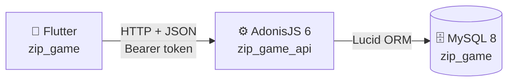
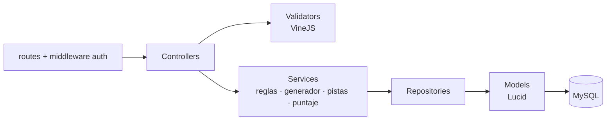
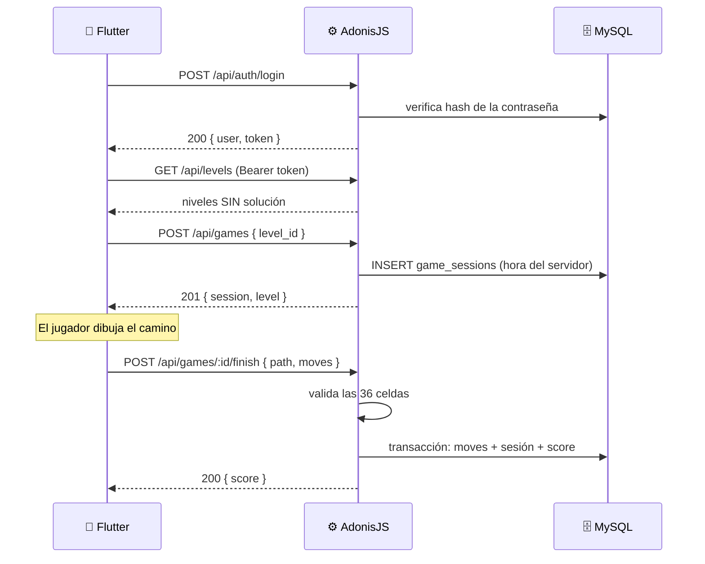
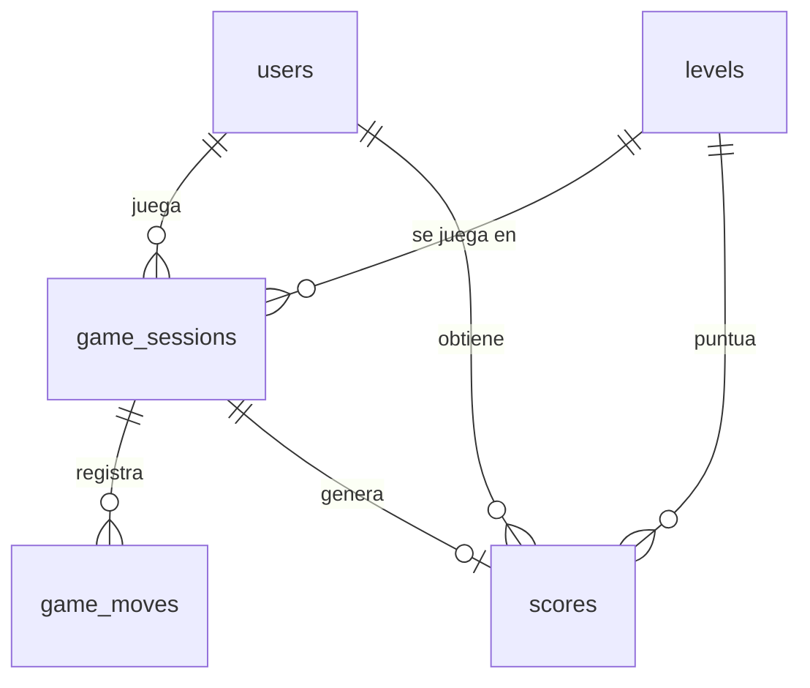
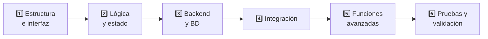

<div align="center">

<a id="inicio"></a>

# 🧩 ZIP Game

### Práctica I · Desarrollo para Dispositivos Inteligentes

**Universidad Tecnológica de Durango (UTD)** · Grupo **10°A BIS** · Tercer parcial

<br>


<br>

| 👨‍🏫 Profesor | 👥 Modalidad | 🏆 Valor | 🧪 Pruebas |
|:---:|:---:|:---:|:---:|
| Ing. Luis Ángel Martínez Vargas | Por equipos | 100 puntos | Flutter Test + Japa |

</div>

---

## 📑 Índice

| # | Sección | # | Sección |
|:---:|---|:---:|---|
| 1 | [¿Qué vas a construir?](#-1-qué-vas-a-construir) | 11 | [Entregables](#-11-entregables) |
| 2 | [Reglas del juego](#-2-reglas-del-juego) | 12 | [Reporte técnico](#-12-reporte-técnico) |
| 3 | [Preparación del entorno](#%EF%B8%8F-3-preparación-del-entorno) | 13 | [Evaluación](#-13-evaluación) |
| 4 | [Arquitectura obligatoria](#%EF%B8%8F-4-arquitectura-obligatoria) | 14 | [Reglas académicas](#-14-reglas-académicas) |
| 5 | [Requisitos funcionales](#-5-requisitos-funcionales) | 15 | [Problemas comunes](#-15-problemas-comunes) |
| 6 | [Funciones avanzadas](#-6-funciones-avanzadas-investigación) | 16 | [Resultado esperado](#-16-resultado-esperado) |
| 7 | [Seguridad y errores](#-7-seguridad-y-manejo-de-errores) | 17 | [Código del backend (AdonisJS 6)](#%EF%B8%8F-17-código-completo-del-backend-adonisjs-6) |
| 8 | [Pruebas](#-8-pruebas) | 18 | [Código del frontend (Flutter)](#-18-código-completo-del-frontend-flutter) |
| 9 | [Fases de desarrollo](#%EF%B8%8F-9-fases-de-desarrollo) | 19 | [Ejecutar todo y verificar](#-19-ejecutar-todo-y-verificar) |
| 10 | [Git y GitHub](#-10-git-y-github) |  |  |

> **Parte 1 (1–16):** la práctica · **Parte 2 (17–19):** el código completo paso a paso.

---

## 🎯 1. ¿Qué vas a construir?

Una **aplicación móvil completa** del juego de lógica **ZIP Game**, formada por tres partes separadas que se comunican por **HTTP + JSON**:

| Parte | Tecnología | Carpeta / nombre |
|---|---|---|
| 📱 Frontend (app) | Flutter + Dart | `zip_game` |
| ⚙️ Backend (API REST) | AdonisJS 6 + TypeScript | `zip_game_api` |
| 🗄️ Base de datos | MySQL 8 (Lucid ORM) | `zip_game` |



> [!IMPORTANT]
> El objetivo **no** es sólo que el juego se vea bonito: deben demostrar arquitectura por capas, manejo de estado,
> API REST, modelado de base de datos, validación, seguridad y pruebas.
> **Cada integrante debe poder explicar cualquier archivo del proyecto.**

> [!NOTE]
> Las secciones **17, 18 y 19** contienen el **código completo** del backend y del frontend, archivo por archivo,
> en el orden en que se construye y con los comandos de cada paso. Den clic en cada archivo para desplegar su código.

<p align="right"><a href="#inicio">⬆️ Volver al inicio</a></p>

---

## 🎮 2. Reglas del juego

El tablero es de **6 × 6 (36 celdas)**. Algunas celdas tienen números (*checkpoints*). El jugador dibuja **un solo camino** que:

| # | Regla |
|:---:|---|
| 1️⃣ | Empieza en la celda con el número **1** |
| 2️⃣ | Conecta los números en **orden ascendente** sin saltarse ninguno |
| 3️⃣ | Se mueve sólo **horizontal o verticalmente** (sin diagonales) |
| 4️⃣ | **No repite** celdas |
| 5️⃣ | Pasa por **las 36 celdas** |
| 6️⃣ | **Termina** en el número más alto (no se puede llegar a él antes de llenar el tablero) |

**Ejemplo** — nivel *Tutorial* y su solución (recorrido en serpiente):

```text
   Tablero                     Solución (orden de visita)
┌────┬────┬────┬────┬────┬────┐   ┌────┬────┬────┬────┬────┬────┐
│  1 │    │    │    │    │  2 │   │  1 │  2 │  3 │  4 │  5 │  6 │
├────┼────┼────┼────┼────┼────┤   ├────┼────┼────┼────┼────┼────┤
│    │  3 │    │    │    │    │   │ 12 │ 11 │ 10 │  9 │  8 │  7 │
├────┼────┼────┼────┼────┼────┤   ├────┼────┼────┼────┼────┼────┤
│    │    │    │  4 │    │    │   │ 13 │ 14 │ 15 │ 16 │ 17 │ 18 │
├────┼────┼────┼────┼────┼────┤   ├────┼────┼────┼────┼────┼────┤
│    │    │    │  5 │    │    │   │ 24 │ 23 │ 22 │ 21 │ 20 │ 19 │
├────┼────┼────┼────┼────┼────┤   ├────┼────┼────┼────┼────┼────┤
│    │  6 │    │    │    │    │   │ 25 │ 26 │ 27 │ 28 │ 29 │ 30 │
├────┼────┼────┼────┼────┼────┤   ├────┼────┼────┼────┼────┼────┤
│  8 │    │    │    │    │  7 │   │ 36 │ 35 │ 34 │ 33 │ 32 │ 31 │
└────┴────┴────┴────┴────┴────┘   └────┴────┴────┴────┴────┴────┘
```

La app debe detectar movimientos válidos e inválidos **al instante**, permitir **reiniciar** y **deshacer**,
mostrar el progreso y funcionar con **mouse (Chrome)** y **táctil (celular)**.

> [!CAUTION]
> **Regla de oro:** el **backend vuelve a validar** la solución completa antes de dar puntos.
> Nunca confíen en que Flutter diga "ya terminé".

<p align="right"><a href="#inicio">⬆️ Volver al inicio</a></p>

---

## 🛠️ 3. Preparación del entorno

### 3.1 Herramientas

| Herramienta | Versión | Verificar con |
|---|---|---|
|  | 20.6 o superior | `node -v` |
|  | 8.x | `mysql --version` |
|  | estable reciente | `flutter --version` · `flutter doctor` |
|  | reciente | `git --version` |
|  | extensiones *Flutter*, *Dart*, *AdonisJS* | — |
| 🗄️ Cliente MySQL | HeidiSQL o MySQL Workbench | — |

> [!TIP]
> Si `mysql` no se reconoce en PowerShell, agréguenlo al PATH de la sesión:
> ```powershell
> $env:Path += ";C:\Program Files\MySQL\MySQL Server 8.4\bin"
> ```

### 3.2 Crear la base de datos

Conéctense como **root** (HeidiSQL, Workbench o consola) y ejecuten, **cambiando la contraseña**:

```sql
CREATE DATABASE zip_game      CHARACTER SET utf8mb4 COLLATE utf8mb4_unicode_ci;
CREATE DATABASE zip_game_test CHARACTER SET utf8mb4 COLLATE utf8mb4_unicode_ci;

CREATE USER 'zip_user'@'localhost' IDENTIFIED BY 'TU_CONTRASEÑA';
CREATE USER 'zip_user'@'127.0.0.1' IDENTIFIED BY 'TU_CONTRASEÑA';
GRANT ALL PRIVILEGES ON zip_game.*      TO 'zip_user'@'localhost';
GRANT ALL PRIVILEGES ON zip_game.*      TO 'zip_user'@'127.0.0.1';
GRANT ALL PRIVILEGES ON zip_game_test.* TO 'zip_user'@'localhost';
GRANT ALL PRIVILEGES ON zip_game_test.* TO 'zip_user'@'127.0.0.1';
FLUSH PRIVILEGES;
```

> [!NOTE]
> Las **tablas NO se crean a mano**: se crean con las migraciones de AdonisJS (paso B4).

### 3.3 Crear el backend (AdonisJS 6)

> [!WARNING]
> `npm init adonisjs@latest` crea un proyecto de **AdonisJS 7**. La práctica es con la versión **6**,
> por eso el comando usa **`adonisjs@2`**.

```powershell
npm init adonisjs@2 -- zip_game_api --kit=api --db=mysql --auth-guard=access_tokens --pkg=npm
cd zip_game_api
```

Verifiquen que `package.json` diga `"@adonisjs/core": "^6..."`. Luego configuren el `.env`:

```ini
PORT=3333
HOST=localhost
DB_HOST=127.0.0.1
DB_PORT=3306
DB_USER=zip_user
DB_PASSWORD=TU_CONTRASEÑA
DB_DATABASE=zip_game
```

```powershell
node ace migration:run
node ace serve --hmr
```

Abran `http://localhost:3333` → debe responder.

<details>
<summary><b>📋 Comandos de Ace que van a necesitar</b></summary>

| Comando | Para qué |
|---|---|
| `node ace make:model Level -m` | Modelo + migración |
| `node ace make:controller levels` | Controlador |
| `node ace make:validator game` | Validador VineJS |
| `node ace make:service game` | Servicio |
| `node ace make:middleware nombre` | Middleware |
| `node ace make:seeder level` | Seeder |
| `node ace make:test nombre --suite=functional` | Prueba |
| `node ace migration:run` | Ejecutar migraciones |
| `node ace migration:rollback` | Deshacer el último lote |
| `node ace migration:fresh --seed` | Borrar todo, recrear y sembrar |
| `node ace db:seed` | Ejecutar seeders |
| `node ace list:routes` | Ver rutas |
| `node ace test` | Ejecutar pruebas |

</details>

### 3.4 Crear el frontend (Flutter)

```powershell
flutter create zip_game --platforms=web,android
cd zip_game
flutter pub add material_ui http shared_preferences
flutter run -d chrome
```

> [!TIP]
> En Android el emulador ve tu PC como `10.0.2.2` (no `localhost`). Lean la URL de la API con
> `String.fromEnvironment('API_URL', defaultValue: 'http://localhost:3333/api')` y ejecuten:
> ```powershell
> flutter run --dart-define=API_URL=http://10.0.2.2:3333/api
> ```

### 3.5 CORS

Flutter Web corre en `http://localhost:<puerto aleatorio>`. Configuren `config/cors.ts` del backend para permitir
`localhost` con cualquier puerto en desarrollo; si no, Chrome bloqueará las peticiones.

<p align="right"><a href="#inicio">⬆️ Volver al inicio</a></p>

---

## 🏛️ 4. Arquitectura obligatoria

### 4.1 Flutter — *feature-first* con capas

```text
lib/
├── main.dart
├── app/            app.dart · routes/ · theme/
├── core/           network/ · errors/ · constants/ · utils/
├── features/
│   ├── auth/
│   ├── home/
│   ├── levels/
│   ├── game/
│   │   ├── presentation/   pages/ · widgets/ · controllers/
│   │   ├── domain/         entities/ · services/ · repositories/
│   │   └── data/           models/ · datasources/ · repositories/
│   ├── leaderboard/
│   └── profile/
└── shared/widgets/
```

| Capa | ✅ Contiene | ❌ No debe contener |
|---|---|---|
| **Presentation** | Pantallas, widgets, controladores de estado | Llamadas HTTP directas, reglas del juego |
| **Domain** | Entidades, reglas del juego, repositorios abstractos | Widgets, JSON, HTTP |
| **Data** | Modelos JSON, datasources HTTP, repositorios concretos | Widgets |

### 4.2 AdonisJS — controladores, servicios y repositorios

```text
zip_game_api/app/
├── controllers/   auth, levels, games, leaderboard, users
├── middleware/    autenticación
├── validators/    VineJS
├── services/      game_service, game_validator_service, level_generator_service,
│                  leaderboard_service (+ los que necesiten)
├── repositories/  acceso a datos
└── models/        user, level, game_session, game_move, score
database/
├── migrations/
└── seeders/
tests/
```



Los **controladores** sólo reciben la petición, validan y delegan. La lógica va en **servicios**.
Las consultas a la BD van en **repositorios**.

<p align="right"><a href="#inicio">⬆️ Volver al inicio</a></p>

---

## 📋 5. Requisitos funcionales

### 5.1 Frontend

| Módulo | Requisitos |
|---|---|
| 🔐 **Autenticación** | Registro e inicio de sesión con validación de formularios; token guardado; rutas protegidas |
| 🏠 **Home** | Nombre de la app, datos del jugador, navegación, acceso al juego; responsive |
| 🗂️ **Niveles** | Lista desde el backend con nombre, dificultad y si está completado; estados **cargando / vacío / error** |
| 🎮 **Juego** | Tablero 6×6 interactivo · números · línea del camino · feedback válido/inválido · mouse y táctil · **cronómetro** · **progreso** · **reiniciar** · **deshacer** · **pista** · mensaje de completado · resumen |
| 🏆 **Ranking** | Mejores puntajes desde el backend, con regla de orden documentada |
| 👤 **Perfil** | Datos del jugador, niveles completados, puntaje total e historial |

El **controlador del juego** maneja: camino actual, siguiente número requerido, cronómetro, errores,
uso de pistas y estado de finalización. La página **no** debe contener la lógica completa del juego.

### 5.2 Backend

| Requisito | Detalle |
|---|---|
| 🔐 Autenticación | Registro, login, tokens, rutas protegidas; contraseñas con hash |
| 🗂️ Niveles | Listar y obtener uno **sin exponer la solución** |
| ▶️ Sesiones de juego | Iniciar partida ligada al usuario y nivel; guardar hora de inicio (del servidor) y estado |
| ✅ Validación | Rechazar caminos con celdas repetidas, diagonales, celdas faltantes, orden incorrecto, inicio o final inválido |
| 🧮 Puntaje | Calculado **sólo en el servidor** con tiempo, errores y pistas |
| 📜 Historial | Guardar partidas terminadas; cada jugador ve sólo las suyas |
| 🏆 Ranking | Servicio que ordena a los jugadores con reglas documentadas |

### 5.3 Endpoints mínimos

| Método | Endpoint | Propósito |
|:---:|---|---|
|  | `/api/auth/register` | Registrar jugador |
|  | `/api/auth/login` | Iniciar sesión |
|  | `/api/levels` | Niveles disponibles |
|  | `/api/levels/:id` | Un nivel |
|  | `/api/games` | Iniciar partida |
|  | `/api/games/:id/finish` | Validar y terminar partida |
|  | `/api/games/history` | Historial |
|  | `/api/leaderboard` | Ranking |
|  | `/api/users/me` | Perfil autenticado |

Además, para las funciones avanzadas: `POST /api/games/:id/hint` y `POST /api/levels/generate`.

| Código | Cuándo |
|:---:|---|
| `200` / `201` | Éxito / recurso creado |
| `400` | Credenciales inválidas |
| `401` | Sin token o token inválido |
| `404` | No existe (o pertenece a otro usuario) |
| `409` | La partida ya fue terminada |
| `422` | Error de validación o solución inválida |



### 5.4 Base de datos (mínimo)

| Tabla | Contenido |
|---|---|
| `users` | Jugadores y datos de autenticación (contraseña con hash) |
| `levels` | Configuración del tablero, dificultad y solución guardada |
| `game_sessions` | Partidas activas y terminadas |
| `game_moves` | Movimientos de cada partida |
| `scores` | Puntajes validados y estadísticas |



Con llaves primarias, llaves foráneas, tipos de datos adecuados y relaciones. **Creadas con migraciones** y
con **seeders** que inserten niveles de demostración. Entreguen el **diagrama entidad-relación**.

> [!TIP]
> Guarden los números del tablero como una lista JSON y numeren las celdas `0..35`
> (`índice = fila × 6 + columna`). Piensen cómo evitar que una misma partida genere dos puntajes.

<p align="right"><a href="#inicio">⬆️ Volver al inicio</a></p>

---

## 🚀 6. Funciones avanzadas (investigación)

| Función | Qué se pide |
|---|---|
| 🎲 **Generación automática** | Tableros 6×6 válidos que **siempre tengan solución**; explicar cómo lo comprueban y guardarlos en MySQL. Investiguen: *camino hamiltoniano*, *backtracking / DFS*, *movimiento backbite* |
| 📈 **Dificultad** | Al menos **Fácil, Media y Difícil**, justificando **cómo se mide** (cantidad de números, separación, número de soluciones, esfuerzo de búsqueda). Etiquetar "Difícil" a un tablero aleatorio **no cuenta** |
| 💡 **Pistas inteligentes** | El backend valida el camino actual y sugiere la siguiente celda (o retroceder) **sin resolver todo**. Se cuentan las pistas y afectan el puntaje |
| 🧠 **Dificultad adaptativa** | Según tiempo, errores, pistas y resultados previos se ajustan los **siguientes** retos. Documentar cuándo sube, baja o se mantiene. **No cambia una partida en curso** |

<p align="right"><a href="#inicio">⬆️ Volver al inicio</a></p>

---

## 🔒 7. Seguridad y manejo de errores

- [x] Validar todas las peticiones (VineJS).
- [x] Autenticación y autorización (un jugador no ve ni termina partidas ajenas).
- [x] Contraseñas con hash; nunca devolverlas en el JSON.
- [x] Puntaje calculado en el servidor.
- [x] Evitar terminar la misma partida dos veces.
- [x] Usar **transacciones** al guardar el resultado.
- [x] Variables sensibles en `.env` y **fuera de GitHub** (`.gitignore`).
- [x] Mensajes de error sin información sensible (sin stack traces ni SQL).
- [x] CORS configurado para Flutter Web.

<p align="right"><a href="#inicio">⬆️ Volver al inicio</a></p>

---

## 🧪 8. Pruebas

| Tipo | Qué probar | Comando |
|---|---|---|
| 📱 Frontend | Render de widgets, estado del controlador, movimiento válido e inválido, reiniciar, completado | `flutter test` |
| ⚙️ Backend | Auth, validación de endpoints, niveles, soluciones inválidas y válidas, puntaje, persistencia | `node ace test` |
| 🔗 Integración | Flutter obtiene un nivel, inicia partida, envía solución válida y muestra el resultado | `flutter test test/integration` |

Usen la base `zip_game_test` para las pruebas del backend (archivo `.env.test` con `DB_DATABASE=zip_game_test`).
Guarden la evidencia:

```powershell
node ace test 2>&1 | Tee-Object -FilePath evidencias_backend.txt
flutter test 2>&1 | Tee-Object -FilePath evidencias_flutter.txt
```

Expliquen en el reporte **qué errores encontraron y cómo los corrigieron**.

<p align="right"><a href="#inicio">⬆️ Volver al inicio</a></p>

---

## 🗺️ 9. Fases de desarrollo



| Fase | Trabajo | Resultado esperado |
|---|---|---|
| **1. Estructura e interfaz** | Proyecto Flutter, widgets, navegación, pantallas, tablero inicial | App responsive con tablero 6×6 y navegación |
| **2. Lógica y estado** | Controlador del juego, reglas, línea del camino, cronómetro, reiniciar, completado | Puzzle jugable localmente con validación correcta |
| **3. Backend y BD** | Proyecto AdonisJS, modelos, migraciones, controladores, servicios, validadores, repositorios | API REST documentada que maneja niveles y partidas |
| **4. Integración** | Flutter ↔ AdonisJS por HTTP + JSON | Niveles del servidor y resultados guardados en MySQL |
| **5. Avanzado** | Generador, pistas, puntaje, dificultad, auth, perfil, ranking | Versión extendida con datos persistentes |
| **6. Pruebas** | Pruebas automáticas y manuales, corrección de defectos | Prototipo funcional y documentado |

> [!NOTE]
> En la fase 2 pueden usar un nivel escrito a mano para probar. **En la entrega final todo debe venir del backend.**

<p align="right"><a href="#inicio">⬆️ Volver al inicio</a></p>

---

## 🌿 10. Git y GitHub

```powershell
git init
git add .
git commit -m "feat: estructura inicial"
git branch -M main
git remote add origin https://github.com/<usuario>/<repo>.git
git push -u origin main
```

- Commits **pequeños y con significado**: `feat(game): validación de movimientos`, `test: ...`, `docs: ...`
- **Todos** los integrantes deben tener commits.
- Antes de subir revisen que no vaya `.env`, contraseñas ni tokens: `git status --ignored`

<p align="right"><a href="#inicio">⬆️ Volver al inicio</a></p>

---

## 📦 11. Entregables

- [ ] Código completo de Flutter
- [ ] Código completo de AdonisJS 6
- [ ] Migraciones y seeders de MySQL
- [ ] Diagrama entidad-relación
- [ ] Documentación de los endpoints REST
- [ ] README con instrucciones de instalación y ejecución
- [ ] Archivos de pruebas y evidencia de su ejecución
- [ ] Capturas de pantalla de la aplicación
- [ ] Evidencia de comunicación frontend–backend (Chrome DevTools → Network)
- [ ] Reporte técnico (sección 12)
- [ ] Repositorio de GitHub con commits significativos
- [ ] Demostración funcional de la aplicación integrada

> [!CAUTION]
> **No deben incluir** contraseñas, tokens, credenciales de la base de datos ni archivos `.env`.

<p align="right"><a href="#inicio">⬆️ Volver al inicio</a></p>

---

## 📝 12. Reporte técnico

| # | Sección | # | Sección |
|:---:|---|:---:|---|
| 1 | Portada | 10 | Implementación de la API REST |
| 2 | Introducción | 11 | Algoritmos del juego y validación |
| 3 | Objetivos general y específicos | 12 | Generación de niveles y dificultad |
| 4 | Descripción de ZIP Game | 13 | Autenticación y seguridad |
| 5 | Tecnologías seleccionadas | 14 | Metodología y resultados de pruebas |
| 6 | Arquitectura del software | 15 | Retos técnicos y soluciones |
| 7 | Frontend: organización y componentes | 16 | Conclusiones |
| 8 | Backend: organización y servicios | 17 | Referencias |
| 9 | Diseño de la base de datos | 18 | Anexos (diagramas, código) |

El reporte debe **explicar las decisiones del equipo**, no sólo pegar código.

<p align="right"><a href="#inicio">⬆️ Volver al inicio</a></p>

---

## 📊 13. Evaluación

| Criterio | % | |
|---|:---:|---|
| Arquitectura y organización del software | **15** |  |
| Interfaz Flutter y jugabilidad interactiva | **20** |  |
| Lógica del juego y validación de movimientos | **15** |  |
| API REST AdonisJS y lógica de negocio | **20** |  |
| Diseño e integración de MySQL | **10** |  |
| Funciones avanzadas | **10** |  |
| Pruebas, documentación y comprensión técnica | **10** |  |
| **Total** | **100** | |

> [!WARNING]
> **No se cumple el requisito si:**
> - la app sólo muestra la interfaz sin comunicarse con el backend;
> - el backend responde "éxito" sin validar realmente la solución;
> - la base de datos no guarda la información del juego.

<p align="right"><a href="#inicio">⬆️ Volver al inicio</a></p>

---

## 🎓 14. Reglas académicas

- Todos los integrantes participan en diseño, implementación y pruebas.
- Cada alumno debe explicar los archivos, clases y componentes que desarrolló.
- Pueden usar paquetes externos y herramientas de asistencia (incluida IA) si el profesor lo permite, pero **son responsables de entender, adaptar y probar** el código. En la demostración se harán preguntas individuales.

<p align="right"><a href="#inicio">⬆️ Volver al inicio</a></p>

---

## 🩺 15. Problemas comunes

| Síntoma | Solución |
|---|---|
| `npm init adonisjs` creó la versión 7 | Usen `npm init adonisjs@2 -- ...` (sección 3.3) |
| Error CORS en Chrome | Permitir `localhost` con cualquier puerto en `config/cors.ts` |
| `ER_ACCESS_DENIED_ERROR` | Revisar `DB_USER` / `DB_PASSWORD` en `.env` |
| `ER_BAD_DB_ERROR` | Crear la base de datos (sección 3.2) |
| Android no conecta | Usar `10.0.2.2` en emulador o la IP de la PC en celular |
| `401` en todas las rutas | Enviar el header `Authorization: Bearer <token>` |
| `mysql` no se reconoce | Agregar MySQL al PATH (sección 3.1) |

<p align="right"><a href="#inicio">⬆️ Volver al inicio</a></p>

---

## 🏁 16. Resultado esperado

Una aplicación ZIP Game que **registra jugadores**, **carga niveles desde el backend**, permite **jugar de forma interactiva**,
**valida los caminos en el servidor**, **guarda los resultados en MySQL** y **muestra el progreso del jugador**; con una
separación clara entre frontend, backend y base de datos, y un equipo capaz de explicar cómo se diseñó, desarrolló,
conectó, probó y mantiene.

<p align="right"><a href="#inicio">⬆️ Volver al inicio</a></p>

---

## ⚙️ 17. Código completo del backend (AdonisJS 6)

> [!NOTE]
> Den clic en cada archivo ▸ para desplegar su código. Sigan los pasos **en orden**: B1 → B13.

Todos los archivos van dentro de la carpeta `zip_game_api`. Cuando el archivo ya existe (lo creó el kit), **reemplacen todo su contenido**; si no existe, créenlo con ese nombre exacto.

### 🔹 Paso B1 — Crear el proyecto y preparar carpetas

```powershell
npm init adonisjs@2 -- zip_game_api --kit=api --db=mysql --auth-guard=access_tokens --pkg=npm
cd zip_game_api
Remove-Item database\migrations\*
New-Item -ItemType Directory -Force app\controllers, app\services, app\repositories, app\validators, app\utils, database\seeders, database\sql, tests\unit, tests\functional
```

Se borran las migraciones del kit porque en el paso B4 se crean las propias (incluidas `users` y `auth_access_tokens`).

En `package.json`, dentro de `"imports"`, **agreguen** estas dos líneas (para poder importar `#repositories/...` y `#utils/...`):

```json
"#repositories/*": "./app/repositories/*.js",
"#utils/*": "./app/utils/*.js",
```

### 🔹 Paso B2 — Configuración y variables de entorno

<details>
<summary>⚙️ <code>.env.example</code> <sub>(15 líneas)</sub></summary>

```text
TZ=UTC
PORT=3333
HOST=localhost
LOG_LEVEL=info
APP_KEY=
NODE_ENV=development

DB_HOST=127.0.0.1
DB_PORT=3306
DB_USER=zip_user
DB_PASSWORD=
DB_DATABASE=zip_game

# Orígenes extra permitidos (producción). En desarrollo se permite cualquier localhost.
CORS_ORIGINS=
```

</details>

Copien `.env.example` a `.env`, generen la llave y pongan la contraseña de `zip_user`:

```powershell
Copy-Item .env.example .env
node ace generate:key
```

Para las pruebas creen `.env.test` (usa la base `zip_game_test`):

```powershell
Set-Content .env.test "NODE_ENV=test`nDB_DATABASE=zip_game_test" -Encoding utf8
```

<details>
<summary>🟦 <code>adonisrc.ts</code> <sub>(40 líneas)</sub></summary>

```ts
import { defineConfig } from '@adonisjs/core/app'

export default defineConfig({
  /*
  | Comandos de Ace disponibles (node ace ...)
  */
  commands: [() => import('@adonisjs/core/commands'), () => import('@adonisjs/lucid/commands')],

  /*
  | Proveedores de servicios que se registran al arrancar la aplicación
  */
  providers: [
    () => import('@adonisjs/core/providers/app_provider'),
    () => import('@adonisjs/core/providers/hash_provider'),
    {
      file: () => import('@adonisjs/core/providers/repl_provider'),
      environment: ['repl', 'test'],
    },
    () => import('@adonisjs/core/providers/vinejs_provider'),
    () => import('@adonisjs/cors/cors_provider'),
    () => import('@adonisjs/lucid/database_provider'),
    () => import('@adonisjs/auth/auth_provider'),
  ],

  /*
  | Archivos que se cargan antes de iniciar el servidor HTTP
  */
  preloads: [() => import('#start/routes'), () => import('#start/kernel')],

  /*
  | Suites de pruebas (Japa)
  */
  tests: {
    suites: [
      { files: ['tests/unit/**/*.spec(.ts|.js)'], name: 'unit', timeout: 30000 },
      { files: ['tests/functional/**/*.spec(.ts|.js)'], name: 'functional', timeout: 30000 },
    ],
    forceExit: false,
  },
})
```

</details>

<details>
<summary>🟦 <code>start/env.ts</code> <sub>(25 líneas)</sub></summary>

```ts
/*
|--------------------------------------------------------------------------
| Validación de variables de entorno (.env)
|--------------------------------------------------------------------------
| La aplicación NO arranca si falta alguna variable obligatoria.
*/
import { Env } from '@adonisjs/core/env'

export default await Env.create(new URL('../', import.meta.url), {
  NODE_ENV: Env.schema.enum(['development', 'production', 'test'] as const),
  PORT: Env.schema.number(),
  APP_KEY: Env.schema.string(),
  HOST: Env.schema.string({ format: 'host' }),
  LOG_LEVEL: Env.schema.string(),

  /* Base de datos MySQL */
  DB_HOST: Env.schema.string({ format: 'host' }),
  DB_PORT: Env.schema.number(),
  DB_USER: Env.schema.string(),
  DB_PASSWORD: Env.schema.string.optional(),
  DB_DATABASE: Env.schema.string(),

  /* Orígenes permitidos por CORS separados por coma (opcional) */
  CORS_ORIGINS: Env.schema.string.optional(),
})
```

</details>

<details>
<summary>🟦 <code>start/kernel.ts</code> <sub>(27 líneas)</sub></summary>

```ts
/*
|--------------------------------------------------------------------------
| Kernel HTTP: middleware global, de router y con nombre
|--------------------------------------------------------------------------
*/
import router from '@adonisjs/core/services/router'
import server from '@adonisjs/core/services/server'

server.errorHandler(() => import('#exceptions/handler'))

/* Se ejecuta en TODAS las peticiones, incluso si no existe la ruta */
server.use([
  () => import('#middleware/container_bindings_middleware'),
  () => import('#middleware/force_json_response_middleware'),
  () => import('@adonisjs/cors/cors_middleware'),
])

/* Se ejecuta sólo en peticiones que coinciden con una ruta */
router.use([
  () => import('@adonisjs/core/bodyparser_middleware'),
  () => import('@adonisjs/auth/initialize_auth_middleware'),
])

/* Middleware con nombre que se asigna a rutas específicas */
export const middleware = router.named({
  auth: () => import('#middleware/auth_middleware'),
})
```

</details>

<details>
<summary>🟦 <code>config/database.ts</code> <sub>(27 líneas)</sub></summary>

```ts
import env from '#start/env'
import { defineConfig } from '@adonisjs/lucid'

const dbConfig = defineConfig({
  connection: 'mysql',
  connections: {
    mysql: {
      client: 'mysql2',
      connection: {
        host: env.get('DB_HOST'),
        port: env.get('DB_PORT'),
        user: env.get('DB_USER'),
        password: env.get('DB_PASSWORD'),
        database: env.get('DB_DATABASE'),
      },
      migrations: {
        naturalSort: true,
        paths: ['database/migrations'],
      },
      seeders: {
        paths: ['database/seeders'],
      },
    },
  },
})

export default dbConfig
```

</details>

<details>
<summary>🟦 <code>config/auth.ts</code> <sub>(25 líneas)</sub></summary>

```ts
import { defineConfig } from '@adonisjs/auth'
import { tokensGuard, tokensUserProvider } from '@adonisjs/auth/access_tokens'
import type { InferAuthenticators, InferAuthEvents, Authenticators } from '@adonisjs/auth/types'

/* Autenticación por tokens opacos (Bearer) guardados en la tabla auth_access_tokens */
const authConfig = defineConfig({
  default: 'api',
  guards: {
    api: tokensGuard({
      provider: tokensUserProvider({
        tokens: 'accessTokens',
        model: () => import('#models/user'),
      }),
    }),
  },
})

export default authConfig

declare module '@adonisjs/auth/types' {
  export interface Authenticators extends InferAuthenticators<typeof authConfig> {}
}
declare module '@adonisjs/core/types' {
  interface EventsList extends InferAuthEvents<Authenticators> {}
}
```

</details>

<details>
<summary>🟦 <code>config/cors.ts</code> <sub>(33 líneas)</sub></summary>

```ts
import env from '#start/env'
import app from '@adonisjs/core/services/app'
import { defineConfig } from '@adonisjs/cors'

/*
|--------------------------------------------------------------------------
| CORS para Flutter Web
|--------------------------------------------------------------------------
| Flutter Web (flutter run -d chrome) se sirve en http://localhost:<puerto aleatorio>.
| En desarrollo se permite cualquier puerto de localhost / 127.0.0.1.
| En producción sólo los orígenes listados en CORS_ORIGINS.
*/
const allowedOrigins = (env.get('CORS_ORIGINS') ?? '')
  .split(',')
  .map((origin) => origin.trim())
  .filter(Boolean)

const localhostPattern = /^https?:\/\/(localhost|127\.0\.0\.1)(:\d+)?$/

const corsConfig = defineConfig({
  enabled: true,
  origin: (requestOrigin) => {
    if (allowedOrigins.includes(requestOrigin)) return true
    return !app.inProduction && localhostPattern.test(requestOrigin)
  },
  methods: ['GET', 'HEAD', 'POST', 'PUT', 'PATCH', 'DELETE'],
  headers: true,
  exposeHeaders: [],
  credentials: true,
  maxAge: 90,
})

export default corsConfig
```

</details>

<details>
<summary>🟦 <code>config/hash.ts</code> <sub>(21 líneas)</sub></summary>

```ts
import { defineConfig, drivers } from '@adonisjs/core/hash'
import type { InferHashers } from '@adonisjs/core/types'

/* Las contraseñas se guardan con scrypt (hash + salt), nunca en texto plano */
const hashConfig = defineConfig({
  default: 'scrypt',
  list: {
    scrypt: drivers.scrypt({
      cost: 16384,
      blockSize: 8,
      parallelization: 1,
      maxMemory: 33554432,
    }),
  },
})

export default hashConfig

declare module '@adonisjs/core/types' {
  export interface HashersList extends InferHashers<typeof hashConfig> {}
}
```

</details>

### 🔹 Paso B3 — Manejo de errores y middleware de autenticación

<details>
<summary>🟦 <code>app/exceptions/game_exception.ts</code> <sub>(23 líneas)</sub></summary>

```ts
import { Exception } from '@adonisjs/core/exceptions'
import type { HttpContext } from '@adonisjs/core/http'

/*
| Excepción de dominio del juego. Se "auto-maneja": responde JSON con
| { message, code, details? } y el status indicado (404, 409, 422...).
*/
export default class GameException extends Exception {
  declare details?: unknown

  constructor(message: string, options: { status: number; code: string; details?: unknown }) {
    super(message, { status: options.status, code: options.code })
    this.details = options.details
  }

  async handle(error: this, ctx: HttpContext) {
    ctx.response.status(error.status).send({
      message: error.message,
      code: error.code,
      ...(error.details !== undefined ? { details: error.details } : {}),
    })
  }
}
```

</details>

<details>
<summary>🟦 <code>app/exceptions/handler.ts</code> <sub>(33 líneas)</sub></summary>

```ts
import app from '@adonisjs/core/services/app'
import { HttpContext, ExceptionHandler } from '@adonisjs/core/http'
import { errors as lucidErrors } from '@adonisjs/lucid'

/*
|--------------------------------------------------------------------------
| Manejador global de errores
|--------------------------------------------------------------------------
| - 404 de Lucid (findOrFail) => { message: 'Resource not found' }
| - Errores de VineJS => 422 { errors: [...] } (manejo propio de VineJS)
| - Errores de auth  => 401 { errors: [...] } (manejo propio de @adonisjs/auth)
| - En producción nunca se exponen stack traces ni detalles de SQL.
*/
export default class HttpExceptionHandler extends ExceptionHandler {
  protected debug = !app.inProduction

  async handle(error: unknown, ctx: HttpContext) {
    if (error instanceof lucidErrors.E_ROW_NOT_FOUND) {
      return ctx.response.status(404).send({ message: 'Resource not found', code: 'E_NOT_FOUND' })
    }

    const status = (error as { status?: number }).status ?? 500
    if (status >= 500 && app.inProduction) {
      return ctx.response.status(500).send({ message: 'Internal server error', code: 'E_INTERNAL' })
    }

    return super.handle(error, ctx)
  }

  async report(error: unknown, ctx: HttpContext) {
    return super.report(error, ctx)
  }
}
```

</details>

<details>
<summary>🟦 <code>app/middleware/auth_middleware.ts</code> <sub>(18 líneas)</sub></summary>

```ts
import type { HttpContext } from '@adonisjs/core/http'
import type { NextFn } from '@adonisjs/core/types/http'
import type { Authenticators } from '@adonisjs/auth/types'

/*
| Verifica el header Authorization: Bearer <token>.
| Si el token falta o es inválido responde 401 automáticamente.
*/
export default class AuthMiddleware {
  async handle(
    ctx: HttpContext,
    next: NextFn,
    options: { guards?: (keyof Authenticators)[] } = {}
  ) {
    await ctx.auth.authenticateUsing(options.guards)
    return next()
  }
}
```

</details>

### 🔹 Paso B4 — Migraciones (tablas de MySQL)

Creen los archivos con estos nombres exactos (el número inicial define el orden de ejecución).

<details>
<summary>🟦 <code>database/migrations/1763600000001_create_users_table.ts</code> <sub>(24 líneas)</sub></summary>

```ts
import { BaseSchema } from '@adonisjs/lucid/schema'

export default class extends BaseSchema {
  protected tableName = 'users'

  async up() {
    this.schema.createTable(this.tableName, (table) => {
      table.increments('id').notNullable()
      table.string('username', 30).notNullable().unique()
      table.string('email', 254).notNullable().unique()
      table.string('password', 255).notNullable() // hash scrypt, nunca texto plano
      table
        .enum('recommended_difficulty', ['easy', 'medium', 'hard'])
        .notNullable()
        .defaultTo('easy')
      table.timestamp('created_at').notNullable()
      table.timestamp('updated_at').nullable()
    })
  }

  async down() {
    this.schema.dropTable(this.tableName)
  }
}
```

</details>

<details>
<summary>🟦 <code>database/migrations/1763600000002_create_access_tokens_table.ts</code> <sub>(31 líneas)</sub></summary>

```ts
import { BaseSchema } from '@adonisjs/lucid/schema'

/* Tokens de acceso (Bearer). Se guarda sólo el HASH del token, no el token. */
export default class extends BaseSchema {
  protected tableName = 'auth_access_tokens'

  async up() {
    this.schema.createTable(this.tableName, (table) => {
      table.increments('id')
      table
        .integer('tokenable_id')
        .notNullable()
        .unsigned()
        .references('id')
        .inTable('users')
        .onDelete('CASCADE')
      table.string('type').notNullable()
      table.string('name').nullable()
      table.string('hash').notNullable()
      table.text('abilities').notNullable()
      table.timestamp('created_at')
      table.timestamp('updated_at')
      table.timestamp('last_used_at').nullable()
      table.timestamp('expires_at').nullable()
    })
  }

  async down() {
    this.schema.dropTable(this.tableName)
  }
}
```

</details>

<details>
<summary>🟦 <code>database/migrations/1763600000003_create_levels_table.ts</code> <sub>(25 líneas)</sub></summary>

```ts
import { BaseSchema } from '@adonisjs/lucid/schema'

export default class extends BaseSchema {
  protected tableName = 'levels'

  async up() {
    this.schema.createTable(this.tableName, (table) => {
      table.increments('id')
      table.string('name', 80).notNullable()
      table.enum('difficulty', ['easy', 'medium', 'hard']).notNullable().index()
      table.tinyint('size').unsigned().notNullable().defaultTo(6)
      table.json('checkpoints').notNullable() // [celda del 1, celda del 2, ...]
      table.json('solution').notNullable() // 36 celdas; nunca se envía al cliente
      table.tinyint('checkpoint_count').unsigned().notNullable()
      table.smallint('difficulty_score').unsigned().notNullable().defaultTo(0)
      table.boolean('is_generated').notNullable().defaultTo(false)
      table.timestamp('created_at').notNullable()
      table.timestamp('updated_at').nullable()
    })
  }

  async down() {
    this.schema.dropTable(this.tableName)
  }
}
```

</details>

<details>
<summary>🟦 <code>database/migrations/1763600000004_create_game_sessions_table.ts</code> <sub>(45 líneas)</sub></summary>

```ts
import { BaseSchema } from '@adonisjs/lucid/schema'

export default class extends BaseSchema {
  protected tableName = 'game_sessions'

  async up() {
    this.schema.createTable(this.tableName, (table) => {
      table.increments('id')
      table
        .integer('user_id')
        .unsigned()
        .notNullable()
        .references('id')
        .inTable('users')
        .onDelete('CASCADE')
      table
        .integer('level_id')
        .unsigned()
        .notNullable()
        .references('id')
        .inTable('levels')
        .onDelete('RESTRICT')
      table
        .enum('status', ['in_progress', 'completed', 'abandoned'])
        .notNullable()
        .defaultTo('in_progress')
      table.enum('difficulty', ['easy', 'medium', 'hard']).notNullable()
      table.dateTime('started_at').notNullable()
      table.dateTime('finished_at').nullable()
      table.integer('duration_seconds').unsigned().nullable()
      table.integer('mistakes').unsigned().notNullable().defaultTo(0)
      table.integer('hints_used').unsigned().notNullable().defaultTo(0)
      table.integer('failed_attempts').unsigned().notNullable().defaultTo(0)
      table.json('final_path').nullable()
      table.timestamp('created_at').notNullable()
      table.timestamp('updated_at').nullable()

      table.index(['user_id', 'status'])
    })
  }

  async down() {
    this.schema.dropTable(this.tableName)
  }
}
```

</details>

<details>
<summary>🟦 <code>database/migrations/1763600000005_create_game_moves_table.ts</code> <sub>(29 líneas)</sub></summary>

```ts
import { BaseSchema } from '@adonisjs/lucid/schema'

export default class extends BaseSchema {
  protected tableName = 'game_moves'

  async up() {
    this.schema.createTable(this.tableName, (table) => {
      table.bigIncrements('id')
      table
        .integer('game_session_id')
        .unsigned()
        .notNullable()
        .references('id')
        .inTable('game_sessions')
        .onDelete('CASCADE')
      table.integer('sequence').unsigned().notNullable()
      table.tinyint('cell_index').unsigned().nullable()
      table.enum('move_type', ['add', 'undo', 'invalid', 'restart']).notNullable()
      table.integer('elapsed_ms').unsigned().nullable()
      table.timestamp('created_at').notNullable()

      table.unique(['game_session_id', 'sequence'])
    })
  }

  async down() {
    this.schema.dropTable(this.tableName)
  }
}
```

</details>

<details>
<summary>🟦 <code>database/migrations/1763600000006_create_scores_table.ts</code> <sub>(47 líneas)</sub></summary>

```ts
import { BaseSchema } from '@adonisjs/lucid/schema'

export default class extends BaseSchema {
  protected tableName = 'scores'

  async up() {
    this.schema.createTable(this.tableName, (table) => {
      table.increments('id')
      table
        .integer('user_id')
        .unsigned()
        .notNullable()
        .references('id')
        .inTable('users')
        .onDelete('CASCADE')
      table
        .integer('level_id')
        .unsigned()
        .notNullable()
        .references('id')
        .inTable('levels')
        .onDelete('RESTRICT')
      /* UNIQUE: una partida sólo puede generar un puntaje (evita doble finalización) */
      table
        .integer('game_session_id')
        .unsigned()
        .notNullable()
        .unique()
        .references('id')
        .inTable('game_sessions')
        .onDelete('CASCADE')
      table.integer('points').unsigned().notNullable()
      table.integer('duration_seconds').unsigned().notNullable()
      table.integer('mistakes').unsigned().notNullable().defaultTo(0)
      table.integer('hints_used').unsigned().notNullable().defaultTo(0)
      table.enum('difficulty', ['easy', 'medium', 'hard']).notNullable()
      table.timestamp('created_at').notNullable()

      table.index(['user_id', 'level_id'])
      table.index(['points'])
    })
  }

  async down() {
    this.schema.dropTable(this.tableName)
  }
}
```

</details>

Ejecuten las migraciones y revisen las tablas en HeidiSQL / Workbench:

```powershell
node ace migration:run
node ace migration:status
```

### 🔹 Paso B5 — Modelos (Lucid ORM)

```powershell
node ace make:model Level
node ace make:model GameSession
node ace make:model GameMove
node ace make:model Score
```

<details>
<summary>🟦 <code>app/models/user.ts</code> <sub>(53 líneas)</sub></summary>

```ts
import { DateTime } from 'luxon'
import hash from '@adonisjs/core/services/hash'
import { compose } from '@adonisjs/core/helpers'
import { BaseModel, column, hasMany } from '@adonisjs/lucid/orm'
import type { HasMany } from '@adonisjs/lucid/types/relations'
import { withAuthFinder } from '@adonisjs/auth/mixins/lucid'
import { DbAccessTokensProvider } from '@adonisjs/auth/access_tokens'
import GameSession from '#models/game_session'
import Score from '#models/score'
import type { Difficulty } from '#utils/board'

/* withAuthFinder agrega verifyCredentials() y hashea la contraseña antes de guardar */
const AuthFinder = withAuthFinder(() => hash.use('scrypt'), {
  uids: ['email'],
  passwordColumnName: 'password',
})

export default class User extends compose(BaseModel, AuthFinder) {
  @column({ isPrimary: true })
  declare id: number

  @column()
  declare username: string

  @column()
  declare email: string

  /* serializeAs: null => la contraseña (hash) NUNCA se envía en el JSON */
  @column({ serializeAs: null })
  declare password: string

  /* Dificultad recomendada por el sistema adaptativo */
  @column()
  declare recommendedDifficulty: Difficulty

  @column.dateTime({ autoCreate: true })
  declare createdAt: DateTime

  @column.dateTime({ autoCreate: true, autoUpdate: true })
  declare updatedAt: DateTime | null

  @hasMany(() => GameSession)
  declare gameSessions: HasMany<typeof GameSession>

  @hasMany(() => Score)
  declare scores: HasMany<typeof Score>

  static accessTokens = DbAccessTokensProvider.forModel(User, {
    expiresIn: '7 days',
    prefix: 'zip_',
    table: 'auth_access_tokens',
  })
}
```

</details>

<details>
<summary>🟦 <code>app/models/level.ts</code> <sub>(55 líneas)</sub></summary>

```ts
import { DateTime } from 'luxon'
import { BaseModel, column, hasMany } from '@adonisjs/lucid/orm'
import type { HasMany } from '@adonisjs/lucid/types/relations'
import GameSession from '#models/game_session'
import type { BoardDefinition, Difficulty } from '#utils/board'

/* Columnas JSON: se guardan como texto y se leen como arreglos */
const jsonColumn = {
  prepare: (value: unknown) => JSON.stringify(value),
  consume: (value: unknown) => (typeof value === 'string' ? JSON.parse(value) : value),
}

export default class Level extends BaseModel {
  @column({ isPrimary: true })
  declare id: number

  @column()
  declare name: string

  @column()
  declare difficulty: Difficulty

  @column()
  declare size: number

  /** checkpoints[i] = índice de celda del número i+1 */
  @column(jsonColumn)
  declare checkpoints: number[]

  /** Solución guardada: NUNCA se serializa hacia el cliente */
  @column({ ...jsonColumn, serializeAs: null })
  declare solution: number[]

  @column()
  declare checkpointCount: number

  @column()
  declare difficultyScore: number

  @column({ consume: (value: unknown) => Boolean(value) })
  declare isGenerated: boolean

  @column.dateTime({ autoCreate: true })
  declare createdAt: DateTime

  @column.dateTime({ autoCreate: true, autoUpdate: true })
  declare updatedAt: DateTime | null

  @hasMany(() => GameSession)
  declare gameSessions: HasMany<typeof GameSession>

  get board(): BoardDefinition {
    return { size: this.size, checkpoints: this.checkpoints }
  }
}
```

</details>

<details>
<summary>🟦 <code>app/models/game_session.ts</code> <sub>(70 líneas)</sub></summary>

```ts
import { DateTime } from 'luxon'
import { BaseModel, belongsTo, column, hasMany, hasOne } from '@adonisjs/lucid/orm'
import type { BelongsTo, HasMany, HasOne } from '@adonisjs/lucid/types/relations'
import User from '#models/user'
import Level from '#models/level'
import GameMove from '#models/game_move'
import Score from '#models/score'
import type { Difficulty } from '#utils/board'

export type GameStatus = 'in_progress' | 'completed' | 'abandoned'

export default class GameSession extends BaseModel {
  @column({ isPrimary: true })
  declare id: number

  @column()
  declare userId: number

  @column()
  declare levelId: number

  @column()
  declare status: GameStatus

  /* Copia de la dificultad al iniciar: la adaptación nunca cambia una partida en curso */
  @column()
  declare difficulty: Difficulty

  @column.dateTime()
  declare startedAt: DateTime

  @column.dateTime()
  declare finishedAt: DateTime | null

  @column()
  declare durationSeconds: number | null

  @column()
  declare mistakes: number

  @column()
  declare hintsUsed: number

  @column()
  declare failedAttempts: number

  @column({
    prepare: (value: unknown) => (value === null ? null : JSON.stringify(value)),
    consume: (value: unknown) => (typeof value === 'string' ? JSON.parse(value) : value),
  })
  declare finalPath: number[] | null

  @column.dateTime({ autoCreate: true })
  declare createdAt: DateTime

  @column.dateTime({ autoCreate: true, autoUpdate: true })
  declare updatedAt: DateTime | null

  @belongsTo(() => User)
  declare user: BelongsTo<typeof User>

  @belongsTo(() => Level)
  declare level: BelongsTo<typeof Level>

  @hasMany(() => GameMove)
  declare moves: HasMany<typeof GameMove>

  @hasOne(() => Score)
  declare score: HasOne<typeof Score>
}
```

</details>

<details>
<summary>🟦 <code>app/models/game_move.ts</code> <sub>(33 líneas)</sub></summary>

```ts
import { DateTime } from 'luxon'
import { BaseModel, belongsTo, column } from '@adonisjs/lucid/orm'
import type { BelongsTo } from '@adonisjs/lucid/types/relations'
import GameSession from '#models/game_session'

export type MoveType = 'add' | 'undo' | 'invalid' | 'restart'

/* Cada interacción del jugador (avance, deshacer, intento inválido, reinicio) */
export default class GameMove extends BaseModel {
  @column({ isPrimary: true })
  declare id: number

  @column()
  declare gameSessionId: number

  @column()
  declare sequence: number

  @column()
  declare cellIndex: number | null

  @column()
  declare moveType: MoveType

  @column()
  declare elapsedMs: number | null

  @column.dateTime({ autoCreate: true })
  declare createdAt: DateTime

  @belongsTo(() => GameSession)
  declare gameSession: BelongsTo<typeof GameSession>
}
```

</details>

<details>
<summary>🟦 <code>app/models/score.ts</code> <sub>(49 líneas)</sub></summary>

```ts
import { DateTime } from 'luxon'
import { BaseModel, belongsTo, column } from '@adonisjs/lucid/orm'
import type { BelongsTo } from '@adonisjs/lucid/types/relations'
import User from '#models/user'
import Level from '#models/level'
import GameSession from '#models/game_session'
import type { Difficulty } from '#utils/board'

/* Puntaje validado por el servidor. Una fila por partida completada. */
export default class Score extends BaseModel {
  @column({ isPrimary: true })
  declare id: number

  @column()
  declare userId: number

  @column()
  declare levelId: number

  @column()
  declare gameSessionId: number

  @column()
  declare points: number

  @column()
  declare durationSeconds: number

  @column()
  declare mistakes: number

  @column()
  declare hintsUsed: number

  @column()
  declare difficulty: Difficulty

  @column.dateTime({ autoCreate: true })
  declare createdAt: DateTime

  @belongsTo(() => User)
  declare user: BelongsTo<typeof User>

  @belongsTo(() => Level)
  declare level: BelongsTo<typeof Level>

  @belongsTo(() => GameSession)
  declare gameSession: BelongsTo<typeof GameSession>
}
```

</details>

### 🔹 Paso B6 — Utilidades del tablero

<details>
<summary>🟦 <code>app/utils/board.ts</code> <sub>(72 líneas)</sub></summary>

```ts
/*
|--------------------------------------------------------------------------
| Utilidades del tablero
|--------------------------------------------------------------------------
| Las celdas se identifican con un índice lineal 0..35:
|   index = fila * 6 + columna
|
|   0  1  2  3  4  5
|   6  7  8  9 10 11
|  ...
|  30 31 32 33 34 35
*/

export const BOARD_SIZE = 6
export const TOTAL_CELLS = BOARD_SIZE * BOARD_SIZE

export type Difficulty = 'easy' | 'medium' | 'hard'
export const DIFFICULTIES: Difficulty[] = ['easy', 'medium', 'hard']

/**
 * Definición pública de un tablero.
 * checkpoints[i] = índice de la celda que contiene el número (i + 1).
 */
export interface BoardDefinition {
  size: number
  checkpoints: number[]
}

export function rowOf(cell: number, size = BOARD_SIZE) {
  return Math.floor(cell / size)
}

export function colOf(cell: number, size = BOARD_SIZE) {
  return cell % size
}

/** true sólo si las celdas son vecinas horizontal o verticalmente (nunca en diagonal) */
export function areAdjacent(a: number, b: number, size = BOARD_SIZE) {
  const dr = Math.abs(rowOf(a, size) - rowOf(b, size))
  const dc = Math.abs(colOf(a, size) - colOf(b, size))
  return dr + dc === 1
}

/** Vecinos ortogonales de una celda */
export function neighbors(cell: number, size = BOARD_SIZE): number[] {
  const r = rowOf(cell, size)
  const c = colOf(cell, size)
  const result: number[] = []
  if (r > 0) result.push(cell - size)
  if (r < size - 1) result.push(cell + size)
  if (c > 0) result.push(cell - 1)
  if (c < size - 1) result.push(cell + 1)
  return result
}

/** Número de cambios de dirección de un camino (métrica de complejidad visual) */
export function countTurns(path: number[]) {
  let turns = 0
  for (let i = 2; i < path.length; i++) {
    const d1 = path[i - 1] - path[i - 2]
    const d2 = path[i] - path[i - 1]
    if (d1 !== d2) turns++
  }
  return turns
}

/** Mapa celda -> número de checkpoint (1..n) */
export function checkpointMap(board: BoardDefinition) {
  const map = new Map<number, number>()
  board.checkpoints.forEach((cell, i) => map.set(cell, i + 1))
  return map
}
```

</details>

<details>
<summary>🟦 <code>app/utils/random.ts</code> <sub>(34 líneas)</sub></summary>

```ts
/*
| Generador pseudoaleatorio con semilla (mulberry32).
| Con la misma semilla produce siempre la misma secuencia, lo que permite
| que los seeders creen exactamente los mismos niveles en cualquier PC.
*/
export type Rng = () => number

export function createRng(seed: number = Date.now()): Rng {
  let a = seed >>> 0
  return () => {
    a = (a + 0x6d2b79f5) >>> 0
    let t = a
    t = Math.imul(t ^ (t >>> 15), t | 1)
    t ^= t + Math.imul(t ^ (t >>> 7), t | 61)
    return ((t ^ (t >>> 14)) >>> 0) / 4294967296
  }
}

export function randomInt(rng: Rng, min: number, max: number) {
  return Math.floor(rng() * (max - min + 1)) + min
}

export function pick<T>(rng: Rng, items: T[]): T {
  return items[Math.floor(rng() * items.length)]
}

export function shuffle<T>(rng: Rng, items: T[]): T[] {
  const copy = [...items]
  for (let i = copy.length - 1; i > 0; i--) {
    const j = Math.floor(rng() * (i + 1))
    ;[copy[i], copy[j]] = [copy[j], copy[i]]
  }
  return copy
}
```

</details>

<details>
<summary>🟦 <code>app/utils/presenters.ts</code> <sub>(46 líneas)</sub></summary>

```ts
import type Level from '#models/level'
import type GameSession from '#models/game_session'
import type User from '#models/user'

/*
| Presentadores: definen EXACTAMENTE qué se envía al cliente.
| La solución del nivel nunca aparece aquí.
*/
export function presentLevel(level: Level, extra: Record<string, unknown> = {}) {
  return {
    id: level.id,
    name: level.name,
    difficulty: level.difficulty,
    size: level.size,
    checkpoints: level.checkpoints,
    checkpoint_count: level.checkpointCount,
    difficulty_score: level.difficultyScore,
    is_generated: level.isGenerated,
    ...extra,
  }
}

export function presentSession(session: GameSession) {
  return {
    id: session.id,
    level_id: session.levelId,
    status: session.status,
    difficulty: session.difficulty,
    started_at: session.startedAt?.toISO(),
    finished_at: session.finishedAt?.toISO() ?? null,
    duration_seconds: session.durationSeconds,
    mistakes: session.mistakes,
    hints_used: session.hintsUsed,
    failed_attempts: session.failedAttempts,
  }
}

export function presentUser(user: User) {
  return {
    id: user.id,
    username: user.username,
    email: user.email,
    recommended_difficulty: user.recommendedDifficulty,
    created_at: user.createdAt?.toISO(),
  }
}
```

</details>

### 🔹 Paso B7 — Servicios (lógica del juego)

Aquí vive todo lo importante: validación de caminos, solucionador por backtracking, generador de niveles, pistas, puntaje y dificultad adaptativa.

```powershell
node ace make:service game_validator
node ace make:service path_solver
node ace make:service level_generator
node ace make:service hint
node ace make:service scoring
node ace make:service adaptive_difficulty
node ace make:service game
node ace make:service leaderboard
```

<details>
<summary>🟦 <code>app/services/game_validator_service.ts</code> <sub>(143 líneas)</sub></summary>

```ts
import { areAdjacent, checkpointMap, type BoardDefinition } from '#utils/board'

export type PathErrorCode =
  | 'EMPTY_PATH'
  | 'OUT_OF_BOUNDS'
  | 'INVALID_START'
  | 'REPEATED_CELL'
  | 'NOT_ADJACENT'
  | 'CHECKPOINT_ORDER'
  | 'PREMATURE_END'
  | 'INCOMPLETE'
  | 'INVALID_END'

export interface PathValidationResult {
  valid: boolean
  code?: PathErrorCode
  message?: string
  /** posición (dentro del arreglo path) donde se detectó el error */
  index?: number
  /** siguiente número de checkpoint que el jugador debe alcanzar */
  nextCheckpoint: number
}

/*
|--------------------------------------------------------------------------
| GameValidatorService
|--------------------------------------------------------------------------
| Implementa TODAS las reglas de ZIP en el servidor. El backend nunca
| confía en el estado "completado" que envía Flutter: recalcula todo.
|
| Reglas verificadas:
|  1. El camino inicia en la celda con el número 1.
|  2. Cada paso es horizontal o vertical (sin diagonales ni saltos).
|  3. Ninguna celda se repite.
|  4. Los checkpoints se visitan en orden ascendente (sin saltarse ninguno).
|  5. El último checkpoint sólo puede pisarse como celda final.
|  6. (solución) Se visitan las 36 celdas y se termina en el mayor número.
*/
export default class GameValidatorService {
  /** Valida un camino parcial (usado por las pistas) */
  validatePrefix(board: BoardDefinition, path: number[]): PathValidationResult {
    const total = board.size * board.size
    const cps = checkpointMap(board)
    const lastNumber = board.checkpoints.length

    if (path.length === 0) {
      return this.fail('EMPTY_PATH', 'The path is empty', 0, 1)
    }

    for (let i = 0; i < path.length; i++) {
      const cell = path[i]
      if (!Number.isInteger(cell) || cell < 0 || cell >= total) {
        return this.fail('OUT_OF_BOUNDS', `Cell ${cell} is outside the board`, i, 1)
      }
    }

    if (path[0] !== board.checkpoints[0]) {
      return this.fail('INVALID_START', 'The path must start on number 1', 0, 1)
    }

    const seen = new Set<number>()
    let next = 1

    for (let i = 0; i < path.length; i++) {
      const cell = path[i]

      if (seen.has(cell)) {
        return this.fail('REPEATED_CELL', `Cell ${cell} is visited twice`, i, next)
      }

      if (i > 0 && !areAdjacent(path[i - 1], cell, board.size)) {
        return this.fail(
          'NOT_ADJACENT',
          `Move ${path[i - 1]} -> ${cell} is not horizontal/vertical`,
          i,
          next
        )
      }

      const number = cps.get(cell)
      if (number !== undefined) {
        if (number !== next) {
          return this.fail(
            'CHECKPOINT_ORDER',
            `Expected checkpoint ${next} but reached ${number}`,
            i,
            next
          )
        }
        if (number === lastNumber && i !== total - 1) {
          return this.fail(
            'PREMATURE_END',
            'The last checkpoint can only be reached after visiting every cell',
            i,
            next
          )
        }
        next++
      }

      seen.add(cell)
    }

    return { valid: true, nextCheckpoint: next }
  }

  /** Valida una solución completa enviada al terminar la partida */
  validateSolution(board: BoardDefinition, path: number[]): PathValidationResult {
    const total = board.size * board.size
    const prefix = this.validatePrefix(board, path)
    if (!prefix.valid) return prefix

    if (path.length !== total) {
      return this.fail(
        'INCOMPLETE',
        `The path covers ${path.length} of ${total} cells`,
        path.length,
        prefix.nextCheckpoint
      )
    }

    const lastCheckpointCell = board.checkpoints[board.checkpoints.length - 1]
    if (path[path.length - 1] !== lastCheckpointCell) {
      return this.fail(
        'INVALID_END',
        'The path must end on the highest number',
        path.length - 1,
        prefix.nextCheckpoint
      )
    }

    return { valid: true, nextCheckpoint: prefix.nextCheckpoint }
  }

  private fail(
    code: PathErrorCode,
    message: string,
    index: number,
    nextCheckpoint: number
  ): PathValidationResult {
    return { valid: false, code, message, index, nextCheckpoint }
  }
}
```

</details>

<details>
<summary>🟦 <code>app/services/path_solver_service.ts</code> <sub>(155 líneas)</sub></summary>

```ts
import { checkpointMap, neighbors, type BoardDefinition } from '#utils/board'

export interface SolveOptions {
  /** Máximo de nodos (estados) a explorar antes de rendirse */
  maxNodes?: number
  /** Detenerse al encontrar esta cantidad de soluciones */
  maxSolutions?: number
  /** Usar la heurística de Warnsdorff (vecino con menos salidas primero) */
  heuristic?: boolean
}

export interface SolveResult {
  solutions: number[][]
  nodes: number
  /** true si la búsqueda terminó sin alcanzar el límite de nodos */
  exhausted: boolean
}

/*
|--------------------------------------------------------------------------
| PathSolverService — búsqueda en profundidad con backtracking
|--------------------------------------------------------------------------
| Se usa para:
|  - Comprobar que un nivel generado tiene solución.
|  - Contar soluciones (medir ambigüedad / dificultad).
|  - Calcular la siguiente celda de una pista a partir del camino actual.
|
| Podas que hacen la búsqueda rápida en 6x6:
|  a) Orden de checkpoints: no se entra a un checkpoint que no sea el siguiente.
|  b) El último checkpoint sólo se pisa si es la celda número 36.
|  c) Conectividad: todas las celdas libres deben ser alcanzables desde la cabeza.
|  d) Callejones: una celda libre con un único vecino disponible tendría que ser
|     el final del camino; si no es el último checkpoint, el estado es inválido.
*/
export default class PathSolverService {
  solve(board: BoardDefinition, prefix: number[] = [], options: SolveOptions = {}): SolveResult {
    const maxNodes = options.maxNodes ?? 500_000
    const maxSolutions = options.maxSolutions ?? 1
    const heuristic = options.heuristic ?? true

    const size = board.size
    const total = size * size
    const cps = checkpointMap(board)
    const lastNumber = board.checkpoints.length
    const lastCell = board.checkpoints[lastNumber - 1]
    const adj = Array.from({ length: total }, (_, c) => neighbors(c, size))

    const start = prefix.length > 0 ? prefix : [board.checkpoints[0]]
    const visited = new Array<boolean>(total).fill(false)
    const path: number[] = []
    let next = 1
    for (const cell of start) {
      visited[cell] = true
      path.push(cell)
      if (cps.get(cell) === next) next++
    }

    const solutions: number[][] = []
    let nodes = 0
    let aborted = false

    const freeDegree = (cell: number, head: number) => {
      let d = 0
      for (const n of adj[cell]) if (!visited[n] || n === head) d++
      return d
    }

    const isPromising = (head: number) => {
      const remaining = total - path.length
      if (remaining === 0) return true

      // (d) callejones sin salida
      for (let c = 0; c < total; c++) {
        if (visited[c]) continue
        const d = freeDegree(c, head)
        if (d === 0) return false
        if (d === 1 && c !== lastCell) {
          // sólo es válido si es el último paso y está junto a la cabeza
          return false
        }
      }

      // (c) conectividad con flood fill desde la cabeza
      const stack = [head]
      const seen = new Set<number>([head])
      let reached = 0
      while (stack.length) {
        const cur = stack.pop()!
        for (const n of adj[cur]) {
          if (!visited[n] && !seen.has(n)) {
            seen.add(n)
            reached++
            stack.push(n)
          }
        }
      }
      return reached === remaining
    }

    const dfs = () => {
      if (aborted || solutions.length >= maxSolutions) return
      nodes++
      if (nodes > maxNodes) {
        aborted = true
        return
      }

      const head = path[path.length - 1]
      if (path.length === total) {
        if (head === lastCell) solutions.push([...path])
        return
      }

      let candidates = adj[head].filter((n) => {
        if (visited[n]) return false
        const number = cps.get(n)
        if (number !== undefined && number !== next) return false
        if (number === lastNumber && path.length + 1 !== total) return false
        return true
      })

      if (heuristic && candidates.length > 1) {
        candidates = candidates
          .map((n) => ({ n, d: adj[n].filter((m) => !visited[m]).length }))
          .sort((a, b) => a.d - b.d)
          .map((x) => x.n)
      }

      for (const n of candidates) {
        const number = cps.get(n)
        visited[n] = true
        path.push(n)
        if (number !== undefined) next++

        if (isPromising(n)) dfs()

        if (number !== undefined) next--
        path.pop()
        visited[n] = false

        if (aborted || solutions.length >= maxSolutions) return
      }
    }

    if (isPromising(path[path.length - 1])) dfs()

    return { solutions, nodes, exhausted: !aborted }
  }

  /** ¿Existe al menos una forma de completar el camino actual? */
  hasSolution(board: BoardDefinition, prefix: number[] = [], maxNodes = 500_000) {
    const result = this.solve(board, prefix, { maxNodes, maxSolutions: 1 })
    return result.solutions[0] ?? null
  }
}
```

</details>

<details>
<summary>🟦 <code>app/services/level_generator_service.ts</code> <sub>(233 líneas)</sub></summary>

```ts
import { BOARD_SIZE, TOTAL_CELLS, countTurns, neighbors, type Difficulty } from '#utils/board'
import { createRng, pick, randomInt, shuffle, type Rng } from '#utils/random'
import PathSolverService from '#services/path_solver_service'
import GameValidatorService from '#services/game_validator_service'

export interface DifficultyMetrics {
  checkpointCount: number
  /** distancia promedio (en pasos) entre checkpoints consecutivos */
  averageGap: number
  /** número de soluciones distintas (tope = SOLUTION_CAP) */
  solutionCount: number
  /** nodos que necesita una búsqueda SIN heurística para hallar la 1a solución */
  searchEffort: number
  /** cambios de dirección de la solución guardada */
  turns: number
  /** puntaje final 0..100 aprox. */
  score: number
}

export interface GeneratedLevel {
  name: string
  difficulty: Difficulty
  size: number
  checkpoints: number[]
  solution: number[]
  checkpointCount: number
  difficultyScore: number
  metrics: DifficultyMetrics
}

/*
|--------------------------------------------------------------------------
| Rangos de checkpoints por dificultad (más pistas = más guía)
|--------------------------------------------------------------------------
*/
export const CHECKPOINT_RANGE: Record<Difficulty, [number, number]> = {
  easy: [10, 13],
  medium: [7, 9],
  hard: [4, 6],
}

/*
| Límites del puntaje de dificultad. Calibrados generando 180 tableros
| (60 por categoría): mediana fácil = 41, media = 61, difícil = 77.
*/
export const SCORE_THRESHOLDS = { medium: 45, hard: 68 }

const SOLUTION_CAP = 50

/*
|--------------------------------------------------------------------------
| LevelGeneratorService
|--------------------------------------------------------------------------
| Algoritmo:
|  1. Se crea un camino hamiltoniano (pasa por las 36 celdas) partiendo de un
|     recorrido en serpiente y aplicando miles de movimientos "backbite"
|     aleatorios, lo que produce caminos muy variados y SIEMPRE válidos.
|  2. Sobre ese camino se colocan los checkpoints (1 al inicio y el mayor al
|     final). Como el propio camino respeta todas las reglas, el nivel
|     tiene al menos una solución garantizada.
|  3. Se verifica con GameValidatorService y PathSolverService.
|  4. Se mide la dificultad con métricas objetivas (ver DifficultyMetrics)
|     y se repite hasta que el puntaje cae en la banda pedida.
*/
export default class LevelGeneratorService {
  constructor(
    private solver = new PathSolverService(),
    private validator = new GameValidatorService()
  ) {}

  generate(difficulty: Difficulty, seed?: number, name?: string): GeneratedLevel {
    const rng = createRng(seed ?? Date.now() ^ Math.floor(Math.random() * 1e9))
    let best: GeneratedLevel | null = null
    let bestDistance = Number.POSITIVE_INFINITY

    for (let attempt = 0; attempt < 40; attempt++) {
      const solution = this.randomHamiltonianPath(rng)
      const [min, max] = CHECKPOINT_RANGE[difficulty]
      const count = randomInt(rng, min, max)
      const checkpoints = this.placeCheckpoints(rng, solution, count, difficulty)
      const board = { size: BOARD_SIZE, checkpoints }

      // Comprobación de solubilidad: el camino base debe ser una solución válida
      if (!this.validator.validateSolution(board, solution).valid) continue

      const metrics = this.measure(checkpoints, solution)
      const level: GeneratedLevel = {
        name: name ?? this.defaultName(difficulty, rng),
        difficulty,
        size: BOARD_SIZE,
        checkpoints,
        solution,
        checkpointCount: checkpoints.length,
        difficultyScore: metrics.score,
        metrics,
      }

      const distance = this.distanceToBand(metrics.score, difficulty)
      if (distance === 0) return level
      if (distance < bestDistance) {
        best = level
        bestDistance = distance
      }
    }

    return best!
  }

  /** Camino hamiltoniano aleatorio mediante movimientos backbite */
  randomHamiltonianPath(rng: Rng, size = BOARD_SIZE): number[] {
    let path: number[] = []
    for (let r = 0; r < size; r++) {
      for (let c = 0; c < size; c++) {
        path.push(r * size + (r % 2 === 0 ? c : size - 1 - c))
      }
    }

    const iterations = size * size * 60
    for (let i = 0; i < iterations; i++) {
      if (rng() < 0.5) path.reverse()
      const end = path[path.length - 1]
      const before = path[path.length - 2]
      const options = neighbors(end, size).filter((n) => n !== before)
      if (options.length === 0) continue
      const target = pick(rng, options)
      const idx = path.indexOf(target)
      // une end-target y elimina la arista target-(idx+1): invierte el tramo final
      path = [...path.slice(0, idx + 1), ...path.slice(idx + 1).reverse()]
    }
    return path
  }

  /**
   * Coloca `count` checkpoints sobre el camino solución.
   * Devuelve las celdas ordenadas: [celda del 1, celda del 2, ...].
   */
  placeCheckpoints(rng: Rng, solution: number[], count: number, difficulty: Difficulty) {
    const last = solution.length - 1
    const positions = new Set<number>([0, last])

    if (difficulty === 'easy') {
      // Espaciado uniforme: guía constante
      for (let i = 1; i < count - 1; i++) positions.add(Math.round((i * last) / (count - 1)))
    } else if (difficulty === 'medium') {
      // Espaciado uniforme con variación de ±2 pasos
      for (let i = 1; i < count - 1; i++) {
        const base = Math.round((i * last) / (count - 1))
        positions.add(Math.min(last - 1, Math.max(1, base + randomInt(rng, -2, 2))))
      }
    } else {
      // Difícil: posiciones aleatorias, preferentemente sobre giros del camino
      const turnPositions: number[] = []
      for (let i = 1; i < last; i++) {
        if (solution[i] - solution[i - 1] !== solution[i + 1] - solution[i]) turnPositions.push(i)
      }
      for (const p of shuffle(rng, turnPositions)) {
        if (positions.size >= count) break
        positions.add(p)
      }
    }

    // Completar si hubo colisiones
    while (positions.size < count) positions.add(randomInt(rng, 1, last - 1))

    return [...positions].sort((a, b) => a - b).map((p) => solution[p])
  }

  /**
   * Métricas objetivas de dificultad:
   *  - menos checkpoints / mayor separación  => menos guía
   *  - más soluciones posibles               => más decisiones
   *  - más esfuerzo de búsqueda sin heurística => más razonamiento
   *  - más giros                              => recorrido más complejo
   */
  measure(checkpoints: number[], solution: number[]): DifficultyMetrics {
    const board = { size: BOARD_SIZE, checkpoints }
    const count = this.solver.solve(board, [], {
      maxSolutions: SOLUTION_CAP,
      maxNodes: 150_000,
    })
    const effort = this.solver.solve(board, [], {
      maxSolutions: 1,
      maxNodes: 150_000,
      heuristic: false,
    })

    const averageGap = (TOTAL_CELLS - 1) / (checkpoints.length - 1)
    const solutionCount = count.solutions.length
    const searchEffort = effort.nodes
    const turns = countTurns(solution)

    const gapPart = Math.min(35, (averageGap / 9) * 35) // 0..35
    const decisionPart = (Math.log2(solutionCount) / Math.log2(SOLUTION_CAP)) * 25 // 0..25
    const effortPart = Math.min(25, (Math.log10(searchEffort + 1) / 5) * 25) // 0..25
    const turnPart = Math.min(15, (turns / 30) * 15) // 0..15

    return {
      checkpointCount: checkpoints.length,
      averageGap: Number(averageGap.toFixed(2)),
      solutionCount,
      searchEffort,
      turns,
      score: Math.round(gapPart + decisionPart + effortPart + turnPart),
    }
  }

  classify(score: number): Difficulty {
    if (score >= SCORE_THRESHOLDS.hard) return 'hard'
    if (score >= SCORE_THRESHOLDS.medium) return 'medium'
    return 'easy'
  }

  private distanceToBand(score: number, difficulty: Difficulty) {
    const bands: Record<Difficulty, [number, number]> = {
      easy: [0, SCORE_THRESHOLDS.medium - 1],
      medium: [SCORE_THRESHOLDS.medium, SCORE_THRESHOLDS.hard - 1],
      hard: [SCORE_THRESHOLDS.hard, 100],
    }
    const [lo, hi] = bands[difficulty]
    if (score < lo) return lo - score
    if (score > hi) return score - hi
    return 0
  }

  private defaultName(difficulty: Difficulty, rng: Rng) {
    const words: Record<Difficulty, string[]> = {
      easy: ['Sunrise', 'Meadow', 'Breeze', 'Pebble', 'Ripple'],
      medium: ['Canyon', 'Labyrinth', 'Circuit', 'Orbit', 'Delta'],
      hard: ['Vortex', 'Eclipse', 'Inferno', 'Abyss', 'Titan'],
    }
    return `${pick(rng, words[difficulty])} #${randomInt(rng, 100, 999)}`
  }
}
```

</details>

<details>
<summary>🟦 <code>app/services/hint_service.ts</code> <sub>(73 líneas)</sub></summary>

```ts
import GameValidatorService from '#services/game_validator_service'
import PathSolverService from '#services/path_solver_service'
import type { BoardDefinition } from '#utils/board'

export type HintResult =
  | { status: 'next'; nextCell: number }
  | { status: 'backtrack'; undoSteps: number; nextCell: number }
  | { status: 'invalid'; code: string; message: string; index: number }

/*
|--------------------------------------------------------------------------
| HintService — pistas inteligentes
|--------------------------------------------------------------------------
| 1. Valida el camino actual en el servidor (nunca confía en el cliente).
| 2. Si el camino sigue la solución guardada => la siguiente celda de ésta.
| 3. Si no, busca (backtracking) una continuación válida desde el camino actual.
| 4. Si el camino actual no tiene salida, indica cuántos pasos deshacer y
|    qué celda tomar después. NUNCA devuelve la solución completa.
*/
export default class HintService {
  constructor(
    private validator = new GameValidatorService(),
    private solver = new PathSolverService()
  ) {}

  getHint(board: BoardDefinition, storedSolution: number[], path: number[]): HintResult {
    // Camino vacío: la pista es la celda del número 1
    if (path.length === 0) return { status: 'next', nextCell: board.checkpoints[0] }

    const check = this.validator.validatePrefix(board, path)
    if (!check.valid) {
      return {
        status: 'invalid',
        code: check.code!,
        message: check.message!,
        index: check.index ?? 0,
      }
    }

    const total = board.size * board.size
    if (path.length >= total) {
      return { status: 'invalid', code: 'COMPLETE', message: 'The path is already complete', index: 0 }
    }

    // ¿Cuánto coincide con la solución guardada?
    let common = 0
    while (common < path.length && path[common] === storedSolution[common]) common++

    if (common === path.length) {
      return { status: 'next', nextCell: storedSolution[path.length] }
    }

    // Buscar una continuación desde el camino actual
    const fromCurrent = this.solver.hasSolution(board, path, 60_000)
    if (fromCurrent) return { status: 'next', nextCell: fromCurrent[path.length] }

    // Callejón sin salida: retroceder hasta un punto con solución
    for (let k = path.length - 1; k > common; k--) {
      const prefix = path.slice(0, k)
      const solution = this.solver.hasSolution(board, prefix, 20_000)
      if (solution) {
        return { status: 'backtrack', undoSteps: path.length - k, nextCell: solution[k] }
      }
    }

    // El prefijo común con la solución guardada siempre tiene salida
    return {
      status: 'backtrack',
      undoSteps: path.length - Math.max(common, 1),
      nextCell: storedSolution[Math.max(common, 1)],
    }
  }
}
```

</details>

<details>
<summary>🟦 <code>app/services/scoring_service.ts</code> <sub>(52 líneas)</sub></summary>

```ts
import type { Difficulty } from '#utils/board'

export interface ScoreInput {
  difficulty: Difficulty
  durationSeconds: number
  mistakes: number
  hintsUsed: number
}

export interface ScoreBreakdown {
  base: number
  timeBonus: number
  timePenalty: number
  mistakePenalty: number
  hintPenalty: number
  total: number
}

/*
|--------------------------------------------------------------------------
| Reglas de puntuación (se calculan SOLO en el backend)
|--------------------------------------------------------------------------
|  base:            fácil 1000 | medio 2000 | difícil 3000
|  tiempo objetivo: fácil 120s | medio 180s | difícil 300s
|  bonus:           +3 pts por cada segundo por debajo del objetivo
|  penalización:    -2 pts por cada segundo por encima del objetivo
|  errores:         -25 pts por movimiento inválido
|  pistas:          -150 pts por pista
|  mínimo:          10% de la base (terminar siempre da puntos)
*/
export const BASE_POINTS: Record<Difficulty, number> = { easy: 1000, medium: 2000, hard: 3000 }
export const TARGET_SECONDS: Record<Difficulty, number> = { easy: 120, medium: 180, hard: 300 }
export const MISTAKE_PENALTY = 25
export const HINT_PENALTY = 150

export default class ScoringService {
  calculate(input: ScoreInput): ScoreBreakdown {
    const base = BASE_POINTS[input.difficulty]
    const target = TARGET_SECONDS[input.difficulty]
    const duration = Math.max(0, Math.round(input.durationSeconds))

    const timeBonus = Math.max(0, target - duration) * 3
    const timePenalty = Math.max(0, duration - target) * 2
    const mistakePenalty = Math.max(0, input.mistakes) * MISTAKE_PENALTY
    const hintPenalty = Math.max(0, input.hintsUsed) * HINT_PENALTY

    const raw = base + timeBonus - timePenalty - mistakePenalty - hintPenalty
    const total = Math.max(Math.round(base * 0.1), raw)

    return { base, timeBonus, timePenalty, mistakePenalty, hintPenalty, total }
  }
}
```

</details>

<details>
<summary>🟦 <code>app/services/adaptive_difficulty_service.ts</code> <sub>(80 líneas)</sub></summary>

```ts
import { DIFFICULTIES, type Difficulty } from '#utils/board'
import { TARGET_SECONDS } from '#services/scoring_service'

export interface GamePerformance {
  difficulty: Difficulty
  durationSeconds: number
  mistakes: number
  hintsUsed: number
}

export type PerformanceRating = 'excellent' | 'normal' | 'poor'

export interface AdaptiveDecision {
  current: Difficulty
  recommended: Difficulty
  change: 'increase' | 'decrease' | 'keep'
  reason: string
}

/*
|--------------------------------------------------------------------------
| Dificultad adaptativa
|--------------------------------------------------------------------------
| Cada partida terminada se califica:
|   EXCELENTE: tiempo <= objetivo, 0 pistas y <= 2 errores
|   DEFICIENTE: tiempo > 2x objetivo, o >= 3 pistas, o >= 10 errores
|   NORMAL: cualquier otro caso
|
| Se observan las últimas 3 partidas jugadas en la dificultad actual:
|   - 2 o más EXCELENTES  => sube un nivel (fácil→medio→difícil)
|   - 2 o más DEFICIENTES => baja un nivel
|   - en otro caso        => se mantiene
|
| La recomendación sólo afecta a las PRÓXIMAS partidas: una sesión ya iniciada
| guarda su propia dificultad y su tablero, por lo que nunca cambia en curso.
*/
export default class AdaptiveDifficultyService {
  static WINDOW = 3

  rate(game: GamePerformance): PerformanceRating {
    const target = TARGET_SECONDS[game.difficulty]
    if (game.durationSeconds <= target && game.hintsUsed === 0 && game.mistakes <= 2) {
      return 'excellent'
    }
    if (game.durationSeconds > target * 2 || game.hintsUsed >= 3 || game.mistakes >= 10) {
      return 'poor'
    }
    return 'normal'
  }

  /** @param recentGames partidas terminadas, la más reciente primero */
  decide(current: Difficulty, recentGames: GamePerformance[]): AdaptiveDecision {
    const window = recentGames
      .filter((g) => g.difficulty === current)
      .slice(0, AdaptiveDifficultyService.WINDOW)

    const ratings = window.map((g) => this.rate(g))
    const excellent = ratings.filter((r) => r === 'excellent').length
    const poor = ratings.filter((r) => r === 'poor').length
    const index = DIFFICULTIES.indexOf(current)

    if (excellent >= 2 && index < DIFFICULTIES.length - 1) {
      return {
        current,
        recommended: DIFFICULTIES[index + 1],
        change: 'increase',
        reason: `${excellent} excellent games in the last ${window.length}`,
      }
    }
    if (poor >= 2 && index > 0) {
      return {
        current,
        recommended: DIFFICULTIES[index - 1],
        change: 'decrease',
        reason: `${poor} poor games in the last ${window.length}`,
      }
    }
    return { current, recommended: current, change: 'keep', reason: 'Performance is stable' }
  }
}
```

</details>

<details>
<summary>🟦 <code>app/services/game_service.ts</code> <sub>(177 líneas)</sub></summary>

```ts
import { inject } from '@adonisjs/core'
import { DateTime } from 'luxon'
import db from '@adonisjs/lucid/services/db'
import GameException from '#exceptions/game_exception'
import GameValidatorService from '#services/game_validator_service'
import HintService from '#services/hint_service'
import ScoringService from '#services/scoring_service'
import AdaptiveDifficultyService from '#services/adaptive_difficulty_service'
import GameSessionRepository, { type MoveInput } from '#repositories/game_session_repository'
import LevelRepository from '#repositories/level_repository'
import ScoreRepository from '#repositories/score_repository'
import UserRepository from '#repositories/user_repository'
import type User from '#models/user'
import type Level from '#models/level'

/*
|--------------------------------------------------------------------------
| GameService — flujo completo de una partida
|--------------------------------------------------------------------------
| start  -> crea la sesión con hora de inicio del SERVIDOR
| hint   -> valida el camino actual y devuelve una pista (cuenta hints_used)
| finish -> valida la solución completa, calcula puntaje y adapta dificultad
|           dentro de UNA transacción con bloqueo de fila (sin doble finalización)
*/
@inject()
export default class GameService {
  constructor(
    private sessions: GameSessionRepository,
    private levels: LevelRepository,
    private scores: ScoreRepository,
    private users: UserRepository,
    private validator: GameValidatorService,
    private hints: HintService,
    private scoring: ScoringService,
    private adaptive: AdaptiveDifficultyService
  ) {}

  async start(user: User, levelId?: number) {
    let level: Level | null
    if (levelId) {
      level = await this.levels.findOrFail(levelId)
    } else {
      // Sin nivel => el sistema adaptativo elige uno de la dificultad recomendada
      level =
        (await this.levels.firstPendingFor(user.id, user.recommendedDifficulty)) ??
        (await this.levels.firstPendingFor(user.id, 'easy'))
      if (!level) {
        throw new GameException('There are no pending levels. Generate a new one.', {
          status: 404,
          code: 'E_NO_LEVELS',
        })
      }
    }

    const session = await this.sessions.start(user.id, level)
    return { session, level }
  }

  async hint(user: User, sessionId: number, path: number[]) {
    const session = await this.sessions.findOwned(sessionId, user.id)
    if (!session) throw this.notFound()
    if (session.status !== 'in_progress') throw this.alreadyFinished()

    const level = await this.levels.findOrFail(session.levelId)
    const result = this.hints.getHint(level.board, level.solution, path)

    if (result.status === 'invalid') {
      throw new GameException(result.message, {
        status: 422,
        code: `E_${result.code}`,
        details: { index: result.index },
      })
    }

    session.hintsUsed += 1
    await session.save()

    return { hint: result, hintsUsed: session.hintsUsed }
  }

  async finish(user: User, sessionId: number, path: number[], moves: MoveInput[]) {
    return db.transaction(async (trx) => {
      const session = await this.sessions.findOwnedForUpdate(sessionId, user.id, trx)
      if (!session) throw this.notFound()
      if (session.status !== 'in_progress') throw this.alreadyFinished()

      const level = await this.levels.findOrFail(session.levelId)
      const validation = this.validator.validateSolution(level.board, path)

      if (!validation.valid) {
        session.failedAttempts += 1
        await session.useTransaction(trx).save()
        return { valid: false as const, validation, session }
      }

      const finishedAt = DateTime.now()
      const durationSeconds = Math.max(
        1,
        Math.round(finishedAt.diff(session.startedAt, 'seconds').seconds)
      )
      // Los errores se cuentan a partir del registro de movimientos
      const mistakes = moves.filter((m) => m.type === 'invalid').length

      await this.sessions.saveMoves(session.id, moves, trx)

      const breakdown = this.scoring.calculate({
        difficulty: session.difficulty,
        durationSeconds,
        mistakes,
        hintsUsed: session.hintsUsed,
      })

      session.merge({
        status: 'completed',
        finishedAt,
        durationSeconds,
        mistakes,
        finalPath: path,
      })
      await session.useTransaction(trx).save()

      const score = await this.scores.create(
        {
          userId: user.id,
          levelId: level.id,
          gameSessionId: session.id,
          points: breakdown.total,
          durationSeconds,
          mistakes,
          hintsUsed: session.hintsUsed,
          difficulty: session.difficulty,
        },
        trx
      )

      // Dificultad adaptativa (sólo afecta partidas futuras)
      const recent = await this.sessions.recentCompleted(user.id, 10, trx)
      const decision = this.adaptive.decide(
        user.recommendedDifficulty,
        recent.map((g) => ({
          difficulty: g.difficulty,
          durationSeconds: g.durationSeconds ?? 0,
          mistakes: g.mistakes,
          hintsUsed: g.hintsUsed,
        }))
      )
      if (decision.recommended !== user.recommendedDifficulty) {
        await this.users.updateRecommendedDifficulty(user.id, decision.recommended, trx)
      }

      return {
        valid: true as const,
        session,
        score,
        breakdown,
        decision,
        rating: this.adaptive.rate({
          difficulty: session.difficulty,
          durationSeconds,
          mistakes,
          hintsUsed: session.hintsUsed,
        }),
      }
    })
  }

  private notFound() {
    return new GameException('Game session not found', { status: 404, code: 'E_SESSION_NOT_FOUND' })
  }

  private alreadyFinished() {
    return new GameException('This game session is already finished', {
      status: 409,
      code: 'E_ALREADY_FINISHED',
    })
  }
}
```

</details>

<details>
<summary>🟦 <code>app/services/leaderboard_service.ts</code> <sub>(18 líneas)</sub></summary>

```ts
import { inject } from '@adonisjs/core'
import ScoreRepository from '#repositories/score_repository'

/*
| Reglas del ranking (documentadas en el manual):
|  1. Por cada nivel se toma el MEJOR puntaje del jugador.
|  2. total_score = suma de esos mejores puntajes.
|  3. Desempates: más niveles completados, menor tiempo total, registro más antiguo.
*/
@inject()
export default class LeaderboardService {
  constructor(private scores: ScoreRepository) {}

  top(limit = 20) {
    const safeLimit = Math.min(Math.max(1, limit), 100)
    return this.scores.leaderboard(safeLimit)
  }
}
```

</details>

### 🔹 Paso B8 — Repositorios (acceso a datos)

<details>
<summary>🟦 <code>app/repositories/user_repository.ts</code> <sub>(57 líneas)</sub></summary>

```ts
import db from '@adonisjs/lucid/services/db'
import type { TransactionClientContract } from '@adonisjs/lucid/types/database'
import User from '#models/user'
import type { Difficulty } from '#utils/board'

/* Encapsula el acceso a la tabla users */
export default class UserRepository {
  create(data: { username: string; email: string; password: string }) {
    return User.create({ ...data, recommendedDifficulty: 'easy' })
  }

  findOrFail(id: number) {
    return User.findOrFail(id)
  }

  async updateRecommendedDifficulty(
    userId: number,
    difficulty: Difficulty,
    trx?: TransactionClientContract
  ) {
    const user = await User.findOrFail(userId, { client: trx })
    user.recommendedDifficulty = difficulty
    await user.save()
    return user
  }

  /** Estadísticas agregadas del perfil */
  async stats(userId: number) {
    const totals = await db
      .from('scores')
      .where('user_id', userId)
      .count('* as games_completed')
      .sum('points as total_points')
      .max('points as best_score')
      .first()

    const levels = await db
      .from('scores')
      .where('user_id', userId)
      .countDistinct('level_id as levels_completed')
      .first()

    const played = await db
      .from('game_sessions')
      .where('user_id', userId)
      .count('* as games_played')
      .first()

    return {
      gamesPlayed: Number(played?.games_played ?? 0),
      gamesCompleted: Number(totals?.games_completed ?? 0),
      levelsCompleted: Number(levels?.levels_completed ?? 0),
      totalPoints: Number(totals?.total_points ?? 0),
      bestScore: Number(totals?.best_score ?? 0),
    }
  }
}
```

</details>

<details>
<summary>🟦 <code>app/repositories/level_repository.ts</code> <sub>(63 líneas)</sub></summary>

```ts
import db from '@adonisjs/lucid/services/db'
import Level from '#models/level'
import type { Difficulty } from '#utils/board'
import type { GeneratedLevel } from '#services/level_generator_service'

export interface LevelWithProgress {
  level: Level
  completed: boolean
  bestScore: number | null
}

/* Encapsula el acceso a la tabla levels */
export default class LevelRepository {
  findOrFail(id: number) {
    return Level.findOrFail(id)
  }

  /** Lista de niveles + si el usuario ya lo completó y su mejor puntaje */
  async listWithProgress(userId: number, difficulty?: Difficulty): Promise<LevelWithProgress[]> {
    const query = Level.query().orderByRaw("FIELD(difficulty, 'easy', 'medium', 'hard')").orderBy('id')
    if (difficulty) query.where('difficulty', difficulty)
    const levels = await query

    const best = await db
      .from('scores')
      .where('user_id', userId)
      .groupBy('level_id')
      .select('level_id')
      .max('points as best')

    const bestByLevel = new Map<number, number>(
      best.map((row: { level_id: number; best: number }) => [row.level_id, Number(row.best)])
    )

    return levels.map((level) => ({
      level,
      completed: bestByLevel.has(level.id),
      bestScore: bestByLevel.get(level.id) ?? null,
    }))
  }

  /** Primer nivel NO completado de una dificultad (para la dificultad adaptativa) */
  async firstPendingFor(userId: number, difficulty: Difficulty) {
    return Level.query()
      .where('difficulty', difficulty)
      .whereNotIn('id', db.from('scores').where('user_id', userId).select('level_id'))
      .orderBy('id')
      .first()
  }

  create(generated: GeneratedLevel, isGenerated = true) {
    return Level.create({
      name: generated.name,
      difficulty: generated.difficulty,
      size: generated.size,
      checkpoints: generated.checkpoints,
      solution: generated.solution,
      checkpointCount: generated.checkpointCount,
      difficultyScore: generated.difficultyScore,
      isGenerated,
    })
  }
}
```

</details>

<details>
<summary>🟦 <code>app/repositories/game_session_repository.ts</code> <sub>(75 líneas)</sub></summary>

```ts
import { DateTime } from 'luxon'
import type { TransactionClientContract } from '@adonisjs/lucid/types/database'
import GameSession from '#models/game_session'
import GameMove, { type MoveType } from '#models/game_move'
import type Level from '#models/level'

export interface MoveInput {
  type: MoveType
  cell?: number | null
  elapsed_ms?: number | null
}

/* Encapsula el acceso a game_sessions y game_moves */
export default class GameSessionRepository {
  start(userId: number, level: Level) {
    return GameSession.create({
      userId,
      levelId: level.id,
      difficulty: level.difficulty,
      status: 'in_progress',
      startedAt: DateTime.now(),
      mistakes: 0,
      hintsUsed: 0,
      failedAttempts: 0,
      finalPath: null,
    })
  }

  /** Sólo devuelve la sesión si pertenece al usuario (protege datos ajenos) */
  findOwned(id: number, userId: number, trx?: TransactionClientContract) {
    return GameSession.query({ client: trx }).where('id', id).where('user_id', userId).first()
  }

  /** Igual que findOwned pero bloquea la fila (SELECT ... FOR UPDATE) */
  findOwnedForUpdate(id: number, userId: number, trx: TransactionClientContract) {
    return GameSession.query({ client: trx })
      .where('id', id)
      .where('user_id', userId)
      .forUpdate()
      .first()
  }

  async saveMoves(sessionId: number, moves: MoveInput[], trx: TransactionClientContract) {
    if (moves.length === 0) return
    await GameMove.createMany(
      moves.map((move, i) => ({
        gameSessionId: sessionId,
        sequence: i + 1,
        moveType: move.type,
        cellIndex: move.cell ?? null,
        elapsedMs: move.elapsed_ms ?? null,
      })),
      { client: trx }
    )
  }

  /** Últimas partidas completadas (más reciente primero) */
  recentCompleted(userId: number, limit: number, trx?: TransactionClientContract) {
    return GameSession.query({ client: trx })
      .where('user_id', userId)
      .where('status', 'completed')
      .orderBy('finished_at', 'desc')
      .orderBy('id', 'desc')
      .limit(limit)
  }

  history(userId: number, page: number, perPage: number) {
    return GameSession.query()
      .where('user_id', userId)
      .preload('level')
      .preload('score')
      .orderBy('id', 'desc')
      .paginate(page, perPage)
  }
}
```

</details>

<details>
<summary>🟦 <code>app/repositories/score_repository.ts</code> <sub>(70 líneas)</sub></summary>

```ts
import db from '@adonisjs/lucid/services/db'
import type { TransactionClientContract } from '@adonisjs/lucid/types/database'
import Score from '#models/score'
import type { Difficulty } from '#utils/board'

export interface LeaderboardRow {
  rank: number
  user_id: number
  username: string
  total_score: number
  levels_completed: number
  total_time_seconds: number
  best_single_score: number
}

/* Encapsula el acceso a la tabla scores y la consulta del ranking */
export default class ScoreRepository {
  create(
    data: {
      userId: number
      levelId: number
      gameSessionId: number
      points: number
      durationSeconds: number
      mistakes: number
      hintsUsed: number
      difficulty: Difficulty
    },
    trx: TransactionClientContract
  ) {
    return Score.create(data, { client: trx })
  }

  /*
  | Ranking: por cada (usuario, nivel) se toma SOLO el mejor puntaje
  | (repetir un nivel no permite "farmear" puntos). Luego se suma por usuario.
  | Orden: total_score DESC, levels_completed DESC, total_time ASC, user_id ASC
  */
  async leaderboard(limit: number): Promise<LeaderboardRow[]> {
    const [rows] = await db.rawQuery(
      `SELECT u.id AS user_id, u.username,
              SUM(b.best_points)      AS total_score,
              COUNT(*)                AS levels_completed,
              SUM(b.best_time)        AS total_time_seconds,
              MAX(b.best_points)      AS best_single_score
         FROM (
               SELECT user_id, level_id,
                      MAX(points)           AS best_points,
                      MIN(duration_seconds) AS best_time
                 FROM scores
                GROUP BY user_id, level_id
              ) b
         JOIN users u ON u.id = b.user_id
        GROUP BY u.id, u.username
        ORDER BY total_score DESC, levels_completed DESC, total_time_seconds ASC, u.id ASC
        LIMIT ?`,
      [limit]
    )

    return (rows as Record<string, unknown>[]).map((row, i) => ({
      rank: i + 1,
      user_id: Number(row.user_id),
      username: String(row.username),
      total_score: Number(row.total_score),
      levels_completed: Number(row.levels_completed),
      total_time_seconds: Number(row.total_time_seconds),
      best_single_score: Number(row.best_single_score),
    }))
  }
}
```

</details>

### 🔹 Paso B9 — Validadores (VineJS)

```powershell
node ace make:validator auth
node ace make:validator game
```

<details>
<summary>🟦 <code>app/validators/auth_validator.ts</code> <sub>(36 líneas)</sub></summary>

```ts
import vine from '@vinejs/vine'

/* POST /api/auth/register */
export const registerValidator = vine.compile(
  vine.object({
    username: vine
      .string()
      .trim()
      .minLength(3)
      .maxLength(30)
      .regex(/^[a-zA-Z0-9_]+$/)
      .unique(async (db, value) => {
        const row = await db.from('users').where('username', value).first()
        return !row
      }),
    email: vine
      .string()
      .trim()
      .email()
      .normalizeEmail()
      .maxLength(254)
      .unique(async (db, value) => {
        const row = await db.from('users').where('email', value).first()
        return !row
      }),
    password: vine.string().minLength(8).maxLength(64),
  })
)

/* POST /api/auth/login */
export const loginValidator = vine.compile(
  vine.object({
    email: vine.string().trim().email().normalizeEmail(),
    password: vine.string().minLength(1),
  })
)
```

</details>

<details>
<summary>🟦 <code>app/validators/game_validator.ts</code> <sub>(53 líneas)</sub></summary>

```ts
import vine from '@vinejs/vine'
import { TOTAL_CELLS } from '#utils/board'

const cell = () => vine.number().withoutDecimals().min(0).max(TOTAL_CELLS - 1)

/* POST /api/games  { level_id? } */
export const startGameValidator = vine.compile(
  vine.object({
    level_id: vine.number().withoutDecimals().positive().optional(),
  })
)

/* POST /api/games/:id/hint  { path: [celdas] } */
export const hintValidator = vine.compile(
  vine.object({
    path: vine.array(cell()).maxLength(TOTAL_CELLS),
  })
)

/* POST /api/games/:id/finish  { path, moves } */
export const finishGameValidator = vine.compile(
  vine.object({
    path: vine.array(cell()).minLength(1).maxLength(TOTAL_CELLS),
    moves: vine
      .array(
        vine.object({
          type: vine.enum(['add', 'undo', 'invalid', 'restart'] as const),
          cell: cell().nullable().optional(),
          elapsed_ms: vine.number().withoutDecimals().min(0).optional(),
        })
      )
      .maxLength(5000)
      .optional(),
  })
)

/* POST /api/levels/generate  { difficulty } */
export const generateLevelValidator = vine.compile(
  vine.object({
    difficulty: vine.enum(['easy', 'medium', 'hard'] as const),
    name: vine.string().trim().minLength(3).maxLength(80).optional(),
  })
)

/* GET /api/levels?difficulty=  y  GET /api/games/history?page=&per_page= */
export const listQueryValidator = vine.compile(
  vine.object({
    difficulty: vine.enum(['easy', 'medium', 'hard'] as const).optional(),
    page: vine.number().withoutDecimals().positive().optional(),
    per_page: vine.number().withoutDecimals().range([1, 50]).optional(),
    limit: vine.number().withoutDecimals().range([1, 100]).optional(),
  })
)
```

</details>

### 🔹 Paso B10 — Controladores y rutas

```powershell
node ace make:controller auth
node ace make:controller users
node ace make:controller levels
node ace make:controller games
node ace make:controller leaderboard
```

<details>
<summary>🟦 <code>app/controllers/auth_controller.ts</code> <sub>(42 líneas)</sub></summary>

```ts
import { inject } from '@adonisjs/core'
import type { HttpContext } from '@adonisjs/core/http'
import User from '#models/user'
import UserRepository from '#repositories/user_repository'
import { loginValidator, registerValidator } from '#validators/auth_validator'
import { presentUser } from '#utils/presenters'

@inject()
export default class AuthController {
  constructor(private users: UserRepository) {}

  /** POST /api/auth/register -> 201 { user, token } */
  async register({ request, response }: HttpContext) {
    const data = await request.validateUsing(registerValidator)
    const user = await this.users.create(data)
    const token = await User.accessTokens.create(user)

    return response.created({
      user: presentUser(user),
      token: { type: 'bearer', value: token.value!.release(), expires_at: token.expiresAt },
    })
  }

  /** POST /api/auth/login -> 200 { user, token } | 400 credenciales inválidas */
  async login({ request }: HttpContext) {
    const { email, password } = await request.validateUsing(loginValidator)
    const user = await User.verifyCredentials(email, password)
    const token = await User.accessTokens.create(user)

    return {
      user: presentUser(user),
      token: { type: 'bearer', value: token.value!.release(), expires_at: token.expiresAt },
    }
  }

  /** POST /api/auth/logout -> 200 (revoca el token actual) */
  async logout({ auth }: HttpContext) {
    const user = auth.getUserOrFail()
    await User.accessTokens.delete(user, user.currentAccessToken.identifier)
    return { message: 'Logged out' }
  }
}
```

</details>

<details>
<summary>🟦 <code>app/controllers/users_controller.ts</code> <sub>(39 líneas)</sub></summary>

```ts
import { inject } from '@adonisjs/core'
import type { HttpContext } from '@adonisjs/core/http'
import UserRepository from '#repositories/user_repository'
import LevelRepository from '#repositories/level_repository'
import { presentUser } from '#utils/presenters'

@inject()
export default class UsersController {
  constructor(
    private users: UserRepository,
    private levels: LevelRepository
  ) {}

  /** GET /api/users/me -> perfil + estadísticas + niveles completados */
  async me({ auth }: HttpContext) {
    const user = auth.getUserOrFail()
    const stats = await this.users.stats(user.id)
    const levels = await this.levels.listWithProgress(user.id)

    return {
      user: presentUser(user),
      stats: {
        games_played: stats.gamesPlayed,
        games_completed: stats.gamesCompleted,
        levels_completed: stats.levelsCompleted,
        total_points: stats.totalPoints,
        best_score: stats.bestScore,
      },
      completed_levels: levels
        .filter((l) => l.completed)
        .map((l) => ({
          id: l.level.id,
          name: l.level.name,
          difficulty: l.level.difficulty,
          best_score: l.bestScore,
        })),
    }
  }
}
```

</details>

<details>
<summary>🟦 <code>app/controllers/levels_controller.ts</code> <sub>(46 líneas)</sub></summary>

```ts
import { inject } from '@adonisjs/core'
import type { HttpContext } from '@adonisjs/core/http'
import LevelRepository from '#repositories/level_repository'
import LevelGeneratorService from '#services/level_generator_service'
import { generateLevelValidator, listQueryValidator } from '#validators/game_validator'
import { presentLevel } from '#utils/presenters'

@inject()
export default class LevelsController {
  constructor(
    private levels: LevelRepository,
    private generator: LevelGeneratorService
  ) {}

  /** GET /api/levels?difficulty=easy -> lista sin soluciones */
  async index({ auth, request }: HttpContext) {
    const user = auth.getUserOrFail()
    const query = await listQueryValidator.validate(request.qs())
    const rows = await this.levels.listWithProgress(user.id, query.difficulty)

    return {
      recommended_difficulty: user.recommendedDifficulty,
      data: rows.map((row) =>
        presentLevel(row.level, { completed: row.completed, best_score: row.bestScore })
      ),
    }
  }

  /** GET /api/levels/:id -> configuración del tablero (sin solución) */
  async show({ params }: HttpContext) {
    const level = await this.levels.findOrFail(Number(params.id))
    return { data: presentLevel(level) }
  }

  /** POST /api/levels/generate { difficulty } -> 201 nivel nuevo guardado en MySQL */
  async generate({ request, response }: HttpContext) {
    const { difficulty, name } = await request.validateUsing(generateLevelValidator)
    const generated = this.generator.generate(difficulty, undefined, name)
    const level = await this.levels.create(generated)

    return response.created({
      data: presentLevel(level),
      metrics: generated.metrics,
    })
  }
}
```

</details>

<details>
<summary>🟦 <code>app/controllers/games_controller.ts</code> <sub>(123 líneas)</sub></summary>

```ts
import { inject } from '@adonisjs/core'
import type { HttpContext } from '@adonisjs/core/http'
import GameService from '#services/game_service'
import GameSessionRepository from '#repositories/game_session_repository'
import {
  finishGameValidator,
  hintValidator,
  listQueryValidator,
  startGameValidator,
} from '#validators/game_validator'
import { presentLevel, presentSession } from '#utils/presenters'
import GameException from '#exceptions/game_exception'

@inject()
export default class GamesController {
  constructor(
    private games: GameService,
    private sessions: GameSessionRepository
  ) {}

  /** POST /api/games { level_id? } -> 201 { session, level } */
  async store({ auth, request, response }: HttpContext) {
    const user = auth.getUserOrFail()
    const { level_id: levelId } = await request.validateUsing(startGameValidator)
    const { session, level } = await this.games.start(user, levelId)

    return response.created({ session: presentSession(session), level: presentLevel(level) })
  }

  /** GET /api/games/:id -> estado de una sesión propia */
  async show({ auth, params }: HttpContext) {
    const user = auth.getUserOrFail()
    const session = await this.sessions.findOwned(Number(params.id), user.id)
    if (!session) {
      throw new GameException('Game session not found', { status: 404, code: 'E_SESSION_NOT_FOUND' })
    }
    return { session: presentSession(session) }
  }

  /** POST /api/games/:id/hint { path } -> { hint, hints_used } */
  async hint({ auth, params, request }: HttpContext) {
    const user = auth.getUserOrFail()
    const { path } = await request.validateUsing(hintValidator)
    const { hint, hintsUsed } = await this.games.hint(user, Number(params.id), path)

    return {
      hint:
        hint.status === 'next'
          ? { type: 'next', next_cell: hint.nextCell }
          : hint.status === 'backtrack'
            ? { type: 'backtrack', undo_steps: hint.undoSteps, next_cell: hint.nextCell }
            : hint,
      hints_used: hintsUsed,
    }
  }

  /**
   * POST /api/games/:id/finish { path, moves }
   *  200 -> solución válida, puntaje calculado en el servidor
   *  422 -> solución inválida (con el motivo)
   *  409 -> la partida ya estaba terminada
   */
  async finish({ auth, params, request, response }: HttpContext) {
    const user = auth.getUserOrFail()
    const { path, moves } = await request.validateUsing(finishGameValidator)
    const result = await this.games.finish(user, Number(params.id), path, moves ?? [])

    if (!result.valid) {
      return response.unprocessableEntity({
        message: result.validation.message,
        code: `E_${result.validation.code}`,
        details: { index: result.validation.index },
        session: presentSession(result.session),
      })
    }

    return {
      message: 'Puzzle solved!',
      session: presentSession(result.session),
      score: {
        points: result.score.points,
        duration_seconds: result.score.durationSeconds,
        mistakes: result.score.mistakes,
        hints_used: result.score.hintsUsed,
        breakdown: {
          base: result.breakdown.base,
          time_bonus: result.breakdown.timeBonus,
          time_penalty: result.breakdown.timePenalty,
          mistake_penalty: result.breakdown.mistakePenalty,
          hint_penalty: result.breakdown.hintPenalty,
        },
      },
      performance: result.rating,
      difficulty: {
        previous: result.decision.current,
        recommended: result.decision.recommended,
        change: result.decision.change,
        reason: result.decision.reason,
      },
    }
  }

  /** GET /api/games/history?page=1&per_page=10 -> historial del usuario autenticado */
  async history({ auth, request }: HttpContext) {
    const user = auth.getUserOrFail()
    const query = await listQueryValidator.validate(request.qs())
    const page = await this.sessions.history(user.id, query.page ?? 1, query.per_page ?? 10)

    return {
      meta: {
        total: page.total,
        per_page: page.perPage,
        current_page: page.currentPage,
        last_page: page.lastPage,
      },
      data: page.all().map((session) => ({
        ...presentSession(session),
        level: { id: session.level.id, name: session.level.name },
        points: session.score?.points ?? null,
      })),
    }
  }
}
```

</details>

<details>
<summary>🟦 <code>app/controllers/leaderboard_controller.ts</code> <sub>(19 líneas)</sub></summary>

```ts
import { inject } from '@adonisjs/core'
import type { HttpContext } from '@adonisjs/core/http'
import LeaderboardService from '#services/leaderboard_service'
import { listQueryValidator } from '#validators/game_validator'

@inject()
export default class LeaderboardController {
  constructor(private leaderboard: LeaderboardService) {}

  /** GET /api/leaderboard?limit=20 */
  async index({ request }: HttpContext) {
    const { limit } = await listQueryValidator.validate(request.qs())
    const rows = await this.leaderboard.top(limit ?? 20)
    return {
      rules: 'Sum of best score per level; ties: more levels, less total time',
      data: rows,
    }
  }
}
```

</details>

<details>
<summary>🟦 <code>start/routes.ts</code> <sub>(54 líneas)</sub></summary>

```ts
/*
|--------------------------------------------------------------------------
| Rutas de la API REST de ZIP Game
|--------------------------------------------------------------------------
| Públicas:   /api/auth/register, /api/auth/login, /api/leaderboard
| Protegidas: todo lo demás (header Authorization: Bearer <token>)
*/
import router from '@adonisjs/core/services/router'
import { middleware } from '#start/kernel'

const AuthController = () => import('#controllers/auth_controller')
const UsersController = () => import('#controllers/users_controller')
const LevelsController = () => import('#controllers/levels_controller')
const GamesController = () => import('#controllers/games_controller')
const LeaderboardController = () => import('#controllers/leaderboard_controller')

router.get('/', async () => ({ name: 'ZIP Game API', version: '1.0.0', status: 'ok' }))

router
  .group(() => {
    /* Autenticación */
    router
      .group(() => {
        router.post('register', [AuthController, 'register'])
        router.post('login', [AuthController, 'login'])
        router.post('logout', [AuthController, 'logout']).use(middleware.auth())
      })
      .prefix('auth')

    /* Ranking público */
    router.get('leaderboard', [LeaderboardController, 'index'])

    /* Rutas protegidas */
    router
      .group(() => {
        router.get('users/me', [UsersController, 'me'])

        router.get('levels', [LevelsController, 'index'])
        router.post('levels/generate', [LevelsController, 'generate'])
        router.get('levels/:id', [LevelsController, 'show']).where('id', router.matchers.number())

        router.post('games', [GamesController, 'store'])
        router.get('games/history', [GamesController, 'history'])
        router.get('games/:id', [GamesController, 'show']).where('id', router.matchers.number())
        router
          .post('games/:id/hint', [GamesController, 'hint'])
          .where('id', router.matchers.number())
        router
          .post('games/:id/finish', [GamesController, 'finish'])
          .where('id', router.matchers.number())
      })
      .use(middleware.auth())
  })
  .prefix('api')
```

</details>

```powershell
node ace list:routes
```

### 🔹 Paso B11 — Seeders (niveles de demostración)

<details>
<summary>🟦 <code>database/seeders/01_level_seeder.ts</code> <sub>(71 líneas)</sub></summary>

```ts
import { BaseSeeder } from '@adonisjs/lucid/seeders'
import Level from '#models/level'
import LevelGeneratorService from '#services/level_generator_service'
import GameValidatorService from '#services/game_validator_service'
import type { Difficulty } from '#utils/board'

/*
| Inserta los niveles de demostración.
| Se usan semillas FIJAS: cualquier integrante del equipo obtiene exactamente
| los mismos tableros al ejecutar `node ace db:seed`.
| Es idempotente: si el nivel ya existe (mismo nombre) lo actualiza.
*/
export default class LevelSeeder extends BaseSeeder {
  async run() {
    const generator = new LevelGeneratorService()
    const validator = new GameValidatorService()

    // Nivel tutorial: recorrido en serpiente con un número cada 5 celdas
    const serpentine: number[] = []
    for (let r = 0; r < 6; r++) {
      for (let c = 0; c < 6; c++) serpentine.push(r * 6 + (r % 2 === 0 ? c : 5 - c))
    }
    const tutorialCheckpoints = [0, 5, 10, 15, 20, 25, 30, 35].map((i) => serpentine[i])

    const levels = [
      {
        name: 'Tutorial',
        difficulty: 'easy' as Difficulty,
        size: 6,
        checkpoints: tutorialCheckpoints,
        solution: serpentine,
        checkpointCount: tutorialCheckpoints.length,
        difficultyScore: generator.measure(tutorialCheckpoints, serpentine).score,
        isGenerated: false,
      },
    ]

    const plan: Array<[Difficulty, string, number]> = [
      ['easy', 'Sunrise', 1001],
      ['easy', 'Meadow', 1002],
      ['easy', 'Pebble', 1003],
      ['medium', 'Canyon', 2001],
      ['medium', 'Circuit', 2002],
      ['medium', 'Orbit', 2003],
      ['hard', 'Vortex', 3001],
      ['hard', 'Eclipse', 3002],
      ['hard', 'Titan', 3003],
    ]

    for (const [difficulty, name, seed] of plan) {
      const generated = generator.generate(difficulty, seed, name)
      levels.push({
        name: generated.name,
        difficulty: generated.difficulty,
        size: generated.size,
        checkpoints: generated.checkpoints,
        solution: generated.solution,
        checkpointCount: generated.checkpointCount,
        difficultyScore: generated.difficultyScore,
        isGenerated: false,
      })
    }

    for (const level of levels) {
      // Doble verificación: nunca se guarda un nivel sin solución válida
      const check = validator.validateSolution(level, level.solution)
      if (!check.valid) throw new Error(`Seed level ${level.name} is invalid: ${check.message}`)
      await Level.updateOrCreate({ name: level.name }, level)
    }
  }
}
```

</details>

<details>
<summary>🟦 <code>database/seeders/02_user_seeder.ts</code> <sub>(21 líneas)</sub></summary>

```ts
import { BaseSeeder } from '@adonisjs/lucid/seeders'
import app from '@adonisjs/core/services/app'
import User from '#models/user'

/*
| Usuario de DEMOSTRACIÓN (sólo desarrollo). La contraseña se hashea
| automáticamente con scrypt al guardarse (withAuthFinder).
|   email:    demo@zipgame.test
|   password: demo12345
*/
export default class UserSeeder extends BaseSeeder {
  static environment = ['development', 'test']

  async run() {
    if (app.inProduction) return
    await User.updateOrCreate(
      { email: 'demo@zipgame.test' },
      { username: 'demo', email: 'demo@zipgame.test', password: 'demo12345', recommendedDifficulty: 'easy' }
    )
  }
}
```

</details>

```powershell
node ace db:seed
```

Scripts SQL de apoyo (crear la base, esquema de referencia para el reporte y consultas para la demostración):

<details>
<summary>🗄️ <code>database/sql/01_create_database.sql</code> <sub>(25 líneas)</sub></summary>

```sql
-- =====================================================================
--  ZIP GAME — Creación de bases de datos y usuario de la aplicación
--  Ejecutar UNA sola vez como root:
--     mysql -u root -p < database/sql/01_create_database.sql
--  ANTES de ejecutar: reemplaza CAMBIA_ESTA_CONTRASENA por una contraseña
--  propia y pon esa misma contraseña en DB_PASSWORD del archivo .env
--  (no subas a GitHub la versión con la contraseña real).
-- =====================================================================

CREATE DATABASE IF NOT EXISTS zip_game
  CHARACTER SET utf8mb4 COLLATE utf8mb4_unicode_ci;

-- Base de datos separada para las pruebas automáticas (node ace test)
CREATE DATABASE IF NOT EXISTS zip_game_test
  CHARACTER SET utf8mb4 COLLATE utf8mb4_unicode_ci;

CREATE USER IF NOT EXISTS 'zip_user'@'localhost' IDENTIFIED BY 'CAMBIA_ESTA_CONTRASENA';
CREATE USER IF NOT EXISTS 'zip_user'@'127.0.0.1' IDENTIFIED BY 'CAMBIA_ESTA_CONTRASENA';

-- Permisos mínimos: sólo sobre las bases del juego
GRANT ALL PRIVILEGES ON zip_game.*      TO 'zip_user'@'localhost';
GRANT ALL PRIVILEGES ON zip_game.*      TO 'zip_user'@'127.0.0.1';
GRANT ALL PRIVILEGES ON zip_game_test.* TO 'zip_user'@'localhost';
GRANT ALL PRIVILEGES ON zip_game_test.* TO 'zip_user'@'127.0.0.1';
FLUSH PRIVILEGES;
```

</details>

<details>
<summary>🗄️ <code>database/sql/02_schema_reference.sql</code> <sub>(95 líneas)</sub></summary>

```sql
-- =====================================================================
--  ZIP GAME — Esquema de referencia (equivalente a las migraciones)
--  IMPORTANTE: la base se crea con `node ace migration:run`.
--  Este archivo sirve para documentación, el reporte técnico y el diagrama ER.
-- =====================================================================
USE zip_game;

CREATE TABLE users (
  id                     INT UNSIGNED AUTO_INCREMENT PRIMARY KEY,
  username               VARCHAR(30)  NOT NULL UNIQUE,
  email                  VARCHAR(254) NOT NULL UNIQUE,
  password               VARCHAR(255) NOT NULL,                 -- hash scrypt
  recommended_difficulty ENUM('easy','medium','hard') NOT NULL DEFAULT 'easy',
  created_at             TIMESTAMP NOT NULL,
  updated_at             TIMESTAMP NULL
);

CREATE TABLE auth_access_tokens (
  id            INT UNSIGNED AUTO_INCREMENT PRIMARY KEY,
  tokenable_id  INT UNSIGNED NOT NULL,
  type          VARCHAR(255) NOT NULL,
  name          VARCHAR(255) NULL,
  hash          VARCHAR(255) NOT NULL,                          -- hash del token
  abilities     TEXT NOT NULL,
  created_at    TIMESTAMP NULL,
  updated_at    TIMESTAMP NULL,
  last_used_at  TIMESTAMP NULL,
  expires_at    TIMESTAMP NULL,
  FOREIGN KEY (tokenable_id) REFERENCES users(id) ON DELETE CASCADE
);

CREATE TABLE levels (
  id               INT UNSIGNED AUTO_INCREMENT PRIMARY KEY,
  name             VARCHAR(80) NOT NULL,
  difficulty       ENUM('easy','medium','hard') NOT NULL,
  size             TINYINT UNSIGNED NOT NULL DEFAULT 6,
  checkpoints      JSON NOT NULL,                               -- [celda del 1, celda del 2, ...]
  solution         JSON NOT NULL,                               -- 36 celdas (privado)
  checkpoint_count TINYINT UNSIGNED NOT NULL,
  difficulty_score SMALLINT UNSIGNED NOT NULL DEFAULT 0,
  is_generated     BOOLEAN NOT NULL DEFAULT FALSE,
  created_at       TIMESTAMP NOT NULL,
  updated_at       TIMESTAMP NULL,
  INDEX (difficulty)
);

CREATE TABLE game_sessions (
  id               INT UNSIGNED AUTO_INCREMENT PRIMARY KEY,
  user_id          INT UNSIGNED NOT NULL,
  level_id         INT UNSIGNED NOT NULL,
  status           ENUM('in_progress','completed','abandoned') NOT NULL DEFAULT 'in_progress',
  difficulty       ENUM('easy','medium','hard') NOT NULL,
  started_at       DATETIME NOT NULL,
  finished_at      DATETIME NULL,
  duration_seconds INT UNSIGNED NULL,
  mistakes         INT UNSIGNED NOT NULL DEFAULT 0,
  hints_used       INT UNSIGNED NOT NULL DEFAULT 0,
  failed_attempts  INT UNSIGNED NOT NULL DEFAULT 0,
  final_path       JSON NULL,
  created_at       TIMESTAMP NOT NULL,
  updated_at       TIMESTAMP NULL,
  INDEX (user_id, status),
  FOREIGN KEY (user_id)  REFERENCES users(id)  ON DELETE CASCADE,
  FOREIGN KEY (level_id) REFERENCES levels(id) ON DELETE RESTRICT
);

CREATE TABLE game_moves (
  id              BIGINT UNSIGNED AUTO_INCREMENT PRIMARY KEY,
  game_session_id INT UNSIGNED NOT NULL,
  sequence        INT UNSIGNED NOT NULL,
  cell_index      TINYINT UNSIGNED NULL,
  move_type       ENUM('add','undo','invalid','restart') NOT NULL,
  elapsed_ms      INT UNSIGNED NULL,
  created_at      TIMESTAMP NOT NULL,
  UNIQUE (game_session_id, sequence),
  FOREIGN KEY (game_session_id) REFERENCES game_sessions(id) ON DELETE CASCADE
);

CREATE TABLE scores (
  id               INT UNSIGNED AUTO_INCREMENT PRIMARY KEY,
  user_id          INT UNSIGNED NOT NULL,
  level_id         INT UNSIGNED NOT NULL,
  game_session_id  INT UNSIGNED NOT NULL UNIQUE,                -- 1 puntaje por partida
  points           INT UNSIGNED NOT NULL,
  duration_seconds INT UNSIGNED NOT NULL,
  mistakes         INT UNSIGNED NOT NULL DEFAULT 0,
  hints_used       INT UNSIGNED NOT NULL DEFAULT 0,
  difficulty       ENUM('easy','medium','hard') NOT NULL,
  created_at       TIMESTAMP NOT NULL,
  INDEX (user_id, level_id),
  INDEX (points),
  FOREIGN KEY (user_id)         REFERENCES users(id)         ON DELETE CASCADE,
  FOREIGN KEY (level_id)        REFERENCES levels(id)        ON DELETE RESTRICT,
  FOREIGN KEY (game_session_id) REFERENCES game_sessions(id) ON DELETE CASCADE
);
```

</details>

<details>
<summary>🗄️ <code>database/sql/03_useful_queries.sql</code> <sub>(27 líneas)</sub></summary>

```sql
-- =====================================================================
--  ZIP GAME — Consultas útiles para la demostración y el reporte
--     mysql -u zip_user -p zip_game < database/sql/03_useful_queries.sql
-- =====================================================================
USE zip_game;

-- Niveles cargados por los seeders (sin mostrar la solución)
SELECT id, name, difficulty, checkpoint_count, difficulty_score, is_generated FROM levels;

-- Jugadores registrados (la contraseña aparece como hash scrypt)
SELECT id, username, email, recommended_difficulty, LEFT(password, 20) AS password_hash FROM users;

-- Últimas partidas
SELECT gs.id, u.username, l.name AS level, gs.status, gs.duration_seconds, gs.mistakes, gs.hints_used
  FROM game_sessions gs JOIN users u ON u.id = gs.user_id JOIN levels l ON l.id = gs.level_id
 ORDER BY gs.id DESC LIMIT 10;

-- Movimientos de una partida
SELECT sequence, move_type, cell_index, elapsed_ms FROM game_moves WHERE game_session_id = 1 ORDER BY sequence;

-- Ranking (misma regla que GET /api/leaderboard)
SELECT u.username, SUM(b.best_points) AS total_score, COUNT(*) AS levels_completed, SUM(b.best_time) AS total_time
  FROM (SELECT user_id, level_id, MAX(points) best_points, MIN(duration_seconds) best_time
          FROM scores GROUP BY user_id, level_id) b
  JOIN users u ON u.id = b.user_id
 GROUP BY u.id, u.username
 ORDER BY total_score DESC, levels_completed DESC, total_time ASC;
```

</details>

### 🔹 Paso B12 — Pruebas del backend (Japa)

<details>
<summary>🟦 <code>tests/bootstrap.ts</code> <sub>(50 líneas)</sub></summary>

```ts
import { assert } from '@japa/assert'
import { apiClient } from '@japa/api-client'
import app from '@adonisjs/core/services/app'
import ace from '@adonisjs/core/services/ace'
import type { Config } from '@japa/runner/types'
import { pluginAdonisJS } from '@japa/plugin-adonisjs'
import testUtils from '@adonisjs/core/services/test_utils'
import { authApiClient } from '@adonisjs/auth/plugins/api_client'

export const plugins: Config['plugins'] = [
  assert(),
  apiClient(),
  pluginAdonisJS(app),
  authApiClient(app),
]

export const runnerHooks: Required<Pick<Config, 'setup' | 'teardown'>> = {
  setup: [],
  teardown: [],
}

/*
| Recrea el esquema de la BD de pruebas (zip_game_test) con las migraciones.
| Cada prueba funcional corre dentro de una transacción global que se revierte
| al terminar, así la BD queda limpia entre pruebas.
*/
async function migrateTestDatabase() {
  for (const [name, args] of [
    ['db:wipe', ['--force']],
    ['migration:run', ['--force', '--disable-locks']],
  ] as const) {
    const command = await ace.exec(name, [...args])
    if (command.exitCode !== 0) {
      throw command.error ?? new Error(`Unable to run ${name} on the test database`)
    }
  }
}

/*
| Sólo la suite "functional" usa MySQL y el servidor HTTP real.
| La suite "unit" prueba la lógica del juego sin base de datos.
*/
export const configureSuite: Config['configureSuite'] = (suite) => {
  if (['browser', 'functional', 'e2e'].includes(suite.name)) {
    return suite.setup(async () => {
      await migrateTestDatabase()
      return testUtils.httpServer().start()
    })
  }
}
```

</details>

<details>
<summary>🟦 <code>tests/unit/game_validator.spec.ts</code> <sub>(61 líneas)</sub></summary>

```ts
import { test } from '@japa/runner'
import GameValidatorService from '#services/game_validator_service'

/* Tablero de prueba: camino en serpiente con checkpoints en 0, 5, 10, ..., 35 del camino */
const serpentine: number[] = []
for (let r = 0; r < 6; r++) {
  for (let c = 0; c < 6; c++) serpentine.push(r * 6 + (r % 2 === 0 ? c : 5 - c))
}
const board = { size: 6, checkpoints: [0, 5, 10, 15, 20, 25, 30, 35].map((i) => serpentine[i]) }
const validator = new GameValidatorService()

test.group('GameValidatorService', () => {
  test('accepts a complete valid solution', ({ assert }) => {
    const result = validator.validateSolution(board, serpentine)
    assert.isTrue(result.valid)
  })

  test('rejects a path that does not start on number 1', ({ assert }) => {
    const result = validator.validatePrefix(board, [1, 2])
    assert.equal(result.code, 'INVALID_START')
  })

  test('rejects diagonal movements', ({ assert }) => {
    const result = validator.validatePrefix(board, [0, 7])
    assert.equal(result.code, 'NOT_ADJACENT')
  })

  test('rejects jumps of more than one cell', ({ assert }) => {
    const result = validator.validatePrefix(board, [0, 2])
    assert.equal(result.code, 'NOT_ADJACENT')
  })

  test('rejects repeated cells', ({ assert }) => {
    const result = validator.validatePrefix(board, [0, 1, 0])
    assert.equal(result.code, 'REPEATED_CELL')
  })

  test('rejects skipping a checkpoint', ({ assert }) => {
    // Checkpoint 2 está en la celda 5. Bajamos a la fila 2 sin pasar por ella.
    const custom = { size: 6, checkpoints: [0, 5, 35] }
    const result = validator.validatePrefix(custom, [0, 6, 7, 8, 9, 10, 11, 5])
    assert.isTrue(result.valid) // aquí sí la pisa en orden
    const skip = validator.validatePrefix({ size: 6, checkpoints: [0, 5, 4, 35] }, [0, 1, 2, 3, 4])
    assert.equal(skip.code, 'CHECKPOINT_ORDER')
  })

  test('rejects reaching the last number before covering every cell', ({ assert }) => {
    const result = validator.validatePrefix({ size: 6, checkpoints: [0, 2] }, [0, 1, 2])
    assert.equal(result.code, 'PREMATURE_END')
  })

  test('rejects incomplete paths', ({ assert }) => {
    const result = validator.validateSolution(board, serpentine.slice(0, 20))
    assert.equal(result.code, 'INCOMPLETE')
  })

  test('rejects cells outside the board', ({ assert }) => {
    const result = validator.validatePrefix(board, [0, 36])
    assert.equal(result.code, 'OUT_OF_BOUNDS')
  })
})
```

</details>

<details>
<summary>🟦 <code>tests/unit/level_generator.spec.ts</code> <sub>(57 líneas)</sub></summary>

```ts
import { test } from '@japa/runner'
import LevelGeneratorService, { CHECKPOINT_RANGE } from '#services/level_generator_service'
import GameValidatorService from '#services/game_validator_service'
import PathSolverService from '#services/path_solver_service'
import { createRng } from '#utils/random'
import { DIFFICULTIES } from '#utils/board'

const generator = new LevelGeneratorService()
const validator = new GameValidatorService()
const solver = new PathSolverService()

test.group('LevelGeneratorService', () => {
  test('random Hamiltonian paths visit the 36 cells once', ({ assert }) => {
    const rng = createRng(7)
    for (let i = 0; i < 50; i++) {
      const path = generator.randomHamiltonianPath(rng)
      assert.lengthOf(path, 36)
      assert.equal(new Set(path).size, 36)
    }
  })

  test('generated {difficulty} levels are solvable and respect the rules')
    .with(DIFFICULTIES)
    .run(({ assert }, difficulty) => {
      for (let seed = 1; seed <= 10; seed++) {
        const level = generator.generate(difficulty, seed)
        const board = { size: 6, checkpoints: level.checkpoints }

        // La solución guardada es válida
        assert.isTrue(validator.validateSolution(board, level.solution).valid)
        // Un solucionador independiente también encuentra solución
        const found = solver.hasSolution(board)
        assert.isNotNull(found)
        assert.isTrue(validator.validateSolution(board, found!).valid)
        // Cantidad de checkpoints dentro del rango de la dificultad
        const [min, max] = CHECKPOINT_RANGE[difficulty]
        assert.isAtLeast(level.checkpointCount, min)
        assert.isAtMost(level.checkpointCount, max)
      }
    })

  test('the same seed generates the same level', ({ assert }) => {
    const a = generator.generate('medium', 99)
    const b = generator.generate('medium', 99)
    assert.deepEqual(a.checkpoints, b.checkpoints)
    assert.deepEqual(a.solution, b.solution)
  })

  test('hard levels score higher on average than easy levels', ({ assert }) => {
    const avg = (d: 'easy' | 'hard') => {
      let sum = 0
      for (let s = 1; s <= 8; s++) sum += generator.generate(d, s).difficultyScore
      return sum / 8
    }
    assert.isAbove(avg('hard'), avg('easy'))
  })
})
```

</details>

<details>
<summary>🟦 <code>tests/unit/scoring_hint_adaptive.spec.ts</code> <sub>(69 líneas)</sub></summary>

```ts
import { test } from '@japa/runner'
import ScoringService from '#services/scoring_service'
import HintService from '#services/hint_service'
import AdaptiveDifficultyService from '#services/adaptive_difficulty_service'
import LevelGeneratorService from '#services/level_generator_service'

test.group('ScoringService', () => {
  const scoring = new ScoringService()

  test('fast game without mistakes gets base + time bonus', ({ assert }) => {
    const r = scoring.calculate({ difficulty: 'easy', durationSeconds: 60, mistakes: 0, hintsUsed: 0 })
    assert.equal(r.total, 1000 + 60 * 3)
  })

  test('mistakes, hints and slow time reduce the score', ({ assert }) => {
    const r = scoring.calculate({ difficulty: 'medium', durationSeconds: 200, mistakes: 4, hintsUsed: 2 })
    assert.equal(r.total, 2000 - 20 * 2 - 4 * 25 - 2 * 150)
  })

  test('score never goes below 10% of the base', ({ assert }) => {
    const r = scoring.calculate({ difficulty: 'hard', durationSeconds: 99999, mistakes: 500, hintsUsed: 50 })
    assert.equal(r.total, 300)
  })
})

test.group('HintService', () => {
  const generator = new LevelGeneratorService()
  const hints = new HintService()
  const level = generator.generate('medium', 4242)
  const board = { size: 6, checkpoints: level.checkpoints }

  test('suggests the next cell of the solution', ({ assert }) => {
    const hint = hints.getHint(board, level.solution, level.solution.slice(0, 5))
    assert.deepEqual(hint, { status: 'next', nextCell: level.solution[5] })
  })

  test('rejects invalid paths', ({ assert }) => {
    const hint = hints.getHint(board, level.solution, [level.solution[0], 99])
    assert.equal(hint.status, 'invalid')
  })

  test('empty path hints the cell with number 1', ({ assert }) => {
    const hint = hints.getHint(board, level.solution, [])
    assert.deepEqual(hint, { status: 'next', nextCell: level.checkpoints[0] })
  })
})

test.group('AdaptiveDifficultyService', () => {
  const adaptive = new AdaptiveDifficultyService()
  const fast = { difficulty: 'easy' as const, durationSeconds: 50, mistakes: 0, hintsUsed: 0 }
  const slow = { difficulty: 'medium' as const, durationSeconds: 500, mistakes: 12, hintsUsed: 3 }

  test('increases after two excellent games', ({ assert }) => {
    assert.equal(adaptive.decide('easy', [fast, fast]).recommended, 'medium')
  })

  test('decreases after two poor games', ({ assert }) => {
    assert.equal(adaptive.decide('medium', [slow, slow]).recommended, 'easy')
  })

  test('keeps difficulty with mixed results', ({ assert }) => {
    assert.equal(adaptive.decide('easy', [fast]).change, 'keep')
  })

  test('never goes above hard', ({ assert }) => {
    const hardFast = { ...fast, difficulty: 'hard' as const }
    assert.equal(adaptive.decide('hard', [hardFast, hardFast]).recommended, 'hard')
  })
})
```

</details>

<details>
<summary>🟦 <code>tests/functional/api.spec.ts</code> <sub>(193 líneas)</sub></summary>

```ts
import { test } from '@japa/runner'
import testUtils from '@adonisjs/core/services/test_utils'
import db from '@adonisjs/lucid/services/db'
import User from '#models/user'
import Level from '#models/level'
import LevelGeneratorService from '#services/level_generator_service'
import LevelRepository from '#repositories/level_repository'

/*
| Pruebas funcionales: levantan el servidor HTTP y usan una BD MySQL real
| (zip_game_test). Antes de correrlas: crear la BD de pruebas y el .env.test.
*/
async function createLevel(difficulty: 'easy' | 'medium' | 'hard' = 'easy', seed = 11) {
  const generated = new LevelGeneratorService().generate(difficulty, seed, `Test ${difficulty} ${seed}`)
  return new LevelRepository().create(generated)
}

function createUser(username = 'player1') {
  return User.create({
    username,
    email: `${username}@zipgame.test`,
    password: 'secret123',
    recommendedDifficulty: 'easy',
  })
}

test.group('Auth', (group) => {
  group.each.setup(() => testUtils.db().withGlobalTransaction())

  test('registers a player and returns a token', async ({ client, assert }) => {
    const response = await client.post('/api/auth/register').json({
      username: 'new_player',
      email: 'new@zipgame.test',
      password: 'secret123',
    })
    response.assertStatus(201)
    assert.exists(response.body().token.value)
    assert.notProperty(response.body().user, 'password')

    const user = await User.findByOrFail('email', 'new@zipgame.test')
    assert.notEqual(user.password, 'secret123') // guardada como hash
  })

  test('returns 422 for invalid registration data', async ({ client }) => {
    const response = await client.post('/api/auth/register').json({ username: 'a', email: 'bad' })
    response.assertStatus(422)
  })

  test('logs in with valid credentials and rejects bad ones', async ({ client, assert }) => {
    await createUser()
    const ok = await client.post('/api/auth/login').json({ email: 'player1@zipgame.test', password: 'secret123' })
    ok.assertStatus(200)
    assert.exists(ok.body().token.value)

    const bad = await client.post('/api/auth/login').json({ email: 'player1@zipgame.test', password: 'wrong' })
    bad.assertStatus(400)
  })

  test('protected routes require a token', async ({ client }) => {
    const response = await client.get('/api/users/me')
    response.assertStatus(401)
  })
})

test.group('Levels', (group) => {
  group.each.setup(() => testUtils.db().withGlobalTransaction())

  test('lists levels without exposing the solution', async ({ client, assert }) => {
    const user = await createUser()
    await createLevel('easy')
    const response = await client.get('/api/levels').loginAs(user)
    response.assertStatus(200)
    assert.lengthOf(response.body().data, 1)
    assert.notProperty(response.body().data[0], 'solution')
    assert.property(response.body().data[0], 'checkpoints')
  })

  test('returns 404 for a missing level', async ({ client }) => {
    const user = await createUser()
    const response = await client.get('/api/levels/9999').loginAs(user)
    response.assertStatus(404)
  })

  test('generates and stores a new level', async ({ client, assert }) => {
    const user = await createUser()
    const response = await client.post('/api/levels/generate').json({ difficulty: 'hard' }).loginAs(user)
    response.assertStatus(201)
    assert.equal(await Level.query().count('* as total').first().then((r) => Number(r!.$extras.total)), 1)
  })
})

test.group('Games', (group) => {
  group.each.setup(() => testUtils.db().withGlobalTransaction())

  test('full flow: start, hint, finish with a valid solution', async ({ client, assert }) => {
    const user = await createUser()
    const level = await createLevel('easy')

    const start = await client.post('/api/games').json({ level_id: level.id }).loginAs(user)
    start.assertStatus(201)
    const sessionId = start.body().session.id

    const hint = await client
      .post(`/api/games/${sessionId}/hint`)
      .json({ path: level.solution.slice(0, 3) })
      .loginAs(user)
    hint.assertStatus(200)
    assert.equal(hint.body().hint.next_cell, level.solution[3])

    const finish = await client
      .post(`/api/games/${sessionId}/finish`)
      .json({
        path: level.solution,
        moves: level.solution.map((cell) => ({ type: 'add', cell })).concat([{ type: 'invalid', cell: 0 }]),
      })
      .loginAs(user)
    finish.assertStatus(200)
    assert.equal(finish.body().session.status, 'completed')
    assert.equal(finish.body().score.mistakes, 1)
    assert.equal(finish.body().score.hints_used, 1)
    assert.isAbove(finish.body().score.points, 0)

    // Persistencia en MySQL
    const moves = await db.from('game_moves').where('game_session_id', sessionId).count('* as total')
    assert.equal(Number(moves[0].total), 37)
    const scores = await db.from('scores').where('game_session_id', sessionId)
    assert.lengthOf(scores, 1)
  })

  test('rejects an invalid solution with 422', async ({ client, assert }) => {
    const user = await createUser()
    const level = await createLevel('easy')
    const start = await client.post('/api/games').json({ level_id: level.id }).loginAs(user)
    const sessionId = start.body().session.id

    const repeated = [...level.solution.slice(0, 35), level.solution[0]]
    const response = await client.post(`/api/games/${sessionId}/finish`).json({ path: repeated }).loginAs(user)
    response.assertStatus(422)
    assert.equal(response.body().code, 'E_REPEATED_CELL')

    const incomplete = await client
      .post(`/api/games/${sessionId}/finish`)
      .json({ path: level.solution.slice(0, 10) })
      .loginAs(user)
    incomplete.assertStatus(422)
    assert.equal(incomplete.body().code, 'E_INCOMPLETE')
  })

  test('prevents finishing the same game twice', async ({ client }) => {
    const user = await createUser()
    const level = await createLevel('easy')
    const start = await client.post('/api/games').json({ level_id: level.id }).loginAs(user)
    const sessionId = start.body().session.id

    const first = await client.post(`/api/games/${sessionId}/finish`).json({ path: level.solution }).loginAs(user)
    first.assertStatus(200)
    const second = await client.post(`/api/games/${sessionId}/finish`).json({ path: level.solution }).loginAs(user)
    second.assertStatus(409)
  })

  test('a player cannot finish another player game', async ({ client }) => {
    const owner = await createUser('owner')
    const intruder = await createUser('intruder')
    const level = await createLevel('easy')
    const start = await client.post('/api/games').json({ level_id: level.id }).loginAs(owner)

    const response = await client
      .post(`/api/games/${start.body().session.id}/finish`)
      .json({ path: level.solution })
      .loginAs(intruder)
    response.assertStatus(404)
  })

  test('history and leaderboard reflect persisted results', async ({ client, assert }) => {
    const user = await createUser()
    const level = await createLevel('easy')
    const start = await client.post('/api/games').json({ level_id: level.id }).loginAs(user)
    await client.post(`/api/games/${start.body().session.id}/finish`).json({ path: level.solution }).loginAs(user)

    const history = await client.get('/api/games/history').loginAs(user)
    history.assertStatus(200)
    assert.lengthOf(history.body().data, 1)

    const leaderboard = await client.get('/api/leaderboard')
    leaderboard.assertStatus(200)
    assert.equal(leaderboard.body().data[0].username, 'player1')
    assert.equal(leaderboard.body().data[0].levels_completed, 1)

    const me = await client.get('/api/users/me').loginAs(user)
    me.assertStatus(200)
    assert.equal(me.body().stats.levels_completed, 1)
  })
})
```

</details>

```powershell
node ace test unit
node ace test functional
node ace test
```

> [!TIP]
> Resultado esperado: **37 pruebas aprobadas** (25 unitarias + 12 funcionales).

### 🔹 Paso B13 — Encender el servidor

```powershell
node ace serve --hmr
```

Debe mostrar `Server address: http://localhost:3333`. Déjenlo encendido mientras usan la app.

<p align="right"><a href="#inicio">⬆️ Volver al inicio</a></p>

---

## 📱 18. Código completo del frontend (Flutter)

> [!NOTE]
> Den clic en cada archivo ▸ para desplegar su código. Sigan los pasos **en orden**: F1 → F8.

Todos los archivos van dentro de la carpeta `zip_game`. Borren el contenido de `lib/main.dart` y `test/widget_test.dart` que crea Flutter.

### 🔹 Paso F1 — Crear el proyecto y dependencias

```powershell
flutter create zip_game --platforms=web,android
cd zip_game
flutter pub add material_ui http shared_preferences
Remove-Item test\widget_test.dart
```

En las versiones recientes de Flutter los widgets Material se importan con `package:material_ui/material_ui.dart`. La sección de dependencias de `pubspec.yaml` debe quedar así:

```yaml
dependencies:
  flutter:
    sdk: flutter
  material_ui: ^1.1.0
  cupertino_icons: ^1.0.8
  http: ^1.6.0
  shared_preferences: ^2.5.6

dev_dependencies:
  flutter_test:
    sdk: flutter
  flutter_lints: ^6.0.0
```

Para Android (permiso de Internet y HTTP en desarrollo):

<details>
<summary>🤖 <code>android/app/src/main/AndroidManifest.xml</code> <sub>(48 líneas)</sub></summary>

```xml
<manifest xmlns:android="http://schemas.android.com/apk/res/android">
    <!-- Necesario para llamar a la API de AdonisJS -->
    <uses-permission android:name="android.permission.INTERNET"/>
    <application
        android:label="ZIP Game"
        android:name="${applicationName}"
        android:usesCleartextTraffic="true"
        android:icon="@mipmap/ic_launcher">
        <activity
            android:name=".MainActivity"
            android:exported="true"
            android:launchMode="singleTop"
            android:taskAffinity=""
            android:theme="@style/LaunchTheme"
            android:configChanges="orientation|keyboardHidden|keyboard|screenSize|smallestScreenSize|locale|layoutDirection|fontScale|screenLayout|density|uiMode"
            android:hardwareAccelerated="true"
            android:windowSoftInputMode="adjustResize">
            <!-- Specifies an Android theme to apply to this Activity as soon as
                 the Android process has started. This theme is visible to the user
                 while the Flutter UI initializes. After that, this theme continues
                 to determine the Window background behind the Flutter UI. -->
            <meta-data
              android:name="io.flutter.embedding.android.NormalTheme"
              android:resource="@style/NormalTheme"
              />
            <intent-filter>
                <action android:name="android.intent.action.MAIN"/>
                <category android:name="android.intent.category.LAUNCHER"/>
            </intent-filter>
        </activity>
        <!-- Don't delete the meta-data below.
             This is used by the Flutter tool to generate GeneratedPluginRegistrant.java -->
        <meta-data
            android:name="flutterEmbedding"
            android:value="2" />
    </application>
    <!-- Required to query activities that can process text, see:
         https://developer.android.com/training/package-visibility and
         https://developer.android.com/reference/android/content/Intent#ACTION_PROCESS_TEXT.

         In particular, this is used by the Flutter engine in io.flutter.plugin.text.ProcessTextPlugin. -->
    <queries>
        <intent>
            <action android:name="android.intent.action.PROCESS_TEXT"/>
            <data android:mimeType="text/plain"/>
        </intent>
    </queries>
</manifest>
```

</details>

### 🔹 Paso F2 — Núcleo (core): configuración, errores y cliente HTTP

<details>
<summary>🎯 <code>lib/core/constants/api_constants.dart</code> <sub>(30 líneas)</sub></summary>

```dart
/// Configuración de la API.
///
/// Se puede cambiar sin tocar código:
///   flutter run -d chrome --dart-define=API_URL=http://localhost:3333/api
///   flutter run -d emulator-5554 --dart-define=API_URL=http://10.0.2.2:3333/api
class ApiConstants {
  ApiConstants._();

  static const String baseUrl = String.fromEnvironment(
    'API_URL',
    defaultValue: 'http://localhost:3333/api',
  );

  static const Duration timeout = Duration(seconds: 15);

  // Endpoints
  static const String register = '/auth/register';
  static const String login = '/auth/login';
  static const String logout = '/auth/logout';
  static const String me = '/users/me';
  static const String levels = '/levels';
  static const String generateLevel = '/levels/generate';
  static const String games = '/games';
  static const String history = '/games/history';
  static const String leaderboard = '/leaderboard';

  static String level(int id) => '/levels/$id';
  static String hint(int sessionId) => '/games/$sessionId/hint';
  static String finish(int sessionId) => '/games/$sessionId/finish';
}
```

</details>

<details>
<summary>🎯 <code>lib/core/errors/api_exception.dart</code> <sub>(60 líneas)</sub></summary>

```dart
/// Error de comunicación con el backend, ya traducido a un mensaje legible.
class ApiException implements Exception {
  ApiException(this.message, {this.statusCode, this.code, this.details});

  final String message;
  final int? statusCode;
  final String? code;
  final Map<String, dynamic>? details;

  bool get isUnauthorized => statusCode == 401;
  bool get isValidation => statusCode == 422;
  bool get isNotFound => statusCode == 404;
  bool get isConflict => statusCode == 409;

  /// Construye el error a partir del JSON que devuelve AdonisJS:
  ///  - { message, code }                      (errores del juego)
  ///  - { errors: [{ message, field, rule }] } (VineJS / auth)
  factory ApiException.fromResponse(int statusCode, dynamic body) {
    String message = _defaultMessage(statusCode);
    String? code;
    Map<String, dynamic>? details;

    if (body is Map<String, dynamic>) {
      if (body['message'] is String) message = body['message'] as String;
      if (body['code'] is String) code = body['code'] as String;
      if (body['details'] is Map<String, dynamic>) {
        details = body['details'] as Map<String, dynamic>;
      }
      final errors = body['errors'];
      if (errors is List && errors.isNotEmpty) {
        message = errors
            .whereType<Map>()
            .map((e) => e['message']?.toString() ?? '')
            .where((m) => m.isNotEmpty)
            .join('\n');
      }
    }
    return ApiException(message, statusCode: statusCode, code: code, details: details);
  }

  static String _defaultMessage(int status) {
    switch (status) {
      case 400:
        return 'Solicitud inválida';
      case 401:
        return 'Sesión expirada. Inicia sesión de nuevo.';
      case 404:
        return 'Recurso no encontrado';
      case 409:
        return 'La operación ya fue realizada';
      case 422:
        return 'Datos inválidos';
      default:
        return 'Error del servidor ($status)';
    }
  }

  @override
  String toString() => message;
}
```

</details>

<details>
<summary>🎯 <code>lib/core/network/token_storage.dart</code> <sub>(36 líneas)</sub></summary>

```dart
import 'package:shared_preferences/shared_preferences.dart';

/// Guarda el token Bearer entre ejecuciones de la app.
abstract class TokenStorage {
  Future<String?> read();
  Future<void> write(String token);
  Future<void> clear();
}

class SharedPrefsTokenStorage implements TokenStorage {
  static const _key = 'zip_game_token';

  @override
  Future<String?> read() async => (await SharedPreferences.getInstance()).getString(_key);

  @override
  Future<void> write(String token) async =>
      (await SharedPreferences.getInstance()).setString(_key, token);

  @override
  Future<void> clear() async => (await SharedPreferences.getInstance()).remove(_key);
}

/// Implementación en memoria (pruebas).
class MemoryTokenStorage implements TokenStorage {
  String? _token;

  @override
  Future<String?> read() async => _token;

  @override
  Future<void> write(String token) async => _token = token;

  @override
  Future<void> clear() async => _token = null;
}
```

</details>

<details>
<summary>🎯 <code>lib/core/network/api_client.dart</code> <sub>(77 líneas)</sub></summary>

```dart
import 'dart:async';
import 'dart:convert';

import 'package:http/http.dart' as http;

import '../constants/api_constants.dart';
import '../errors/api_exception.dart';
import 'token_storage.dart';

/// Cliente HTTP único de la app.
///  - Agrega el header Authorization: Bearer `token`
///  - Serializa/deserializa JSON
///  - Convierte errores HTTP en [ApiException]
class ApiClient {
  ApiClient({
    required this.tokenStorage,
    http.Client? httpClient,
    String? baseUrl,
  })  : _http = httpClient ?? http.Client(),
        baseUrl = baseUrl ?? ApiConstants.baseUrl;

  final TokenStorage tokenStorage;
  final http.Client _http;
  final String baseUrl;

  /// Se invoca cuando el backend responde 401 (token vencido o inválido).
  void Function()? onUnauthorized;

  Future<dynamic> get(String path, {Map<String, String>? query}) =>
      _send('GET', path, query: query);

  Future<dynamic> post(String path, {Object? body}) => _send('POST', path, body: body);

  Future<dynamic> _send(
    String method,
    String path, {
    Object? body,
    Map<String, String>? query,
  }) async {
    final uri = Uri.parse('$baseUrl$path').replace(queryParameters: query);
    final token = await tokenStorage.read();
    final headers = <String, String>{
      'Accept': 'application/json',
      'Content-Type': 'application/json',
      if (token != null) 'Authorization': 'Bearer $token',
    };

    http.Response response;
    try {
      final request = method == 'GET'
          ? _http.get(uri, headers: headers)
          : _http.post(uri, headers: headers, body: jsonEncode(body ?? {}));
      response = await request.timeout(ApiConstants.timeout);
    } on TimeoutException {
      throw ApiException('El servidor tardó demasiado en responder');
    } catch (_) {
      throw ApiException(
        'No se pudo conectar con el servidor ($baseUrl). ¿Está encendido el backend?',
      );
    }

    final decoded = response.body.isEmpty ? null : _tryDecode(response.body);

    if (response.statusCode >= 200 && response.statusCode < 300) return decoded;

    if (response.statusCode == 401) onUnauthorized?.call();
    throw ApiException.fromResponse(response.statusCode, decoded);
  }

  dynamic _tryDecode(String body) {
    try {
      return jsonDecode(body);
    } catch (_) {
      return null;
    }
  }
}
```

</details>

<details>
<summary>🎯 <code>lib/core/utils/formatters.dart</code> <sub>(20 líneas)</sub></summary>

```dart
/// Formatea segundos como mm:ss
String formatDuration(int totalSeconds) {
  final m = (totalSeconds ~/ 60).toString().padLeft(2, '0');
  final s = (totalSeconds % 60).toString().padLeft(2, '0');
  return '$m:$s';
}

/// Traduce la dificultad del backend al español
String difficultyLabel(String difficulty) {
  switch (difficulty) {
    case 'easy':
      return 'Fácil';
    case 'medium':
      return 'Media';
    case 'hard':
      return 'Difícil';
    default:
      return difficulty;
  }
}
```

</details>

### 🔹 Paso F3 — Autenticación (domain → data → presentation)

<details>
<summary>🎯 <code>lib/features/auth/domain/entities/user.dart</code> <sub>(14 líneas)</sub></summary>

```dart
/// Jugador autenticado (entidad de dominio, sin dependencias de JSON).
class User {
  const User({
    required this.id,
    required this.username,
    required this.email,
    required this.recommendedDifficulty,
  });

  final int id;
  final String username;
  final String email;
  final String recommendedDifficulty;
}
```

</details>

<details>
<summary>🎯 <code>lib/features/auth/domain/repositories/auth_repository.dart</code> <sub>(17 líneas)</sub></summary>

```dart
import '../entities/user.dart';

/// Contrato de autenticación. La capa de presentación sólo conoce esta interfaz.
abstract class AuthRepository {
  Future<User> login({required String email, required String password});

  Future<User> register({
    required String username,
    required String email,
    required String password,
  });

  /// Devuelve el usuario si hay un token guardado y sigue siendo válido.
  Future<User?> restoreSession();

  Future<void> logout();
}
```

</details>

<details>
<summary>🎯 <code>lib/features/auth/data/models/user_model.dart</code> <sub>(18 líneas)</sub></summary>

```dart
import '../../domain/entities/user.dart';

/// Conversión JSON <-> User
class UserModel extends User {
  const UserModel({
    required super.id,
    required super.username,
    required super.email,
    required super.recommendedDifficulty,
  });

  factory UserModel.fromJson(Map<String, dynamic> json) => UserModel(
        id: json['id'] as int,
        username: json['username'] as String,
        email: json['email'] as String,
        recommendedDifficulty: (json['recommended_difficulty'] as String?) ?? 'easy',
      );
}
```

</details>

<details>
<summary>🎯 <code>lib/features/auth/data/datasources/auth_remote_datasource.dart</code> <sub>(43 líneas)</sub></summary>

```dart
import '../../../../core/constants/api_constants.dart';
import '../../../../core/network/api_client.dart';
import '../models/user_model.dart';

/// Llamadas HTTP de autenticación.
class AuthRemoteDataSource {
  AuthRemoteDataSource(this._api);

  final ApiClient _api;

  Future<({UserModel user, String token})> login(String email, String password) async {
    final json = await _api.post(ApiConstants.login, body: {
      'email': email,
      'password': password,
    }) as Map<String, dynamic>;
    return _parseAuth(json);
  }

  Future<({UserModel user, String token})> register(
    String username,
    String email,
    String password,
  ) async {
    final json = await _api.post(ApiConstants.register, body: {
      'username': username,
      'email': email,
      'password': password,
    }) as Map<String, dynamic>;
    return _parseAuth(json);
  }

  Future<UserModel> me() async {
    final json = await _api.get(ApiConstants.me) as Map<String, dynamic>;
    return UserModel.fromJson(json['user'] as Map<String, dynamic>);
  }

  Future<void> logout() => _api.post(ApiConstants.logout);

  ({UserModel user, String token}) _parseAuth(Map<String, dynamic> json) => (
        user: UserModel.fromJson(json['user'] as Map<String, dynamic>),
        token: (json['token'] as Map<String, dynamic>)['value'] as String,
      );
}
```

</details>

<details>
<summary>🎯 <code>lib/features/auth/data/repositories/auth_repository_impl.dart</code> <sub>(51 líneas)</sub></summary>

```dart
import '../../../../core/errors/api_exception.dart';
import '../../../../core/network/token_storage.dart';
import '../../domain/entities/user.dart';
import '../../domain/repositories/auth_repository.dart';
import '../datasources/auth_remote_datasource.dart';

class AuthRepositoryImpl implements AuthRepository {
  AuthRepositoryImpl(this._remote, this._storage);

  final AuthRemoteDataSource _remote;
  final TokenStorage _storage;

  @override
  Future<User> login({required String email, required String password}) async {
    final result = await _remote.login(email, password);
    await _storage.write(result.token);
    return result.user;
  }

  @override
  Future<User> register({
    required String username,
    required String email,
    required String password,
  }) async {
    final result = await _remote.register(username, email, password);
    await _storage.write(result.token);
    return result.user;
  }

  @override
  Future<User?> restoreSession() async {
    if (await _storage.read() == null) return null;
    try {
      return await _remote.me();
    } on ApiException catch (e) {
      if (e.isUnauthorized) await _storage.clear();
      return null;
    }
  }

  @override
  Future<void> logout() async {
    try {
      await _remote.logout();
    } catch (_) {
      // Aunque falle la red, se borra el token local
    }
    await _storage.clear();
  }
}
```

</details>

<details>
<summary>🎯 <code>lib/features/auth/presentation/controllers/auth_controller.dart</code> <sub>(73 líneas)</sub></summary>

```dart
import 'package:flutter/foundation.dart';

import '../../../../core/errors/api_exception.dart';
import '../../domain/entities/user.dart';
import '../../domain/repositories/auth_repository.dart';

enum AuthStatus { unknown, authenticated, unauthenticated }

/// Estado global de autenticación (ChangeNotifier).
class AuthController extends ChangeNotifier {
  AuthController(this._repository);

  final AuthRepository _repository;

  AuthStatus status = AuthStatus.unknown;
  User? user;
  bool loading = false;
  String? error;

  Future<void> restore() async {
    user = await _repository.restoreSession();
    status = user == null ? AuthStatus.unauthenticated : AuthStatus.authenticated;
    notifyListeners();
  }

  Future<bool> login(String email, String password) =>
      _run(() => _repository.login(email: email, password: password));

  Future<bool> register(String username, String email, String password) =>
      _run(() => _repository.register(username: username, email: email, password: password));

  Future<void> logout() async {
    await _repository.logout();
    expire();
  }

  /// Se llama cuando el backend responde 401
  void expire() {
    user = null;
    status = AuthStatus.unauthenticated;
    notifyListeners();
  }

  /// Actualiza los datos del usuario (p. ej. la dificultad recomendada)
  void updateRecommendedDifficulty(String difficulty) {
    final current = user;
    if (current == null) return;
    user = User(
      id: current.id,
      username: current.username,
      email: current.email,
      recommendedDifficulty: difficulty,
    );
    notifyListeners();
  }

  Future<bool> _run(Future<User> Function() action) async {
    loading = true;
    error = null;
    notifyListeners();
    try {
      user = await action();
      status = AuthStatus.authenticated;
      return true;
    } on ApiException catch (e) {
      error = e.message;
      return false;
    } finally {
      loading = false;
      notifyListeners();
    }
  }
}
```

</details>

<details>
<summary>🎯 <code>lib/features/auth/presentation/widgets/auth_form_card.dart</code> <sub>(76 líneas)</sub></summary>

```dart
import 'package:material_ui/material_ui.dart';

/// Tarjeta reutilizable para login y registro
class AuthFormCard extends StatelessWidget {
  const AuthFormCard({
    super.key,
    required this.title,
    required this.formKey,
    required this.fields,
    required this.submitLabel,
    required this.onSubmit,
    this.error,
    this.loading = false,
    this.footer,
    this.showBack = false,
  });

  final String title;
  final GlobalKey<FormState> formKey;
  final List<Widget> fields;
  final String submitLabel;
  final VoidCallback onSubmit;
  final String? error;
  final bool loading;
  final Widget? footer;
  final bool showBack;

  @override
  Widget build(BuildContext context) {
    final scheme = Theme.of(context).colorScheme;
    return Scaffold(
      appBar: showBack ? AppBar() : null,
      body: Center(
        child: SingleChildScrollView(
          padding: const EdgeInsets.all(24),
          child: ConstrainedBox(
            constraints: const BoxConstraints(maxWidth: 420),
            child: Form(
              key: formKey,
              child: Column(crossAxisAlignment: CrossAxisAlignment.stretch, children: [
                Icon(Icons.route, size: 64, color: scheme.primary),
                const SizedBox(height: 8),
                Text('ZIP Game',
                    textAlign: TextAlign.center,
                    style: Theme.of(context).textTheme.headlineMedium),
                Text(title, textAlign: TextAlign.center),
                const SizedBox(height: 24),
                ...fields,
                if (error != null) ...[
                  const SizedBox(height: 12),
                  Text(error!,
                      key: const Key('auth_error'),
                      style: TextStyle(color: scheme.error),
                      textAlign: TextAlign.center),
                ],
                const SizedBox(height: 20),
                FilledButton(
                  key: const Key('auth_submit'),
                  onPressed: loading ? null : onSubmit,
                  child: Padding(
                    padding: const EdgeInsets.all(12),
                    child: loading
                        ? const SizedBox(
                            height: 20, width: 20, child: CircularProgressIndicator(strokeWidth: 2))
                        : Text(submitLabel),
                  ),
                ),
                if (footer != null) ...[const SizedBox(height: 8), footer!],
              ]),
            ),
          ),
        ),
      ),
    );
  }
}
```

</details>

<details>
<summary>🎯 <code>lib/features/auth/presentation/pages/login_page.dart</code> <sub>(72 líneas)</sub></summary>

```dart
import 'package:material_ui/material_ui.dart';

import '../../../../app/app_scope.dart';
import '../../../../app/routes/app_routes.dart';
import '../widgets/auth_form_card.dart';

class LoginPage extends StatefulWidget {
  const LoginPage({super.key});

  @override
  State<LoginPage> createState() => _LoginPageState();
}

class _LoginPageState extends State<LoginPage> {
  final _formKey = GlobalKey<FormState>();
  final _email = TextEditingController();
  final _password = TextEditingController();

  @override
  void dispose() {
    _email.dispose();
    _password.dispose();
    super.dispose();
  }

  Future<void> _submit() async {
    if (!_formKey.currentState!.validate()) return;
    await AppScope.of(context).authController.login(_email.text.trim(), _password.text);
  }

  @override
  Widget build(BuildContext context) {
    final auth = AppScope.of(context).authController;
    return ListenableBuilder(
      listenable: auth,
      builder: (context, _) => AuthFormCard(
        title: 'Iniciar sesión',
        formKey: _formKey,
        error: auth.error,
        loading: auth.loading,
        submitLabel: 'Entrar',
        onSubmit: _submit,
        fields: [
          TextFormField(
            key: const Key('login_email'),
            controller: _email,
            keyboardType: TextInputType.emailAddress,
            decoration: const InputDecoration(labelText: 'Correo', prefixIcon: Icon(Icons.email)),
            validator: (v) =>
                v != null && RegExp(r'^[^@\s]+@[^@\s]+\.[^@\s]+$').hasMatch(v.trim())
                    ? null
                    : 'Correo inválido',
          ),
          const SizedBox(height: 12),
          TextFormField(
            key: const Key('login_password'),
            controller: _password,
            obscureText: true,
            decoration:
                const InputDecoration(labelText: 'Contraseña', prefixIcon: Icon(Icons.lock)),
            validator: (v) => v == null || v.isEmpty ? 'Escribe tu contraseña' : null,
            onFieldSubmitted: (_) => _submit(),
          ),
        ],
        footer: TextButton(
          onPressed: () => Navigator.of(context).pushNamed(AppRoutes.register),
          child: const Text('¿No tienes cuenta? Regístrate'),
        ),
      ),
    );
  }
}
```

</details>

<details>
<summary>🎯 <code>lib/features/auth/presentation/pages/register_page.dart</code> <sub>(91 líneas)</sub></summary>

```dart
import 'package:material_ui/material_ui.dart';

import '../../../../app/app_scope.dart';
import '../widgets/auth_form_card.dart';

class RegisterPage extends StatefulWidget {
  const RegisterPage({super.key});

  @override
  State<RegisterPage> createState() => _RegisterPageState();
}

class _RegisterPageState extends State<RegisterPage> {
  final _formKey = GlobalKey<FormState>();
  final _username = TextEditingController();
  final _email = TextEditingController();
  final _password = TextEditingController();
  final _confirm = TextEditingController();

  @override
  void dispose() {
    for (final c in [_username, _email, _password, _confirm]) {
      c.dispose();
    }
    super.dispose();
  }

  Future<void> _submit() async {
    if (!_formKey.currentState!.validate()) return;
    final ok = await AppScope.of(context)
        .authController
        .register(_username.text.trim(), _email.text.trim(), _password.text);
    if (ok && mounted) Navigator.of(context).pop(); // la raíz ya muestra el Home
  }

  @override
  Widget build(BuildContext context) {
    final auth = AppScope.of(context).authController;
    return ListenableBuilder(
      listenable: auth,
      builder: (context, _) => AuthFormCard(
        title: 'Crear cuenta',
        showBack: true,
        formKey: _formKey,
        error: auth.error,
        loading: auth.loading,
        submitLabel: 'Registrarme',
        onSubmit: _submit,
        fields: [
          TextFormField(
            key: const Key('register_username'),
            controller: _username,
            decoration: const InputDecoration(labelText: 'Usuario', prefixIcon: Icon(Icons.person)),
            validator: (v) => v != null && RegExp(r'^[a-zA-Z0-9_]{3,30}$').hasMatch(v.trim())
                ? null
                : '3 a 30 caracteres: letras, números o _',
          ),
          const SizedBox(height: 12),
          TextFormField(
            key: const Key('register_email'),
            controller: _email,
            keyboardType: TextInputType.emailAddress,
            decoration: const InputDecoration(labelText: 'Correo', prefixIcon: Icon(Icons.email)),
            validator: (v) =>
                v != null && RegExp(r'^[^@\s]+@[^@\s]+\.[^@\s]+$').hasMatch(v.trim())
                    ? null
                    : 'Correo inválido',
          ),
          const SizedBox(height: 12),
          TextFormField(
            key: const Key('register_password'),
            controller: _password,
            obscureText: true,
            decoration:
                const InputDecoration(labelText: 'Contraseña', prefixIcon: Icon(Icons.lock)),
            validator: (v) => v != null && v.length >= 8 ? null : 'Mínimo 8 caracteres',
          ),
          const SizedBox(height: 12),
          TextFormField(
            key: const Key('register_confirm'),
            controller: _confirm,
            obscureText: true,
            decoration: const InputDecoration(
                labelText: 'Confirmar contraseña', prefixIcon: Icon(Icons.lock_outline)),
            validator: (v) => v == _password.text ? null : 'Las contraseñas no coinciden',
          ),
        ],
      ),
    );
  }
}
```

</details>

### 🔹 Paso F4 — Niveles

<details>
<summary>🎯 <code>lib/features/levels/domain/entities/level.dart</code> <sub>(26 líneas)</sub></summary>

```dart
/// Nivel del juego tal como lo entrega el backend (SIN la solución).
class Level {
  const Level({
    required this.id,
    required this.name,
    required this.difficulty,
    required this.size,
    required this.checkpoints,
    this.difficultyScore = 0,
    this.completed = false,
    this.bestScore,
  });

  final int id;
  final String name;
  final String difficulty;
  final int size;

  /// checkpoints[i] = índice de la celda que contiene el número i + 1
  final List<int> checkpoints;
  final int difficultyScore;
  final bool completed;
  final int? bestScore;

  int get totalCells => size * size;
}
```

</details>

<details>
<summary>🎯 <code>lib/features/levels/domain/repositories/levels_repository.dart</code> <sub>(17 líneas)</sub></summary>

```dart
import '../entities/level.dart';

class LevelsPage {
  const LevelsPage({required this.levels, required this.recommendedDifficulty});

  final List<Level> levels;
  final String recommendedDifficulty;
}

abstract class LevelsRepository {
  Future<LevelsPage> getLevels({String? difficulty});

  Future<Level> getLevel(int id);

  /// Pide al backend que genere y guarde un nivel nuevo
  Future<Level> generate(String difficulty);
}
```

</details>

<details>
<summary>🎯 <code>lib/features/levels/data/models/level_model.dart</code> <sub>(25 líneas)</sub></summary>

```dart
import '../../domain/entities/level.dart';

class LevelModel extends Level {
  const LevelModel({
    required super.id,
    required super.name,
    required super.difficulty,
    required super.size,
    required super.checkpoints,
    super.difficultyScore,
    super.completed,
    super.bestScore,
  });

  factory LevelModel.fromJson(Map<String, dynamic> json) => LevelModel(
        id: json['id'] as int,
        name: json['name'] as String,
        difficulty: json['difficulty'] as String,
        size: json['size'] as int,
        checkpoints: (json['checkpoints'] as List).map((e) => e as int).toList(),
        difficultyScore: (json['difficulty_score'] as int?) ?? 0,
        completed: (json['completed'] as bool?) ?? false,
        bestScore: json['best_score'] as int?,
      );
}
```

</details>

<details>
<summary>🎯 <code>lib/features/levels/data/datasources/levels_remote_datasource.dart</code> <sub>(33 líneas)</sub></summary>

```dart
import '../../../../core/constants/api_constants.dart';
import '../../../../core/network/api_client.dart';
import '../models/level_model.dart';

class LevelsRemoteDataSource {
  LevelsRemoteDataSource(this._api);

  final ApiClient _api;

  Future<({List<LevelModel> levels, String recommended})> getLevels({String? difficulty}) async {
    final json = await _api.get(
      ApiConstants.levels,
      query: difficulty == null ? null : {'difficulty': difficulty},
    ) as Map<String, dynamic>;
    return (
      levels: (json['data'] as List)
          .map((e) => LevelModel.fromJson(e as Map<String, dynamic>))
          .toList(),
      recommended: (json['recommended_difficulty'] as String?) ?? 'easy',
    );
  }

  Future<LevelModel> getLevel(int id) async {
    final json = await _api.get(ApiConstants.level(id)) as Map<String, dynamic>;
    return LevelModel.fromJson(json['data'] as Map<String, dynamic>);
  }

  Future<LevelModel> generate(String difficulty) async {
    final json = await _api.post(ApiConstants.generateLevel, body: {'difficulty': difficulty})
        as Map<String, dynamic>;
    return LevelModel.fromJson(json['data'] as Map<String, dynamic>);
  }
}
```

</details>

<details>
<summary>🎯 <code>lib/features/levels/data/repositories/levels_repository_impl.dart</code> <sub>(21 líneas)</sub></summary>

```dart
import '../../domain/entities/level.dart';
import '../../domain/repositories/levels_repository.dart';
import '../datasources/levels_remote_datasource.dart';

class LevelsRepositoryImpl implements LevelsRepository {
  LevelsRepositoryImpl(this._remote);

  final LevelsRemoteDataSource _remote;

  @override
  Future<LevelsPage> getLevels({String? difficulty}) async {
    final result = await _remote.getLevels(difficulty: difficulty);
    return LevelsPage(levels: result.levels, recommendedDifficulty: result.recommended);
  }

  @override
  Future<Level> getLevel(int id) => _remote.getLevel(id);

  @override
  Future<Level> generate(String difficulty) => _remote.generate(difficulty);
}
```

</details>

<details>
<summary>🎯 <code>lib/features/levels/presentation/controllers/levels_controller.dart</code> <sub>(57 líneas)</sub></summary>

```dart
import 'package:flutter/foundation.dart';

import '../../../../core/errors/api_exception.dart';
import '../../domain/entities/level.dart';
import '../../domain/repositories/levels_repository.dart';

enum LoadState { loading, ready, empty, error }

class LevelsController extends ChangeNotifier {
  LevelsController(this._repository);

  final LevelsRepository _repository;

  LoadState state = LoadState.loading;
  List<Level> levels = [];
  String recommendedDifficulty = 'easy';
  String? filter;
  String? error;
  bool generating = false;

  Future<void> load() async {
    state = LoadState.loading;
    error = null;
    notifyListeners();
    try {
      final page = await _repository.getLevels(difficulty: filter);
      levels = page.levels;
      recommendedDifficulty = page.recommendedDifficulty;
      state = levels.isEmpty ? LoadState.empty : LoadState.ready;
    } on ApiException catch (e) {
      error = e.message;
      state = LoadState.error;
    }
    notifyListeners();
  }

  Future<void> setFilter(String? difficulty) async {
    filter = difficulty;
    await load();
  }

  Future<Level?> generate(String difficulty) async {
    generating = true;
    notifyListeners();
    try {
      final level = await _repository.generate(difficulty);
      await load();
      return level;
    } on ApiException catch (e) {
      error = e.message;
      return null;
    } finally {
      generating = false;
      notifyListeners();
    }
  }
}
```

</details>

<details>
<summary>🎯 <code>lib/features/levels/presentation/pages/levels_page.dart</code> <sub>(149 líneas)</sub></summary>

```dart
import 'package:material_ui/material_ui.dart';

import '../../../../app/app_scope.dart';
import '../../../../app/routes/app_routes.dart';
import '../../../../core/utils/formatters.dart';
import '../../../../shared/widgets/async_view.dart';
import '../controllers/levels_controller.dart';

class LevelsPage extends StatefulWidget {
  const LevelsPage({super.key});

  @override
  State<LevelsPage> createState() => _LevelsPageState();
}

class _LevelsPageState extends State<LevelsPage> {
  LevelsController? _controller;

  @override
  void didChangeDependencies() {
    super.didChangeDependencies();
    _controller ??= LevelsController(AppScope.of(context).levelsRepository)..load();
  }

  @override
  void dispose() {
    _controller?.dispose();
    super.dispose();
  }

  Future<void> _openGame(int levelId) async {
    await Navigator.of(context).pushNamed(AppRoutes.game, arguments: levelId);
    _controller!.load(); // refresca "completado" y mejor puntaje
  }

  Future<void> _generate() async {
    final difficulty = await showDialog<String>(
      context: context,
      builder: (context) => SimpleDialog(
        title: const Text('Generar nivel nuevo'),
        children: [
          for (final d in ['easy', 'medium', 'hard'])
            SimpleDialogOption(
              onPressed: () => Navigator.pop(context, d),
              child: Text(difficultyLabel(d)),
            ),
        ],
      ),
    );
    if (difficulty == null) return;
    final level = await _controller!.generate(difficulty);
    if (!mounted) return;
    ScaffoldMessenger.of(context).showSnackBar(SnackBar(
      content: Text(level == null ? 'No se pudo generar' : 'Nivel "${level.name}" creado'),
    ));
  }

  @override
  Widget build(BuildContext context) {
    final c = _controller!;
    return ListenableBuilder(
      listenable: c,
      builder: (context, _) => Scaffold(
        appBar: AppBar(title: const Text('Niveles')),
        floatingActionButton: FloatingActionButton.extended(
          onPressed: c.generating ? null : _generate,
          icon: c.generating
              ? const SizedBox(width: 18, height: 18, child: CircularProgressIndicator(strokeWidth: 2))
              : const Icon(Icons.auto_awesome),
          label: const Text('Generar'),
        ),
        body: Column(children: [
          SingleChildScrollView(
            scrollDirection: Axis.horizontal,
            padding: const EdgeInsets.all(8),
            child: Row(children: [
              for (final d in [null, 'easy', 'medium', 'hard'])
                Padding(
                  padding: const EdgeInsets.only(right: 8),
                  child: ChoiceChip(
                    label: Text(d == null ? 'Todos' : difficultyLabel(d)),
                    selected: c.filter == d,
                    onSelected: (_) => c.setFilter(d),
                  ),
                ),
            ]),
          ),
          Expanded(child: _content(c)),
        ]),
      ),
    );
  }

  Widget _content(LevelsController c) {
    switch (c.state) {
      case LoadState.loading:
        return const Center(child: CircularProgressIndicator());
      case LoadState.error:
        return StateMessage(
          icon: Icons.cloud_off,
          message: c.error ?? 'Error',
          actionLabel: 'Reintentar',
          onAction: c.load,
        );
      case LoadState.empty:
        return const StateMessage(
          icon: Icons.inbox_outlined,
          message: 'No hay niveles. Ejecuta los seeders o genera uno nuevo.',
        );
      case LoadState.ready:
        return RefreshIndicator(
          onRefresh: c.load,
          child: ListView.builder(
            padding: const EdgeInsets.fromLTRB(12, 0, 12, 96),
            itemCount: c.levels.length,
            itemBuilder: (context, i) {
              final level = c.levels[i];
              final recommended = level.difficulty == c.recommendedDifficulty;
              return Card(
                child: ListTile(
                  key: Key('level_${level.id}'),
                  leading: CircleAvatar(
                    backgroundColor: switch (level.difficulty) {
                      'easy' => Colors.green.shade200,
                      'medium' => Colors.orange.shade200,
                      _ => Colors.red.shade200,
                    },
                    child: Text('${level.checkpoints.length}'),
                  ),
                  title: Text(level.name),
                  subtitle: Text(
                    '${difficultyLabel(level.difficulty)} · ${level.checkpoints.length} números'
                    '${recommended ? ' · recomendado' : ''}',
                  ),
                  trailing: level.completed
                      ? Column(mainAxisSize: MainAxisSize.min, children: [
                          const Icon(Icons.check_circle, color: Colors.green),
                          Text('${level.bestScore} pts', style: const TextStyle(fontSize: 12)),
                        ])
                      : const Icon(Icons.play_circle_outline),
                  onTap: () => _openGame(level.id),
                ),
              );
            },
          ),
        );
    }
  }
}
```

</details>

### 🔹 Paso F5 — Juego: reglas, datos, controlador y tablero

`zip_rules.dart` contiene las reglas (igual que el backend) y `game_controller.dart` el estado de la partida. `zip_board.dart` dibuja el tablero y recibe los gestos de mouse y táctiles.

<details>
<summary>🎯 <code>lib/features/game/domain/services/zip_rules.dart</code> <sub>(101 líneas)</sub></summary>

```dart
/// Motivos por los que un movimiento puede ser inválido.
enum MoveError {
  mustStartOnOne,
  notAdjacent,
  alreadyVisited,
  wrongCheckpoint,
  lastCheckpointTooEarly,
  complete,
}

/// Resultado de validar un movimiento.
class MoveCheck {
  const MoveCheck.ok()
      : valid = true,
        error = null;
  const MoveCheck.fail(this.error) : valid = false;

  final bool valid;
  final MoveError? error;
}

/// Reglas puras de ZIP (capa de dominio, sin Flutter ni HTTP).
///
/// Son las MISMAS reglas que valida el backend en GameValidatorService;
/// aquí se usan para dar retroalimentación inmediata al jugador.
class ZipRules {
  ZipRules({required this.size, required List<int> checkpoints})
      : checkpoints = List.unmodifiable(checkpoints),
        _numberAt = {for (var i = 0; i < checkpoints.length; i++) checkpoints[i]: i + 1};

  final int size;
  final List<int> checkpoints;
  final Map<int, int> _numberAt;

  int get totalCells => size * size;
  int get lastNumber => checkpoints.length;

  /// Número que contiene la celda (o null si no es checkpoint)
  int? numberAt(int cell) => _numberAt[cell];

  int rowOf(int cell) => cell ~/ size;
  int colOf(int cell) => cell % size;

  /// Sólo vecinos horizontales o verticales (sin diagonales)
  bool areAdjacent(int a, int b) =>
      (rowOf(a) - rowOf(b)).abs() + (colOf(a) - colOf(b)).abs() == 1;

  /// Siguiente número que el jugador debe alcanzar con el camino actual
  int nextCheckpoint(List<int> path) {
    var next = 1;
    for (final cell in path) {
      if (_numberAt[cell] == next) next++;
    }
    return next;
  }

  /// ¿Se puede extender [path] con [cell]?
  MoveCheck canMove(List<int> path, int cell) {
    if (path.length >= totalCells) return const MoveCheck.fail(MoveError.complete);

    if (path.isEmpty) {
      return cell == checkpoints.first
          ? const MoveCheck.ok()
          : const MoveCheck.fail(MoveError.mustStartOnOne);
    }
    if (path.contains(cell)) return const MoveCheck.fail(MoveError.alreadyVisited);
    if (!areAdjacent(path.last, cell)) return const MoveCheck.fail(MoveError.notAdjacent);

    final number = _numberAt[cell];
    if (number != null) {
      if (number != nextCheckpoint(path)) {
        return const MoveCheck.fail(MoveError.wrongCheckpoint);
      }
      if (number == lastNumber && path.length + 1 != totalCells) {
        return const MoveCheck.fail(MoveError.lastCheckpointTooEarly);
      }
    }
    return const MoveCheck.ok();
  }

  /// Completo: 36 celdas y termina en el número mayor
  bool isComplete(List<int> path) =>
      path.length == totalCells && path.last == checkpoints.last;

  static String describe(MoveError error) {
    switch (error) {
      case MoveError.mustStartOnOne:
        return 'Debes iniciar en el número 1';
      case MoveError.notAdjacent:
        return 'Sólo puedes moverte en horizontal o vertical a una celda vecina';
      case MoveError.alreadyVisited:
        return 'No puedes pasar dos veces por la misma celda';
      case MoveError.wrongCheckpoint:
        return 'Debes conectar los números en orden ascendente';
      case MoveError.lastCheckpointTooEarly:
        return 'Llena todas las celdas antes de llegar al último número';
      case MoveError.complete:
        return 'El camino ya está completo';
    }
  }
}
```

</details>

<details>
<summary>🎯 <code>lib/features/game/domain/entities/game_entities.dart</code> <sub>(65 líneas)</sub></summary>

```dart
/// Sesión de juego creada por el backend
class GameSession {
  const GameSession({
    required this.id,
    required this.levelId,
    required this.status,
    required this.difficulty,
  });

  final int id;
  final int levelId;
  final String status;
  final String difficulty;
}

enum MoveType { add, undo, invalid, restart }

/// Registro de cada interacción (se envía al terminar y se guarda en game_moves)
class MoveRecord {
  const MoveRecord({required this.type, this.cell, required this.elapsedMs});

  final MoveType type;
  final int? cell;
  final int elapsedMs;
}

enum HintType { next, backtrack }

/// Pista calculada por el servidor
class Hint {
  const Hint({
    required this.type,
    required this.nextCell,
    required this.hintsUsed,
    this.undoSteps = 0,
  });

  final HintType type;
  final int nextCell;
  final int undoSteps;
  final int hintsUsed;
}

/// Resultado validado por el servidor
class GameResult {
  const GameResult({
    required this.points,
    required this.durationSeconds,
    required this.mistakes,
    required this.hintsUsed,
    required this.breakdown,
    required this.performance,
    required this.recommendedDifficulty,
    required this.difficultyChange,
  });

  final int points;
  final int durationSeconds;
  final int mistakes;
  final int hintsUsed;
  final Map<String, int> breakdown;
  final String performance;
  final String recommendedDifficulty;
  final String difficultyChange;
}
```

</details>

<details>
<summary>🎯 <code>lib/features/game/domain/repositories/game_repository.dart</code> <sub>(15 líneas)</sub></summary>

```dart
import '../../../levels/domain/entities/level.dart';
import '../entities/game_entities.dart';

/// Contrato para la comunicación de partidas con el backend.
abstract class GameRepository {
  /// Inicia una sesión. Si [levelId] es null el backend elige un nivel
  /// según la dificultad adaptativa.
  Future<({GameSession session, Level level})> startGame({int? levelId});

  /// Pide una pista para el camino actual (el backend la valida y la cuenta).
  Future<Hint> requestHint(int sessionId, List<int> path);

  /// Envía la solución. Lanza ApiException(422) si el backend la rechaza.
  Future<GameResult> finishGame(int sessionId, List<int> path, List<MoveRecord> moves);
}
```

</details>

<details>
<summary>🎯 <code>lib/features/game/data/models/game_models.dart</code> <sub>(71 líneas)</sub></summary>

```dart
import '../../domain/entities/game_entities.dart';

class GameSessionModel extends GameSession {
  const GameSessionModel({
    required super.id,
    required super.levelId,
    required super.status,
    required super.difficulty,
  });

  factory GameSessionModel.fromJson(Map<String, dynamic> json) => GameSessionModel(
        id: json['id'] as int,
        levelId: json['level_id'] as int,
        status: json['status'] as String,
        difficulty: json['difficulty'] as String,
      );
}

class HintModel extends Hint {
  const HintModel({
    required super.type,
    required super.nextCell,
    required super.hintsUsed,
    super.undoSteps,
  });

  factory HintModel.fromJson(Map<String, dynamic> json) {
    final hint = json['hint'] as Map<String, dynamic>;
    return HintModel(
      type: hint['type'] == 'backtrack' ? HintType.backtrack : HintType.next,
      nextCell: hint['next_cell'] as int,
      undoSteps: (hint['undo_steps'] as int?) ?? 0,
      hintsUsed: json['hints_used'] as int,
    );
  }
}

class GameResultModel extends GameResult {
  const GameResultModel({
    required super.points,
    required super.durationSeconds,
    required super.mistakes,
    required super.hintsUsed,
    required super.breakdown,
    required super.performance,
    required super.recommendedDifficulty,
    required super.difficultyChange,
  });

  factory GameResultModel.fromJson(Map<String, dynamic> json) {
    final score = json['score'] as Map<String, dynamic>;
    final difficulty = json['difficulty'] as Map<String, dynamic>;
    return GameResultModel(
      points: score['points'] as int,
      durationSeconds: score['duration_seconds'] as int,
      mistakes: score['mistakes'] as int,
      hintsUsed: score['hints_used'] as int,
      breakdown: (score['breakdown'] as Map<String, dynamic>)
          .map((key, value) => MapEntry(key, value as int)),
      performance: json['performance'] as String,
      recommendedDifficulty: difficulty['recommended'] as String,
      difficultyChange: difficulty['change'] as String,
    );
  }
}

Map<String, dynamic> moveToJson(MoveRecord move) => {
      'type': move.type.name,
      if (move.cell != null) 'cell': move.cell,
      'elapsed_ms': move.elapsedMs,
    };
```

</details>

<details>
<summary>🎯 <code>lib/features/game/data/datasources/game_remote_datasource.dart</code> <sub>(35 líneas)</sub></summary>

```dart
import '../../../../core/constants/api_constants.dart';
import '../../../../core/network/api_client.dart';
import '../../../levels/data/models/level_model.dart';
import '../../domain/entities/game_entities.dart';
import '../models/game_models.dart';

class GameRemoteDataSource {
  GameRemoteDataSource(this._api);

  final ApiClient _api;

  Future<({GameSessionModel session, LevelModel level})> start({int? levelId}) async {
    final json = await _api.post(ApiConstants.games, body: {
      'level_id': ?levelId,
    }) as Map<String, dynamic>;
    return (
      session: GameSessionModel.fromJson(json['session'] as Map<String, dynamic>),
      level: LevelModel.fromJson(json['level'] as Map<String, dynamic>),
    );
  }

  Future<HintModel> hint(int sessionId, List<int> path) async {
    final json = await _api.post(ApiConstants.hint(sessionId), body: {'path': path})
        as Map<String, dynamic>;
    return HintModel.fromJson(json);
  }

  Future<GameResultModel> finish(int sessionId, List<int> path, List<MoveRecord> moves) async {
    final json = await _api.post(ApiConstants.finish(sessionId), body: {
      'path': path,
      'moves': moves.map(moveToJson).toList(),
    }) as Map<String, dynamic>;
    return GameResultModel.fromJson(json);
  }
}
```

</details>

<details>
<summary>🎯 <code>lib/features/game/data/repositories/game_repository_impl.dart</code> <sub>(23 líneas)</sub></summary>

```dart
import '../../../levels/domain/entities/level.dart';
import '../../domain/entities/game_entities.dart';
import '../../domain/repositories/game_repository.dart';
import '../datasources/game_remote_datasource.dart';

class GameRepositoryImpl implements GameRepository {
  GameRepositoryImpl(this._remote);

  final GameRemoteDataSource _remote;

  @override
  Future<({GameSession session, Level level})> startGame({int? levelId}) async {
    final result = await _remote.start(levelId: levelId);
    return (session: result.session, level: result.level);
  }

  @override
  Future<Hint> requestHint(int sessionId, List<int> path) => _remote.hint(sessionId, path);

  @override
  Future<GameResult> finishGame(int sessionId, List<int> path, List<MoveRecord> moves) =>
      _remote.finish(sessionId, path, moves);
}
```

</details>

<details>
<summary>🎯 <code>lib/features/game/presentation/controllers/game_controller.dart</code> <sub>(223 líneas)</sub></summary>

```dart
import 'dart:async';

import 'package:flutter/foundation.dart';

import '../../../../core/errors/api_exception.dart';
import '../../../levels/domain/entities/level.dart';
import '../../domain/entities/game_entities.dart';
import '../../domain/repositories/game_repository.dart';
import '../../domain/services/zip_rules.dart';

enum GameStatus { idle, loading, playing, submitting, completed, error }

/// Controlador de la partida: camino actual, siguiente checkpoint, cronómetro,
/// errores, pistas y estado de finalización.
///
/// La página sólo dibuja este estado; toda la lógica vive aquí y en [ZipRules].
class GameController extends ChangeNotifier {
  GameController(this._repository);

  final GameRepository _repository;

  GameStatus status = GameStatus.idle;
  Level? level;
  ZipRules? rules;
  GameSession? session;
  GameResult? result;

  final List<int> path = [];
  final List<MoveRecord> moves = [];

  int mistakes = 0;
  int hintsUsed = 0;
  int? hintCell;
  int? invalidCell;
  String? message;
  String? error;

  final Stopwatch _stopwatch = Stopwatch();
  Timer? _ticker;
  Timer? _flashTimer;
  int? _lastInvalidDragCell;
  bool _disposed = false;

  // ---------- Lectura de estado ----------
  Duration get elapsed => _stopwatch.elapsed;
  int get totalCells => level?.totalCells ?? 36;
  int get progress => path.length;
  int get nextCheckpoint => rules?.nextCheckpoint(path) ?? 1;
  bool get isPlaying => status == GameStatus.playing;
  bool get isComplete => rules != null && rules!.isComplete(path);

  // ---------- Ciclo de vida ----------
  Future<void> start({int? levelId}) async {
    status = GameStatus.loading;
    error = null;
    _notify();
    try {
      final started = await _repository.startGame(levelId: levelId);
      _setup(started.session, started.level);
    } on ApiException catch (e) {
      error = e.message;
      status = GameStatus.error;
      _notify();
    }
  }

  void _setup(GameSession newSession, Level newLevel) {
    session = newSession;
    level = newLevel;
    rules = ZipRules(size: newLevel.size, checkpoints: newLevel.checkpoints);
    path.clear();
    moves.clear();
    mistakes = 0;
    hintsUsed = 0;
    hintCell = null;
    invalidCell = null;
    result = null;
    message = 'Empieza en el número 1';
    status = GameStatus.playing;
    _stopwatch
      ..reset()
      ..start();
    _ticker?.cancel();
    _ticker = Timer.periodic(const Duration(seconds: 1), (_) => _notify());
    _notify();
  }

  // ---------- Interacción ----------

  /// Clic / toque sobre una celda.
  /// - Celda nueva: intenta avanzar (si es inválida cuenta como error).
  /// - Celda ya recorrida: recorta el camino hasta esa celda.
  void tapCell(int cell) {
    if (!isPlaying) return;
    if (path.isNotEmpty && cell == path.last) return;
    if (path.contains(cell)) {
      _truncateTo(cell);
      return;
    }
    _tryAdd(cell);
  }

  /// Arrastre (mouse o dedo) que entra a una celda.
  void dragToCell(int cell) {
    if (!isPlaying) return;
    if (path.isNotEmpty && cell == path.last) return;
    if (path.length >= 2 && cell == path[path.length - 2]) {
      undo();
      return;
    }
    if (path.contains(cell)) return;
    if (path.isNotEmpty && !rules!.areAdjacent(path.last, cell)) return;
    if (_lastInvalidDragCell == cell) return;
    _tryAdd(cell, fromDrag: true);
  }

  void endDrag() => _lastInvalidDragCell = null;

  void undo() {
    if (!isPlaying || path.isEmpty) return;
    final removed = path.removeLast();
    _record(MoveType.undo, removed);
    message = null;
    _notify();
  }

  void restart() {
    if (!isPlaying) return;
    path.clear();
    hintCell = null;
    _record(MoveType.restart, null);
    message = 'Nivel reiniciado. Empieza en el número 1';
    _notify();
  }

  Future<void> requestHint() async {
    if (!isPlaying || session == null) return;
    try {
      final hint = await _repository.requestHint(session!.id, List.of(path));
      hintsUsed = hint.hintsUsed;
      hintCell = hint.nextCell;
      message = hint.type == HintType.backtrack
          ? 'Este camino no tiene salida: deshaz ${hint.undoSteps} paso(s) y sigue por la celda marcada'
          : 'Pista: continúa por la celda marcada';
    } on ApiException catch (e) {
      message = e.message;
    }
    _notify();
  }

  Future<void> submit() async {
    if (session == null || !isComplete) return;
    status = GameStatus.submitting;
    message = 'Validando con el servidor...';
    _notify();
    try {
      result = await _repository.finishGame(session!.id, List.of(path), List.of(moves));
      status = GameStatus.completed;
      message = '¡Puzzle resuelto!';
      _stopwatch.stop();
      _ticker?.cancel();
    } on ApiException catch (e) {
      // El servidor rechazó la solución (422) o ya estaba terminada (409)
      status = e.isConflict ? GameStatus.completed : GameStatus.playing;
      message = e.message;
    }
    _notify();
  }

  // ---------- Internos ----------
  void _tryAdd(int cell, {bool fromDrag = false}) {
    final check = rules!.canMove(path, cell);
    if (check.valid) {
      path.add(cell);
      _record(MoveType.add, cell);
      hintCell = null; // la pista se consume al moverse
      invalidCell = null;
      _lastInvalidDragCell = null;
      message = null;
      _notify();
      if (isComplete) submit();
      return;
    }

    mistakes++;
    _record(MoveType.invalid, cell);
    invalidCell = cell;
    if (fromDrag) _lastInvalidDragCell = cell;
    message = ZipRules.describe(check.error!);
    _flashTimer?.cancel();
    _flashTimer = Timer(const Duration(milliseconds: 700), () {
      invalidCell = null;
      _notify();
    });
    _notify();
  }

  void _truncateTo(int cell) {
    final index = path.indexOf(cell);
    while (path.length > index + 1) {
      _record(MoveType.undo, path.removeLast());
    }
    message = null;
    _notify();
  }

  void _record(MoveType type, int? cell) {
    moves.add(MoveRecord(type: type, cell: cell, elapsedMs: _stopwatch.elapsedMilliseconds));
  }

  void _notify() {
    if (!_disposed) notifyListeners();
  }

  @override
  void dispose() {
    _disposed = true;
    _ticker?.cancel();
    _flashTimer?.cancel();
    _stopwatch.stop();
    super.dispose();
  }
}
```

</details>

<details>
<summary>🎯 <code>lib/features/game/presentation/widgets/zip_board.dart</code> <sub>(185 líneas)</sub></summary>

```dart
import 'dart:math' as math;

import 'package:material_ui/material_ui.dart';

import '../controllers/game_controller.dart';

/// Tablero interactivo 6x6.
///  - Mouse (Chrome): clic o arrastrar con el botón presionado.
///  - Táctil (móvil): tocar o deslizar el dedo.
class ZipBoard extends StatelessWidget {
  const ZipBoard({super.key, required this.controller});

  final GameController controller;

  @override
  Widget build(BuildContext context) {
    final rules = controller.rules!;
    final size = rules.size;
    final scheme = Theme.of(context).colorScheme;

    return LayoutBuilder(builder: (context, constraints) {
      final side = math.min(constraints.maxWidth, 460.0);
      final cell = side / size;

      int? cellAt(Offset p) {
        if (p.dx < 0 || p.dy < 0 || p.dx >= side || p.dy >= side) return null;
        return (p.dy ~/ cell) * size + (p.dx ~/ cell);
      }

      return Center(
        child: SizedBox(
          key: const Key('zip_board'),
          width: side,
          height: side,
          child: GestureDetector(
            onTapUp: (d) {
              final c = cellAt(d.localPosition);
              if (c != null) controller.tapCell(c);
            },
            onPanStart: (d) {
              final c = cellAt(d.localPosition);
              if (c != null) controller.dragToCell(c);
            },
            onPanUpdate: (d) {
              final c = cellAt(d.localPosition);
              if (c != null) controller.dragToCell(c);
            },
            onPanEnd: (_) => controller.endDrag(),
            child: Stack(children: [
              // 1) Celdas
              for (var i = 0; i < size * size; i++)
                Positioned(
                  left: (i % size) * cell,
                  top: (i ~/ size) * cell,
                  width: cell,
                  height: cell,
                  child: _Cell(
                    key: Key('cell_$i'),
                    visited: controller.path.contains(i),
                    invalid: controller.invalidCell == i,
                    hinted: controller.hintCell == i,
                    completed: controller.isComplete,
                    scheme: scheme,
                  ),
                ),
              // 2) Línea del camino
              IgnorePointer(
                child: CustomPaint(
                  size: Size(side, side),
                  painter: _PathPainter(
                    path: List.of(controller.path),
                    size: size,
                    color: controller.isComplete ? Colors.green : scheme.primary,
                  ),
                ),
              ),
              // 3) Números (checkpoints)
              for (var n = 0; n < rules.checkpoints.length; n++)
                Positioned(
                  left: (rules.checkpoints[n] % size) * cell + cell * 0.2,
                  top: (rules.checkpoints[n] ~/ size) * cell + cell * 0.2,
                  width: cell * 0.6,
                  height: cell * 0.6,
                  child: IgnorePointer(
                    child: Container(
                      key: Key('checkpoint_${n + 1}'),
                      alignment: Alignment.center,
                      decoration: BoxDecoration(
                        shape: BoxShape.circle,
                        color: n + 1 < controller.nextCheckpoint
                            ? scheme.primary
                            : Colors.black87,
                      ),
                      child: Text(
                        '${n + 1}',
                        style: TextStyle(
                          color: Colors.white,
                          fontWeight: FontWeight.bold,
                          fontSize: cell * 0.26,
                        ),
                      ),
                    ),
                  ),
                ),
            ]),
          ),
        ),
      );
    });
  }
}

class _Cell extends StatelessWidget {
  const _Cell({
    super.key,
    required this.visited,
    required this.invalid,
    required this.hinted,
    required this.completed,
    required this.scheme,
  });

  final bool visited;
  final bool invalid;
  final bool hinted;
  final bool completed;
  final ColorScheme scheme;

  @override
  Widget build(BuildContext context) {
    Color color = scheme.surfaceContainerHighest;
    if (visited) color = completed ? Colors.green.shade100 : scheme.primaryContainer;
    if (invalid) color = Colors.red.shade300;

    return AnimatedContainer(
      duration: const Duration(milliseconds: 150),
      margin: const EdgeInsets.all(2),
      decoration: BoxDecoration(
        color: color,
        borderRadius: BorderRadius.circular(8),
        border: hinted ? Border.all(color: Colors.amber.shade700, width: 4) : null,
      ),
    );
  }
}

class _PathPainter extends CustomPainter {
  _PathPainter({required this.path, required this.size, required this.color});

  final List<int> path;
  final int size;
  final Color color;

  @override
  void paint(Canvas canvas, Size canvasSize) {
    if (path.isEmpty) return;
    final cell = canvasSize.width / size;
    Offset center(int i) => Offset((i % size + 0.5) * cell, (i ~/ size + 0.5) * cell);

    final paint = Paint()
      ..color = color.withValues(alpha: 0.85)
      ..strokeWidth = cell * 0.32
      ..strokeCap = StrokeCap.round
      ..strokeJoin = StrokeJoin.round
      ..style = PaintingStyle.stroke;

    final line = Path()..moveTo(center(path.first).dx, center(path.first).dy);
    for (final i in path.skip(1)) {
      line.lineTo(center(i).dx, center(i).dy);
    }
    canvas.drawPath(line, paint);
    canvas.drawCircle(center(path.last), cell * 0.2, Paint()..color = color);
  }

  @override
  bool shouldRepaint(_PathPainter old) =>
      old.path.length != path.length || old.color != color || !_same(old.path, path);

  bool _same(List<int> a, List<int> b) {
    for (var i = 0; i < a.length; i++) {
      if (a[i] != b[i]) return false;
    }
    return true;
  }
}
```

</details>

<details>
<summary>🎯 <code>lib/features/game/presentation/widgets/game_hud.dart</code> <sub>(69 líneas)</sub></summary>

```dart
import 'package:material_ui/material_ui.dart';

import '../../../../core/utils/formatters.dart';
import '../controllers/game_controller.dart';

/// Barra de información: cronómetro, progreso, siguiente número, errores y pistas.
class GameHud extends StatelessWidget {
  const GameHud({super.key, required this.controller});

  final GameController controller;

  @override
  Widget build(BuildContext context) {
    final rules = controller.rules!;
    final next = controller.nextCheckpoint;
    final nextLabel = next > rules.lastNumber ? '✓' : '$next';

    return Column(children: [
      Wrap(
        alignment: WrapAlignment.center,
        spacing: 8,
        runSpacing: 8,
        children: [
          _Stat(
            key: const Key('hud_timer'),
            icon: Icons.timer_outlined,
            label: formatDuration(controller.elapsed.inSeconds),
          ),
          _Stat(
            key: const Key('hud_progress'),
            icon: Icons.grid_on,
            label: '${controller.progress}/${controller.totalCells}',
          ),
          _Stat(key: const Key('hud_next'), icon: Icons.flag_outlined, label: 'Sig: $nextLabel'),
          _Stat(
            key: const Key('hud_mistakes'),
            icon: Icons.close,
            label: 'Errores: ${controller.mistakes}',
          ),
          _Stat(
            key: const Key('hud_hints'),
            icon: Icons.lightbulb_outline,
            label: 'Pistas: ${controller.hintsUsed}',
          ),
        ],
      ),
      const SizedBox(height: 8),
      ClipRRect(
        borderRadius: BorderRadius.circular(8),
        child: LinearProgressIndicator(
          minHeight: 8,
          value: controller.progress / controller.totalCells,
        ),
      ),
    ]);
  }
}

class _Stat extends StatelessWidget {
  const _Stat({super.key, required this.icon, required this.label});

  final IconData icon;
  final String label;

  @override
  Widget build(BuildContext context) {
    return Chip(avatar: Icon(icon, size: 18), label: Text(label));
  }
}
```

</details>

<details>
<summary>🎯 <code>lib/features/game/presentation/widgets/result_summary.dart</code> <sub>(76 líneas)</sub></summary>

```dart
import 'package:material_ui/material_ui.dart';

import '../../../../core/utils/formatters.dart';
import '../../domain/entities/game_entities.dart';

/// Resumen del resultado VALIDADO por el backend.
class ResultSummary extends StatelessWidget {
  const ResultSummary({
    super.key,
    required this.result,
    required this.onPlayNext,
    required this.onBack,
  });

  final GameResult result;
  final VoidCallback onPlayNext;
  final VoidCallback onBack;

  @override
  Widget build(BuildContext context) {
    final text = Theme.of(context).textTheme;
    final b = result.breakdown;
    final changeText = switch (result.difficultyChange) {
      'increase' => '¡Subes de dificultad! Próximo reto: ${difficultyLabel(result.recommendedDifficulty)}',
      'decrease' => 'Bajamos la dificultad a ${difficultyLabel(result.recommendedDifficulty)}',
      _ => 'Dificultad recomendada: ${difficultyLabel(result.recommendedDifficulty)}',
    };

    return Card(
      key: const Key('result_summary'),
      color: Colors.green.shade50,
      child: Padding(
        padding: const EdgeInsets.all(20),
        child: Column(mainAxisSize: MainAxisSize.min, children: [
          const Icon(Icons.emoji_events, size: 48, color: Colors.amber),
          Text('¡Puzzle resuelto!', style: text.headlineSmall),
          const SizedBox(height: 8),
          Text('${result.points} puntos',
              key: const Key('result_points'),
              style: text.displaySmall?.copyWith(fontWeight: FontWeight.bold)),
          const SizedBox(height: 12),
          _row('Tiempo', formatDuration(result.durationSeconds)),
          _row('Errores', '${result.mistakes}'),
          _row('Pistas', '${result.hintsUsed}'),
          const Divider(),
          _row('Base', '+${b['base'] ?? 0}'),
          _row('Bonus de tiempo', '+${b['time_bonus'] ?? 0}'),
          _row('Penalización tiempo', '-${b['time_penalty'] ?? 0}'),
          _row('Penalización errores', '-${b['mistake_penalty'] ?? 0}'),
          _row('Penalización pistas', '-${b['hint_penalty'] ?? 0}'),
          const Divider(),
          Text(changeText, textAlign: TextAlign.center),
          const SizedBox(height: 16),
          Wrap(spacing: 12, runSpacing: 8, alignment: WrapAlignment.center, children: [
            OutlinedButton.icon(
              onPressed: onBack,
              icon: const Icon(Icons.list),
              label: const Text('Niveles'),
            ),
            FilledButton.icon(
              key: const Key('play_next'),
              onPressed: onPlayNext,
              icon: const Icon(Icons.play_arrow),
              label: const Text('Siguiente reto'),
            ),
          ]),
        ]),
      ),
    );
  }

  Widget _row(String label, String value) => Padding(
        padding: const EdgeInsets.symmetric(vertical: 2),
        child: Row(children: [Expanded(child: Text(label)), Text(value)]),
      );
}
```

</details>

<details>
<summary>🎯 <code>lib/features/game/presentation/pages/game_page.dart</code> <sub>(157 líneas)</sub></summary>

```dart
import 'package:material_ui/material_ui.dart';

import '../../../../app/app_scope.dart';
import '../../../../core/utils/formatters.dart';
import '../controllers/game_controller.dart';
import '../widgets/game_hud.dart';
import '../widgets/result_summary.dart';
import '../widgets/zip_board.dart';

/// Pantalla de juego. Si [levelId] es null el backend elige el nivel
/// según la dificultad adaptativa del jugador.
class GamePage extends StatefulWidget {
  const GamePage({super.key, this.levelId});

  final int? levelId;

  @override
  State<GamePage> createState() => _GamePageState();
}

class _GamePageState extends State<GamePage> {
  GameController? _controller;

  @override
  void didChangeDependencies() {
    super.didChangeDependencies();
    if (_controller == null) {
      _controller = GameController(AppScope.of(context).gameRepository);
      _controller!.addListener(_onChange);
      _controller!.start(levelId: widget.levelId);
    }
  }

  Object? _reportedResult;

  void _onChange() {
    final result = _controller!.result;
    // Actualiza (una sola vez) la dificultad recomendada del usuario al terminar
    if (result != null && !identical(result, _reportedResult)) {
      _reportedResult = result;
      AppScope.of(context).authController.updateRecommendedDifficulty(result.recommendedDifficulty);
    }
  }

  @override
  void dispose() {
    _controller?.removeListener(_onChange);
    _controller?.dispose();
    super.dispose();
  }

  @override
  Widget build(BuildContext context) {
    final controller = _controller!;
    return ListenableBuilder(
      listenable: controller,
      builder: (context, _) {
        final level = controller.level;
        return Scaffold(
          appBar: AppBar(
            title: Text(level == null
                ? 'ZIP Game'
                : '${level.name} · ${difficultyLabel(level.difficulty)}'),
          ),
          body: SafeArea(child: _body(context, controller)),
        );
      },
    );
  }

  Widget _body(BuildContext context, GameController c) {
    switch (c.status) {
      case GameStatus.idle:
      case GameStatus.loading:
        return const Center(child: CircularProgressIndicator());
      case GameStatus.error:
        return Center(
          child: Padding(
            padding: const EdgeInsets.all(24),
            child: Column(mainAxisSize: MainAxisSize.min, children: [
              const Icon(Icons.error_outline, size: 48, color: Colors.red),
              const SizedBox(height: 8),
              Text(c.error ?? 'Error', textAlign: TextAlign.center),
              const SizedBox(height: 16),
              FilledButton(
                onPressed: () => c.start(levelId: widget.levelId),
                child: const Text('Reintentar'),
              ),
            ]),
          ),
        );
      default:
        break;
    }

    final busy = c.status == GameStatus.submitting;
    final invalidMessage = c.invalidCell != null;

    return SingleChildScrollView(
      padding: const EdgeInsets.all(16),
      child: Center(
        child: ConstrainedBox(
          constraints: const BoxConstraints(maxWidth: 520),
          child: Column(children: [
            GameHud(controller: c),
            const SizedBox(height: 12),
            ZipBoard(controller: c),
            const SizedBox(height: 12),
            AnimatedSwitcher(
              duration: const Duration(milliseconds: 200),
              child: c.message == null
                  ? const SizedBox(height: 24)
                  : Text(
                      c.message!,
                      key: ValueKey(c.message),
                      textAlign: TextAlign.center,
                      style: TextStyle(
                        color: invalidMessage ? Colors.red.shade700 : null,
                        fontWeight: FontWeight.w600,
                      ),
                    ),
            ),
            const SizedBox(height: 12),
            if (c.status == GameStatus.completed && c.result != null)
              ResultSummary(
                result: c.result!,
                onBack: () => Navigator.of(context).pop(),
                onPlayNext: () => c.start(),
              )
            else
              Wrap(spacing: 8, runSpacing: 8, alignment: WrapAlignment.center, children: [
                OutlinedButton.icon(
                  key: const Key('btn_undo'),
                  onPressed: busy || c.path.isEmpty ? null : c.undo,
                  icon: const Icon(Icons.undo),
                  label: const Text('Deshacer'),
                ),
                OutlinedButton.icon(
                  key: const Key('btn_restart'),
                  onPressed: busy ? null : c.restart,
                  icon: const Icon(Icons.restart_alt),
                  label: const Text('Reiniciar'),
                ),
                FilledButton.tonalIcon(
                  key: const Key('btn_hint'),
                  onPressed: busy ? null : c.requestHint,
                  icon: const Icon(Icons.lightbulb),
                  label: const Text('Pista'),
                ),
                if (busy) const CircularProgressIndicator(),
              ]),
          ]),
        ),
      ),
    );
  }
}
```

</details>

### 🔹 Paso F6 — Ranking, perfil, inicio y widgets compartidos

<details>
<summary>🎯 <code>lib/features/leaderboard/domain/leaderboard_entry.dart</code> <sub>(22 líneas)</sub></summary>

```dart
/// Fila del ranking
class LeaderboardEntry {
  const LeaderboardEntry({
    required this.rank,
    required this.userId,
    required this.username,
    required this.totalScore,
    required this.levelsCompleted,
    required this.totalTimeSeconds,
  });

  final int rank;
  final int userId;
  final String username;
  final int totalScore;
  final int levelsCompleted;
  final int totalTimeSeconds;
}

abstract class LeaderboardRepository {
  Future<List<LeaderboardEntry>> top({int limit = 20});
}
```

</details>

<details>
<summary>🎯 <code>lib/features/leaderboard/data/leaderboard_repository_impl.dart</code> <sub>(27 líneas)</sub></summary>

```dart
import '../../../core/constants/api_constants.dart';
import '../../../core/network/api_client.dart';
import '../domain/leaderboard_entry.dart';

/// Datasource + repositorio del ranking (módulo pequeño: una sola clase en la capa data).
class LeaderboardRepositoryImpl implements LeaderboardRepository {
  LeaderboardRepositoryImpl(this._api);

  final ApiClient _api;

  @override
  Future<List<LeaderboardEntry>> top({int limit = 20}) async {
    final json = await _api.get(ApiConstants.leaderboard, query: {'limit': '$limit'})
        as Map<String, dynamic>;
    return (json['data'] as List).map((e) {
      final row = e as Map<String, dynamic>;
      return LeaderboardEntry(
        rank: row['rank'] as int,
        userId: row['user_id'] as int,
        username: row['username'] as String,
        totalScore: row['total_score'] as int,
        levelsCompleted: row['levels_completed'] as int,
        totalTimeSeconds: row['total_time_seconds'] as int,
      );
    }).toList();
  }
}
```

</details>

<details>
<summary>🎯 <code>lib/features/leaderboard/presentation/leaderboard_page.dart</code> <sub>(79 líneas)</sub></summary>

```dart
import 'package:material_ui/material_ui.dart';

import '../../../app/app_scope.dart';
import '../../../core/utils/formatters.dart';
import '../../../shared/widgets/async_view.dart';
import '../domain/leaderboard_entry.dart';

class LeaderboardPage extends StatefulWidget {
  const LeaderboardPage({super.key});

  @override
  State<LeaderboardPage> createState() => _LeaderboardPageState();
}

class _LeaderboardPageState extends State<LeaderboardPage> {
  late Future<List<LeaderboardEntry>> _future;

  @override
  void didChangeDependencies() {
    super.didChangeDependencies();
    _future = AppScope.of(context).leaderboardRepository.top();
  }

  @override
  Widget build(BuildContext context) {
    final me = AppScope.of(context).authController.user?.id;
    return Scaffold(
      appBar: AppBar(title: const Text('Ranking')),
      body: RefreshIndicator(
        onRefresh: () async {
          setState(() => _future = AppScope.of(context).leaderboardRepository.top());
          await _future;
        },
        child: AsyncView<List<LeaderboardEntry>>(
          future: _future,
          isEmpty: (rows) => rows.isEmpty,
          emptyMessage: 'Aún no hay puntajes. ¡Sé el primero!',
          onRetry: () => setState(() => _future = AppScope.of(context).leaderboardRepository.top()),
          builder: (rows) => ListView(
            padding: const EdgeInsets.all(12),
            children: [
              const Padding(
                padding: EdgeInsets.all(8),
                child: Text(
                  'Regla: suma del mejor puntaje de cada nivel. '
                  'Empates: más niveles completados y luego menor tiempo total.',
                  style: TextStyle(fontStyle: FontStyle.italic),
                ),
              ),
              for (final row in rows)
                Card(
                  color: row.userId == me ? Theme.of(context).colorScheme.primaryContainer : null,
                  child: ListTile(
                    leading: CircleAvatar(
                      backgroundColor: switch (row.rank) {
                        1 => Colors.amber,
                        2 => Colors.grey.shade400,
                        3 => Colors.brown.shade300,
                        _ => null,
                      },
                      child: Text('${row.rank}'),
                    ),
                    title: Text(row.username),
                    subtitle: Text(
                      '${row.levelsCompleted} niveles · ${formatDuration(row.totalTimeSeconds)}',
                    ),
                    trailing: Text(
                      '${row.totalScore}',
                      style: const TextStyle(fontWeight: FontWeight.bold, fontSize: 18),
                    ),
                  ),
                ),
            ],
          ),
        ),
      ),
    );
  }
}
```

</details>

<details>
<summary>🎯 <code>lib/features/profile/domain/profile.dart</code> <sub>(50 líneas)</sub></summary>

```dart
/// Perfil del jugador con estadísticas
class Profile {
  const Profile({
    required this.username,
    required this.email,
    required this.recommendedDifficulty,
    required this.gamesPlayed,
    required this.gamesCompleted,
    required this.levelsCompleted,
    required this.totalPoints,
    required this.bestScore,
    required this.completedLevels,
  });

  final String username;
  final String email;
  final String recommendedDifficulty;
  final int gamesPlayed;
  final int gamesCompleted;
  final int levelsCompleted;
  final int totalPoints;
  final int bestScore;
  final List<({String name, String difficulty, int bestScore})> completedLevels;
}

/// Partida del historial
class HistoryEntry {
  const HistoryEntry({
    required this.id,
    required this.levelName,
    required this.status,
    required this.difficulty,
    this.durationSeconds,
    this.points,
    this.startedAt,
  });

  final int id;
  final String levelName;
  final String status;
  final String difficulty;
  final int? durationSeconds;
  final int? points;
  final DateTime? startedAt;
}

abstract class ProfileRepository {
  Future<Profile> getProfile();
  Future<List<HistoryEntry>> getHistory({int page = 1});
}
```

</details>

<details>
<summary>🎯 <code>lib/features/profile/data/profile_repository_impl.dart</code> <sub>(52 líneas)</sub></summary>

```dart
import '../../../core/constants/api_constants.dart';
import '../../../core/network/api_client.dart';
import '../domain/profile.dart';

class ProfileRepositoryImpl implements ProfileRepository {
  ProfileRepositoryImpl(this._api);

  final ApiClient _api;

  @override
  Future<Profile> getProfile() async {
    final json = await _api.get(ApiConstants.me) as Map<String, dynamic>;
    final user = json['user'] as Map<String, dynamic>;
    final stats = json['stats'] as Map<String, dynamic>;
    return Profile(
      username: user['username'] as String,
      email: user['email'] as String,
      recommendedDifficulty: user['recommended_difficulty'] as String,
      gamesPlayed: stats['games_played'] as int,
      gamesCompleted: stats['games_completed'] as int,
      levelsCompleted: stats['levels_completed'] as int,
      totalPoints: stats['total_points'] as int,
      bestScore: stats['best_score'] as int,
      completedLevels: (json['completed_levels'] as List).map((e) {
        final l = e as Map<String, dynamic>;
        return (
          name: l['name'] as String,
          difficulty: l['difficulty'] as String,
          bestScore: (l['best_score'] as int?) ?? 0,
        );
      }).toList(),
    );
  }

  @override
  Future<List<HistoryEntry>> getHistory({int page = 1}) async {
    final json = await _api.get(ApiConstants.history, query: {'page': '$page', 'per_page': '20'})
        as Map<String, dynamic>;
    return (json['data'] as List).map((e) {
      final row = e as Map<String, dynamic>;
      return HistoryEntry(
        id: row['id'] as int,
        levelName: (row['level'] as Map<String, dynamic>)['name'] as String,
        status: row['status'] as String,
        difficulty: row['difficulty'] as String,
        durationSeconds: row['duration_seconds'] as int?,
        points: row['points'] as int?,
        startedAt: DateTime.tryParse((row['started_at'] as String?) ?? ''),
      );
    }).toList();
  }
}
```

</details>

<details>
<summary>🎯 <code>lib/features/profile/presentation/profile_page.dart</code> <sub>(102 líneas)</sub></summary>

```dart
import 'package:material_ui/material_ui.dart';

import '../../../app/app_scope.dart';
import '../../../core/utils/formatters.dart';
import '../../../shared/widgets/async_view.dart';
import '../domain/profile.dart';

class ProfilePage extends StatefulWidget {
  const ProfilePage({super.key});

  @override
  State<ProfilePage> createState() => _ProfilePageState();
}

class _ProfilePageState extends State<ProfilePage> {
  late Future<(Profile, List<HistoryEntry>)> _future;

  @override
  void didChangeDependencies() {
    super.didChangeDependencies();
    _future = _load();
  }

  Future<(Profile, List<HistoryEntry>)> _load() async {
    final repo = AppScope.of(context).profileRepository;
    final results = await Future.wait([repo.getProfile(), repo.getHistory()]);
    return (results[0] as Profile, results[1] as List<HistoryEntry>);
  }

  @override
  Widget build(BuildContext context) {
    return Scaffold(
      appBar: AppBar(title: const Text('Mi perfil')),
      body: AsyncView<(Profile, List<HistoryEntry>)>(
        future: _future,
        onRetry: () => setState(() => _future = _load()),
        builder: (data) {
          final (profile, history) = data;
          final text = Theme.of(context).textTheme;
          return ListView(
            padding: const EdgeInsets.all(16),
            children: [
              ListTile(
                leading: CircleAvatar(child: Text(profile.username[0].toUpperCase())),
                title: Text(profile.username, style: text.titleLarge),
                subtitle: Text(profile.email),
              ),
              const SizedBox(height: 8),
              Wrap(spacing: 8, runSpacing: 8, children: [
                _stat('Puntos totales', '${profile.totalPoints}'),
                _stat('Mejor puntaje', '${profile.bestScore}'),
                _stat('Niveles completados', '${profile.levelsCompleted}'),
                _stat('Partidas jugadas', '${profile.gamesPlayed}'),
                _stat('Dificultad recomendada', difficultyLabel(profile.recommendedDifficulty)),
              ]),
              const SizedBox(height: 16),
              Text('Niveles completados', style: text.titleMedium),
              if (profile.completedLevels.isEmpty) const Text('Todavía no completas ningún nivel.'),
              for (final l in profile.completedLevels)
                ListTile(
                  dense: true,
                  leading: const Icon(Icons.check_circle, color: Colors.green),
                  title: Text(l.name),
                  subtitle: Text(difficultyLabel(l.difficulty)),
                  trailing: Text('${l.bestScore} pts'),
                ),
              const SizedBox(height: 16),
              Text('Historial de partidas', style: text.titleMedium),
              if (history.isEmpty) const Text('Sin partidas registradas.'),
              for (final h in history)
                ListTile(
                  dense: true,
                  leading: Icon(
                    h.status == 'completed' ? Icons.emoji_events : Icons.hourglass_bottom,
                    color: h.status == 'completed' ? Colors.amber : null,
                  ),
                  title: Text('${h.levelName} · ${difficultyLabel(h.difficulty)}'),
                  subtitle: Text(h.status == 'completed'
                      ? 'Tiempo ${formatDuration(h.durationSeconds ?? 0)}'
                      : 'En progreso / sin terminar'),
                  trailing: Text(h.points == null ? '-' : '${h.points} pts'),
                ),
            ],
          );
        },
      ),
    );
  }

  Widget _stat(String label, String value) => SizedBox(
        width: 160,
        child: Card(
          child: Padding(
            padding: const EdgeInsets.all(12),
            child: Column(crossAxisAlignment: CrossAxisAlignment.start, children: [
              Text(value, style: const TextStyle(fontSize: 20, fontWeight: FontWeight.bold)),
              Text(label, style: const TextStyle(fontSize: 12)),
            ]),
          ),
        ),
      );
}
```

</details>

<details>
<summary>🎯 <code>lib/features/home/presentation/pages/home_page.dart</code> <sub>(88 líneas)</sub></summary>

```dart
import 'package:material_ui/material_ui.dart';

import '../../../../app/app_scope.dart';
import '../../../../app/routes/app_routes.dart';
import '../../../../core/utils/formatters.dart';

/// Pantalla principal: nombre de la app, datos del jugador y navegación.
class HomePage extends StatelessWidget {
  const HomePage({super.key});

  @override
  Widget build(BuildContext context) {
    final auth = AppScope.of(context).authController;
    final user = auth.user!;
    final scheme = Theme.of(context).colorScheme;

    return Scaffold(
      appBar: AppBar(
        title: const Text('ZIP Game'),
        actions: [
          IconButton(
            tooltip: 'Cerrar sesión',
            icon: const Icon(Icons.logout),
            onPressed: auth.logout,
          ),
        ],
      ),
      body: Center(
        child: SingleChildScrollView(
          padding: const EdgeInsets.all(24),
          child: ConstrainedBox(
            constraints: const BoxConstraints(maxWidth: 480),
            child: Column(crossAxisAlignment: CrossAxisAlignment.stretch, children: [
              Card(
                color: scheme.primaryContainer,
                child: ListTile(
                  leading: CircleAvatar(child: Text(user.username[0].toUpperCase())),
                  title: Text('¡Hola, ${user.username}!'),
                  subtitle: Text(
                    'Dificultad recomendada: ${difficultyLabel(user.recommendedDifficulty)}',
                  ),
                ),
              ),
              const SizedBox(height: 24),
              const Text(
                'Conecta los números en orden pasando por TODAS las celdas del tablero, '
                'sin diagonales y sin repetir celdas.',
                textAlign: TextAlign.center,
              ),
              const SizedBox(height: 24),
              FilledButton.icon(
                key: const Key('home_quick_play'),
                onPressed: () => Navigator.of(context).pushNamed(AppRoutes.game),
                icon: const Icon(Icons.bolt),
                label: const Padding(
                  padding: EdgeInsets.all(12),
                  child: Text('Juego rápido (dificultad adaptativa)'),
                ),
              ),
              const SizedBox(height: 12),
              _NavButton(icon: Icons.grid_view, label: 'Niveles', route: AppRoutes.levels),
              _NavButton(icon: Icons.leaderboard, label: 'Ranking', route: AppRoutes.leaderboard),
              _NavButton(icon: Icons.person, label: 'Mi perfil', route: AppRoutes.profile),
            ]),
          ),
        ),
      ),
    );
  }
}

class _NavButton extends StatelessWidget {
  const _NavButton({required this.icon, required this.label, required this.route});

  final IconData icon;
  final String label;
  final String route;

  @override
  Widget build(BuildContext context) => Padding(
        padding: const EdgeInsets.only(bottom: 12),
        child: OutlinedButton.icon(
          onPressed: () => Navigator.of(context).pushNamed(route),
          icon: Icon(icon),
          label: Padding(padding: const EdgeInsets.all(12), child: Text(label)),
        ),
      );
}
```

</details>

<details>
<summary>🎯 <code>lib/shared/widgets/async_view.dart</code> <sub>(79 líneas)</sub></summary>

```dart
import 'package:material_ui/material_ui.dart';

/// Muestra los estados de carga, vacío, error y contenido de un Future.
class AsyncView<T> extends StatelessWidget {
  const AsyncView({
    super.key,
    required this.future,
    required this.builder,
    this.isEmpty,
    this.emptyMessage = 'No hay datos',
    this.onRetry,
  });

  final Future<T> future;
  final Widget Function(T data) builder;
  final bool Function(T data)? isEmpty;
  final String emptyMessage;
  final VoidCallback? onRetry;

  @override
  Widget build(BuildContext context) {
    return FutureBuilder<T>(
      future: future,
      builder: (context, snapshot) {
        if (snapshot.connectionState != ConnectionState.done) {
          return const Center(child: CircularProgressIndicator());
        }
        if (snapshot.hasError) {
          return StateMessage(
            icon: Icons.cloud_off,
            message: snapshot.error.toString(),
            actionLabel: onRetry == null ? null : 'Reintentar',
            onAction: onRetry,
          );
        }
        final data = snapshot.data as T;
        if (isEmpty?.call(data) ?? false) {
          return StateMessage(icon: Icons.inbox_outlined, message: emptyMessage);
        }
        return builder(data);
      },
    );
  }
}

/// Mensaje centrado reutilizable (vacío / error)
class StateMessage extends StatelessWidget {
  const StateMessage({
    super.key,
    required this.icon,
    required this.message,
    this.actionLabel,
    this.onAction,
  });

  final IconData icon;
  final String message;
  final String? actionLabel;
  final VoidCallback? onAction;

  @override
  Widget build(BuildContext context) {
    return ListView(
      children: [
        const SizedBox(height: 80),
        Icon(icon, size: 56, color: Theme.of(context).colorScheme.outline),
        const SizedBox(height: 12),
        Padding(
          padding: const EdgeInsets.symmetric(horizontal: 24),
          child: Text(message, textAlign: TextAlign.center),
        ),
        if (actionLabel != null) ...[
          const SizedBox(height: 16),
          Center(child: FilledButton(onPressed: onAction, child: Text(actionLabel!))),
        ],
      ],
    );
  }
}
```

</details>

### 🔹 Paso F7 — App: tema, rutas, dependencias y main

<details>
<summary>🎯 <code>lib/app/theme/app_theme.dart</code> <sub>(19 líneas)</sub></summary>

```dart
import 'package:material_ui/material_ui.dart';

class AppTheme {
  AppTheme._();

  static const Color seed = Color(0xFF5B3CC4);

  static ThemeData light() => ThemeData(
        colorScheme: ColorScheme.fromSeed(seedColor: seed),
        useMaterial3: true,
        inputDecorationTheme: const InputDecorationTheme(border: OutlineInputBorder()),
      );

  static ThemeData dark() => ThemeData(
        colorScheme: ColorScheme.fromSeed(seedColor: seed, brightness: Brightness.dark),
        useMaterial3: true,
        inputDecorationTheme: const InputDecorationTheme(border: OutlineInputBorder()),
      );
}
```

</details>

<details>
<summary>🎯 <code>lib/app/routes/app_routes.dart</code> <sub>(37 líneas)</sub></summary>

```dart
import 'package:material_ui/material_ui.dart';

import '../../features/auth/presentation/pages/register_page.dart';
import '../../features/game/presentation/pages/game_page.dart';
import '../../features/leaderboard/presentation/leaderboard_page.dart';
import '../../features/levels/presentation/pages/levels_page.dart';
import '../../features/profile/presentation/profile_page.dart';

/// Rutas con nombre de la aplicación
class AppRoutes {
  AppRoutes._();

  static const register = '/register';
  static const levels = '/levels';
  static const game = '/game'; // argumento opcional: int levelId
  static const leaderboard = '/leaderboard';
  static const profile = '/profile';

  static Route<dynamic>? onGenerateRoute(RouteSettings settings) {
    final Widget page;
    switch (settings.name) {
      case register:
        page = const RegisterPage();
      case levels:
        page = const LevelsPage();
      case game:
        page = GamePage(levelId: settings.arguments as int?);
      case leaderboard:
        page = const LeaderboardPage();
      case profile:
        page = const ProfilePage();
      default:
        return null;
    }
    return MaterialPageRoute(builder: (_) => page, settings: settings);
  }
}
```

</details>

<details>
<summary>🎯 <code>lib/app/app_scope.dart</code> <sub>(70 líneas)</sub></summary>

```dart
import 'package:material_ui/material_ui.dart';

import '../core/network/api_client.dart';
import '../core/network/token_storage.dart';
import '../features/auth/data/datasources/auth_remote_datasource.dart';
import '../features/auth/data/repositories/auth_repository_impl.dart';
import '../features/auth/domain/repositories/auth_repository.dart';
import '../features/auth/presentation/controllers/auth_controller.dart';
import '../features/game/data/datasources/game_remote_datasource.dart';
import '../features/game/data/repositories/game_repository_impl.dart';
import '../features/game/domain/repositories/game_repository.dart';
import '../features/leaderboard/data/leaderboard_repository_impl.dart';
import '../features/leaderboard/domain/leaderboard_entry.dart';
import '../features/levels/data/datasources/levels_remote_datasource.dart';
import '../features/levels/data/repositories/levels_repository_impl.dart';
import '../features/levels/domain/repositories/levels_repository.dart';
import '../features/profile/data/profile_repository_impl.dart';
import '../features/profile/domain/profile.dart';

/// Contenedor de dependencias (inyección manual).
/// Las pantallas obtienen los repositorios con `AppScope.of(context)`
/// y nunca crean clientes HTTP por su cuenta.
class AppDependencies {
  AppDependencies({
    required this.authRepository,
    required this.levelsRepository,
    required this.gameRepository,
    required this.leaderboardRepository,
    required this.profileRepository,
  }) : authController = AuthController(authRepository);

  final AuthRepository authRepository;
  final LevelsRepository levelsRepository;
  final GameRepository gameRepository;
  final LeaderboardRepository leaderboardRepository;
  final ProfileRepository profileRepository;
  final AuthController authController;

  /// Construye las dependencias reales que hablan con AdonisJS
  factory AppDependencies.production() {
    final api = ApiClient(tokenStorage: SharedPrefsTokenStorage());
    final deps = AppDependencies(
      authRepository: AuthRepositoryImpl(AuthRemoteDataSource(api), api.tokenStorage),
      levelsRepository: LevelsRepositoryImpl(LevelsRemoteDataSource(api)),
      gameRepository: GameRepositoryImpl(GameRemoteDataSource(api)),
      leaderboardRepository: LeaderboardRepositoryImpl(api),
      profileRepository: ProfileRepositoryImpl(api),
    );
    api.onUnauthorized = () async {
      await api.tokenStorage.clear();
      deps.authController.expire();
    };
    return deps;
  }
}

class AppScope extends InheritedWidget {
  const AppScope({super.key, required this.dependencies, required super.child});

  final AppDependencies dependencies;

  static AppDependencies of(BuildContext context) {
    final scope = context.dependOnInheritedWidgetOfExactType<AppScope>();
    assert(scope != null, 'AppScope no encontrado en el árbol de widgets');
    return scope!.dependencies;
  }

  @override
  bool updateShouldNotify(AppScope oldWidget) => dependencies != oldWidget.dependencies;
}
```

</details>

<details>
<summary>🎯 <code>lib/app/app.dart</code> <sub>(70 líneas)</sub></summary>

```dart
import 'package:material_ui/material_ui.dart';

import '../features/auth/presentation/controllers/auth_controller.dart';
import '../features/auth/presentation/pages/login_page.dart';
import '../features/home/presentation/pages/home_page.dart';
import 'app_scope.dart';
import 'routes/app_routes.dart';
import 'theme/app_theme.dart';

class ZipGameApp extends StatefulWidget {
  const ZipGameApp({super.key, required this.dependencies});

  final AppDependencies dependencies;

  @override
  State<ZipGameApp> createState() => _ZipGameAppState();
}

class _ZipGameAppState extends State<ZipGameApp> {
  final _navigatorKey = GlobalKey<NavigatorState>();

  @override
  void initState() {
    super.initState();
    final auth = widget.dependencies.authController;
    auth.addListener(_onAuthChange);
    auth.restore();
  }

  /// Si la sesión expira se regresa a la raíz (login)
  void _onAuthChange() {
    if (widget.dependencies.authController.status == AuthStatus.unauthenticated) {
      _navigatorKey.currentState?.popUntil((route) => route.isFirst);
    }
  }

  @override
  void dispose() {
    widget.dependencies.authController.removeListener(_onAuthChange);
    super.dispose();
  }

  @override
  Widget build(BuildContext context) {
    return AppScope(
      dependencies: widget.dependencies,
      child: MaterialApp(
        title: 'ZIP Game',
        debugShowCheckedModeBanner: false,
        navigatorKey: _navigatorKey,
        theme: AppTheme.light(),
        darkTheme: AppTheme.dark(),
        onGenerateRoute: AppRoutes.onGenerateRoute,
        home: ListenableBuilder(
          listenable: widget.dependencies.authController,
          builder: (context, _) {
            switch (widget.dependencies.authController.status) {
              case AuthStatus.unknown:
                return const Scaffold(body: Center(child: CircularProgressIndicator()));
              case AuthStatus.unauthenticated:
                return const LoginPage();
              case AuthStatus.authenticated:
                return const HomePage();
            }
          },
        ),
      ),
    );
  }
}
```

</details>

<details>
<summary>🎯 <code>lib/main.dart</code> <sub>(13 líneas)</sub></summary>

```dart
import 'package:material_ui/material_ui.dart';

import 'app/app.dart';
import 'app/app_scope.dart';

/// Punto de entrada de ZIP Game.
///
/// Ejecutar (con el backend AdonisJS encendido en el puerto 3333):
///   flutter run -d chrome
void main() {
  WidgetsFlutterBinding.ensureInitialized();
  runApp(ZipGameApp(dependencies: AppDependencies.production()));
}
```

</details>

```powershell
flutter analyze
```

Debe responder `No issues found!`.

### 🔹 Paso F8 — Pruebas de Flutter

<details>
<summary>🎯 <code>test/helpers/fakes.dart</code> <sub>(82 líneas)</sub></summary>

```dart
import 'package:zip_game/core/errors/api_exception.dart';
import 'package:zip_game/features/auth/domain/entities/user.dart';
import 'package:zip_game/features/auth/domain/repositories/auth_repository.dart';
import 'package:zip_game/features/game/domain/entities/game_entities.dart';
import 'package:zip_game/features/game/domain/repositories/game_repository.dart';
import 'package:zip_game/features/game/domain/services/zip_rules.dart';
import 'package:zip_game/features/levels/domain/entities/level.dart';

/// Camino en serpiente: 0..5, 11..6, 12..17, 23..18, 24..29, 35..30
List<int> serpentine() => [
      for (var r = 0; r < 6; r++)
        for (var c = 0; c < 6; c++) r * 6 + (r.isEven ? c : 5 - c),
    ];

/// Nivel tutorial con un número cada 5 celdas del camino en serpiente
Level tutorialLevel() {
  final s = serpentine();
  return Level(
    id: 1,
    name: 'Tutorial',
    difficulty: 'easy',
    size: 6,
    checkpoints: [0, 5, 10, 15, 20, 25, 30, 35].map((i) => s[i]).toList(),
  );
}

/// Repositorio falso que imita al backend sin red
class FakeGameRepository implements GameRepository {
  final level = tutorialLevel();
  final solution = serpentine();
  int hints = 0;
  List<MoveRecord>? lastMoves;

  @override
  Future<({GameSession session, Level level})> startGame({int? levelId}) async => (
        session: const GameSession(id: 10, levelId: 1, status: 'in_progress', difficulty: 'easy'),
        level: level,
      );

  @override
  Future<Hint> requestHint(int sessionId, List<int> path) async {
    hints++;
    return Hint(type: HintType.next, nextCell: solution[path.length], hintsUsed: hints);
  }

  @override
  Future<GameResult> finishGame(int sessionId, List<int> path, List<MoveRecord> moves) async {
    lastMoves = moves;
    final rules = ZipRules(size: 6, checkpoints: level.checkpoints);
    if (!rules.isComplete(path)) {
      throw ApiException('Invalid path', statusCode: 422, code: 'E_INCOMPLETE');
    }
    final mistakes = moves.where((m) => m.type == MoveType.invalid).length;
    return GameResult(
      points: 1200 - mistakes * 25 - hints * 150,
      durationSeconds: 30,
      mistakes: mistakes,
      hintsUsed: hints,
      breakdown: const {'base': 1000, 'time_bonus': 270},
      performance: 'excellent',
      recommendedDifficulty: 'easy',
      difficultyChange: 'keep',
    );
  }
}

class FakeAuthRepository implements AuthRepository {
  static const demo = User(id: 1, username: 'demo', email: 'demo@zipgame.test', recommendedDifficulty: 'easy');

  @override
  Future<User> login({required String email, required String password}) async => demo;

  @override
  Future<User> register({required String username, required String email, required String password}) async =>
      demo;

  @override
  Future<User?> restoreSession() async => demo;

  @override
  Future<void> logout() async {}
}
```

</details>

<details>
<summary>🎯 <code>test/domain/zip_rules_test.dart</code> <sub>(53 líneas)</sub></summary>

```dart
import 'package:flutter_test/flutter_test.dart';
import 'package:zip_game/features/game/domain/services/zip_rules.dart';

import '../helpers/fakes.dart';

void main() {
  final level = tutorialLevel();
  final rules = ZipRules(size: 6, checkpoints: level.checkpoints);
  final solution = serpentine();

  group('ZipRules', () {
    test('the first move must be the cell with number 1', () {
      expect(rules.canMove([], 0).valid, isTrue);
      expect(rules.canMove([], 1).error, MoveError.mustStartOnOne);
    });

    test('horizontal and vertical moves are allowed', () {
      expect(rules.canMove([0], 1).valid, isTrue);
      expect(rules.canMove([0], 6).valid, isTrue);
    });

    test('diagonal moves and jumps are rejected', () {
      expect(rules.canMove([0], 7).error, MoveError.notAdjacent);
      expect(rules.canMove([0], 2).error, MoveError.notAdjacent);
    });

    test('a cell cannot be visited twice', () {
      expect(rules.canMove([0, 1, 7, 6], 0).error, MoveError.alreadyVisited);
    });

    test('numbers must be connected in ascending order', () {
      // Checkpoint 3 está en la celda 7 (posición 10 del camino); llegar antes que el 2 es error
      final custom = ZipRules(size: 6, checkpoints: [0, 5, 1, 35]);
      expect(custom.canMove([0], 1).error, MoveError.wrongCheckpoint);
    });

    test('the last number cannot be reached before filling the board', () {
      final custom = ZipRules(size: 6, checkpoints: [0, 1]);
      expect(custom.canMove([0], 1).error, MoveError.lastCheckpointTooEarly);
    });

    test('detects a complete solution', () {
      expect(rules.isComplete(solution), isTrue);
      expect(rules.isComplete(solution.sublist(0, 35)), isFalse);
    });

    test('computes the next checkpoint', () {
      expect(rules.nextCheckpoint([]), 1);
      expect(rules.nextCheckpoint(solution.sublist(0, 6)), 3);
      expect(rules.nextCheckpoint(solution), 9);
    });
  });
}
```

</details>

<details>
<summary>🎯 <code>test/controllers/game_controller_test.dart</code> <sub>(80 líneas)</sub></summary>

```dart
import 'package:flutter_test/flutter_test.dart';
import 'package:zip_game/features/game/domain/entities/game_entities.dart';
import 'package:zip_game/features/game/presentation/controllers/game_controller.dart';

import '../helpers/fakes.dart';

void main() {
  late FakeGameRepository repo;
  late GameController controller;

  setUp(() async {
    repo = FakeGameRepository();
    controller = GameController(repo);
    await controller.start(levelId: 1);
  });

  tearDown(() => controller.dispose());

  test('starts in playing state with an empty path', () {
    expect(controller.status, GameStatus.playing);
    expect(controller.path, isEmpty);
    expect(controller.nextCheckpoint, 1);
  });

  test('valid movements extend the path', () {
    controller.tapCell(0);
    controller.tapCell(1);
    expect(controller.path, [0, 1]);
    expect(controller.mistakes, 0);
  });

  test('invalid movements are rejected and counted as mistakes', () {
    controller.tapCell(0);
    controller.tapCell(7); // diagonal
    expect(controller.path, [0]);
    expect(controller.mistakes, 1);
    expect(controller.invalidCell, 7);
    expect(controller.moves.last.type, MoveType.invalid);
  });

  test('undo removes the last cell', () {
    controller.tapCell(0);
    controller.tapCell(1);
    controller.undo();
    expect(controller.path, [0]);
  });

  test('dragging back to the previous cell undoes the move', () {
    controller.dragToCell(0);
    controller.dragToCell(1);
    controller.dragToCell(0);
    expect(controller.path, [0]);
  });

  test('restart clears the path', () {
    controller.tapCell(0);
    controller.tapCell(1);
    controller.restart();
    expect(controller.path, isEmpty);
    expect(controller.moves.last.type, MoveType.restart);
  });

  test('hints come from the repository and are counted', () async {
    controller.tapCell(0);
    await controller.requestHint();
    expect(controller.hintCell, 1);
    expect(controller.hintsUsed, 1);
  });

  test('completing the board submits it and shows the server result', () async {
    for (final cell in serpentine()) {
      controller.tapCell(cell);
    }
    await pumpEventQueue();
    expect(controller.status, GameStatus.completed);
    expect(controller.result, isNotNull);
    expect(controller.result!.points, 1200);
    expect(repo.lastMoves!.length, 36);
  });
}
```

</details>

<details>
<summary>🎯 <code>test/widgets/game_page_test.dart</code> <sub>(100 líneas)</sub></summary>

```dart
import 'package:flutter_test/flutter_test.dart';
import 'package:material_ui/material_ui.dart';
import 'package:zip_game/app/app_scope.dart';
import 'package:zip_game/features/game/presentation/pages/game_page.dart';
import 'package:zip_game/features/leaderboard/domain/leaderboard_entry.dart';
import 'package:zip_game/features/levels/domain/entities/level.dart';
import 'package:zip_game/features/levels/domain/repositories/levels_repository.dart';
import 'package:zip_game/features/profile/domain/profile.dart';

import '../helpers/fakes.dart';

class _Unused implements LevelsRepository, LeaderboardRepository, ProfileRepository {
  @override
  dynamic noSuchMethod(Invocation invocation) => throw UnimplementedError();

  @override
  Future<LevelsPage> getLevels({String? difficulty}) => throw UnimplementedError();
  @override
  Future<Level> getLevel(int id) => throw UnimplementedError();
  @override
  Future<Level> generate(String difficulty) => throw UnimplementedError();
  @override
  Future<List<LeaderboardEntry>> top({int limit = 20}) => throw UnimplementedError();
  @override
  Future<Profile> getProfile() => throw UnimplementedError();
  @override
  Future<List<HistoryEntry>> getHistory({int page = 1}) => throw UnimplementedError();
}

Future<void> pumpGame(WidgetTester tester, FakeGameRepository repo) async {
  tester.view.physicalSize = const Size(900, 1600);
  tester.view.devicePixelRatio = 1;
  addTearDown(tester.view.reset);

  final unused = _Unused();
  final deps = AppDependencies(
    authRepository: FakeAuthRepository(),
    levelsRepository: unused,
    gameRepository: repo,
    leaderboardRepository: unused,
    profileRepository: unused,
  );
  await deps.authController.restore();

  await tester.pumpWidget(AppScope(
    dependencies: deps,
    child: const MaterialApp(home: GamePage(levelId: 1)),
  ));
  await tester.pump(); // termina start()
}

void main() {
  testWidgets('renders the 6x6 board with its numbers', (tester) async {
    await pumpGame(tester, FakeGameRepository());

    expect(find.byKey(const Key('zip_board')), findsOneWidget);
    for (var i = 0; i < 36; i++) {
      expect(find.byKey(Key('cell_$i')), findsOneWidget);
    }
    for (var n = 1; n <= 8; n++) {
      expect(find.byKey(Key('checkpoint_$n')), findsOneWidget);
    }
    expect(find.text('0/36'), findsOneWidget);
    await tester.pumpWidget(const SizedBox());
  });

  testWidgets('tapping cells shows valid and invalid feedback', (tester) async {
    await pumpGame(tester, FakeGameRepository());

    await tester.tap(find.byKey(const Key('cell_0')));
    await tester.pump();
    expect(find.text('1/36'), findsOneWidget);

    await tester.tap(find.byKey(const Key('cell_7'))); // diagonal => inválido
    await tester.pump();
    expect(find.text('Errores: 1'), findsOneWidget);
    expect(find.textContaining('horizontal o vertical'), findsOneWidget);

    await tester.tap(find.byKey(const Key('btn_restart')));
    await tester.pump();
    expect(find.text('0/36'), findsOneWidget);

    await tester.pump(const Duration(seconds: 1));
    await tester.pumpWidget(const SizedBox());
  });

  testWidgets('completing the puzzle shows the result returned by the backend', (tester) async {
    await pumpGame(tester, FakeGameRepository());

    for (final cell in serpentine()) {
      await tester.tap(find.byKey(Key('cell_$cell')));
      await tester.pump();
    }
    await tester.pump();

    expect(find.byKey(const Key('result_summary')), findsOneWidget);
    expect(find.text('1200 puntos'), findsOneWidget);
    await tester.pumpWidget(const SizedBox());
  });
}
```

</details>

<details>
<summary>🎯 <code>test/integration/api_flow_test.dart</code> <sub>(63 líneas)</sub></summary>

```dart
// Prueba de INTEGRACIÓN contra el backend real (AdonisJS + MySQL).
//
// Requisitos: backend encendido (`node ace serve --hmr`) y seeders ejecutados.
// Ejecutar:
//   flutter test test/integration --dart-define=INTEGRATION=true
//
// Flujo: registrar -> obtener niveles -> iniciar partida -> construir la
// solución pidiendo pistas al servidor -> enviar -> recibir puntaje validado.
import 'package:flutter_test/flutter_test.dart';
import 'package:zip_game/core/network/api_client.dart';
import 'package:zip_game/core/network/token_storage.dart';
import 'package:zip_game/features/auth/data/datasources/auth_remote_datasource.dart';
import 'package:zip_game/features/auth/data/repositories/auth_repository_impl.dart';
import 'package:zip_game/features/game/data/datasources/game_remote_datasource.dart';
import 'package:zip_game/features/game/data/repositories/game_repository_impl.dart';
import 'package:zip_game/features/game/domain/entities/game_entities.dart';
import 'package:zip_game/features/levels/data/datasources/levels_remote_datasource.dart';
import 'package:zip_game/features/levels/data/repositories/levels_repository_impl.dart';

const runIntegration = bool.fromEnvironment('INTEGRATION');

void main() {
  test(
    'Flutter retrieves a level, plays it and gets the backend result',
    () async {
      final api = ApiClient(tokenStorage: MemoryTokenStorage());
      final auth = AuthRepositoryImpl(AuthRemoteDataSource(api), api.tokenStorage);
      final levels = LevelsRepositoryImpl(LevelsRemoteDataSource(api));
      final games = GameRepositoryImpl(GameRemoteDataSource(api));

      final stamp = DateTime.now().millisecondsSinceEpoch;
      final user = await auth.register(
        username: 'it_$stamp',
        email: 'it_$stamp@zipgame.test',
        password: 'integration123',
      );
      expect(user.username, 'it_$stamp');

      final page = await levels.getLevels();
      expect(page.levels, isNotEmpty);
      final level = page.levels.first;

      final started = await games.startGame(levelId: level.id);
      expect(started.level.checkpoints, level.checkpoints);

      // Se construye la solución con las pistas del servidor
      final path = <int>[];
      final moves = <MoveRecord>[];
      while (path.length < level.totalCells) {
        final hint = await games.requestHint(started.session.id, path);
        expect(hint.type, HintType.next);
        path.add(hint.nextCell);
        moves.add(MoveRecord(type: MoveType.add, cell: hint.nextCell, elapsedMs: 0));
      }

      final result = await games.finishGame(started.session.id, path, moves);
      expect(result.hintsUsed, level.totalCells);
      expect(result.points, greaterThan(0));
    },
    skip: runIntegration ? false : 'Usa --dart-define=INTEGRATION=true con el backend encendido',
    timeout: const Timeout(Duration(minutes: 2)),
  );
}
```

</details>

```powershell
flutter test
flutter test test/integration --dart-define=INTEGRATION=true
```

> [!TIP]
> Resultado esperado: **19 pruebas aprobadas** y la de integración aprobada con el backend encendido.

<p align="right"><a href="#inicio">⬆️ Volver al inicio</a></p>

---

## ✅ 19. Ejecutar todo y verificar

Abran **dos terminales** con MySQL encendido:

| Terminal | Comandos |
|---|---|
| 1 — Backend | `cd zip_game_api` → `node ace serve --hmr` |
| 2 — Frontend | `cd zip_game` → `flutter run -d chrome` |

Usuario de demostración (lo crea el seeder): **demo@zipgame.test** / **demo12345**.

Lista de verificación:

- [ ] Registrar un usuario nuevo y ver su contraseña como hash en la tabla `users`.
- [ ] Abrir **Niveles**, filtrar por dificultad y jugar el *Tutorial*.
- [ ] Hacer un movimiento diagonal: la celda se pone roja y sube el contador de errores.
- [ ] Probar **Deshacer**, **Reiniciar** y **Pista**.
- [ ] Completar el tablero: el resumen muestra el puntaje calculado por el servidor.
- [ ] Revisar en MySQL las tablas `game_sessions`, `game_moves` y `scores`.
- [ ] Usar **Generar** para crear un nivel aleatorio nuevo.
- [ ] Revisar **Ranking** y **Mi perfil**.
- [ ] En Chrome (F12 → Network) capturar las peticiones `login`, `levels`, `games` y `finish` como evidencia.

Reiniciar la base con datos limpios en cualquier momento:

```powershell
node ace migration:fresh --seed
```

---

<div align="center">

**ZIP Game · Práctica I** · Desarrollo para Dispositivos Inteligentes · UTD

<a href="#inicio">⬆️ Volver al inicio</a>

</div>
